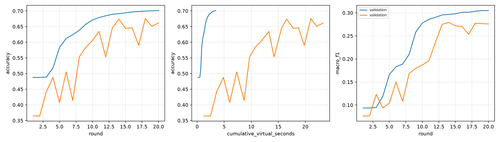

# Validation evidence — 17 October 2026

This page preserves the historical 17 October baseline evidence. For the implemented Fuzzy TOPSIS/fairness-credit selectors and F1–F5 smoke/restart checks, see [FMCDM validation — 25 October 2026](fuzzy-mcdm-2026-10-25.md). The datasets, architectures and protocols differ; do not pool these results or interpret the historical test counts below as current suite totals.

Implementation revision: `e32a18218a395d37934a57a8c5dd5a61f4f07124`. Both federated runs recorded that revision and a clean working tree at initialization. The centralized diagnostic ran during development before that commit; its training implementation is included in the same revision. Subsequent changes add this report and improve Windows service start/stop scripts.

Environment: Windows, Intel Core i5-1135G7, JDK 17.0.11, Python 3.13.0, CPU PyTorch 2.14.1, one torch thread. Exact Python dependencies: [validated environment](../../ml-python/requirements-validated.txt).

## Checks completed locally

- Seven Python tests pass: deterministic/disjoint partitions; train-only scaling and split isolation; tensor averaging/invalid weights; virtual parallel time, OOM, dropout and deadlines; real training/state isolation; busy-worker/path restrictions; checksum corruption detection.
- Five Java tests pass: Spring/SQLite initialization; FedAvg and FedLBW numeric cases; stale/foreign update rejection; deterministic resource selection and memory feasibility.
- Real HTTP integration passes: 100 logical clients, K=5 and 20 rounds; all-dropout and deadline scenarios skip aggregation; FedLBW proxy weights normalize; worker interruption plus Java/Python restart resumes from SQLite and finishes rounds 1–20 exactly once.
- Windows start → health → stop (including child processes) → start succeeds. Saved service PIDs correspond to actual listening processes.
- Two full Covertype runs and a five-epoch centralized diagnostic complete. Plot generation succeeds.

## Smoke results

All runs use the same stratified train/proxy/test pools (435,759 / 29,051 / 116,202). Both federated runs use 100 clients, K=5, 20 rounds, seed 42, one local epoch, SGD 0.01 and batch size 32.

| Run | Partition / policy | Accuracy | Macro-F1 | Accepted / selected |
| --- | --- | --- | --- | --- |
| FedAvg | IID equal, Random, simulation disabled | 0.701038 | 0.304848 | 100 / 100 |
| FedLBW | Dirichlet label skew alpha=0.5, Resource-aware, heterogeneous simulation | 0.661899 | 0.275868 | 93 / 100 |
| Centralized diagnostic | Entire training pool, 5 epochs | 0.781579 | 0.626365 | N/A |

The untrained model's test accuracy is 0.322852, macro-F1 0.077369. A repeated IID FedAvg run produced the same final accuracy, loss and macro-F1. Recorded peak RSS of the worker process reached approximately 543.5 MiB. This is shared-process memory and does not calibrate per-device RAM feasibility.

Both 20-round federated runs have zero recall for classes 3–6 (zero-based labels). Rare-class quality is not solved by this smoke run. Resource-aware selection reached only 20% successful-client coverage in its configured scenario, versus 57% for the IID Random run; different partitions/scenarios mean this is not a controlled comparison of policies. Do not infer algorithm superiority from this table or compare centralized compute directly with FL.

These results verify execution and expose research limitations. Resource calibration, longer training and controlled multi-seed comparisons remain necessary before research conclusions.

Machine-readable evidence: [summary and manifest hashes](summary.json), [FedAvg CSV](covertype-fedavg-42-validated.csv), [FedLBW CSV](covertype-resource-fedlbw-42.csv), [centralized evaluation](centralized.json). Full checkpoints, client logs, confusion matrices and SQLite records remain under the ignored local `artifacts/` tree; aggregate confusion matrices are also in `summary.json`.

