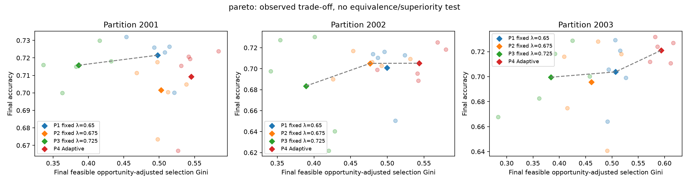

# Published experiment results

## Fuzzy uncertainty pilot — 31 October 2026

The Covertype pilot completed **32/32 experiments and 2,104 rounds**: two short
audit runs, 24 E2 robustness runs and six E4 calibration runs. These use proxy
evaluation. E3 held-out confirmation has **not started**; its full-mode attempt
is blocked by disk capacity. The C1/C4/C5 validation policy lock is preserved.

- [Pilot reports, data and publication details](research/fuzzy-uncertainty-20261031-004757-b6b730/README.md)
- [Research summary](research/fuzzy-uncertainty-20261031-004757-b6b730/fuzzy-mcdm-research-summary.md)
- [E2 results CSV](research/fuzzy-uncertainty-20261031-004757-b6b730/e2-robustness-results.csv)
- [E4 calibration report](research/fuzzy-uncertainty-20261031-004757-b6b730/e4-calibration-results.md)
- [Checksums and snapshot scope](research/fuzzy-uncertainty-20261031-004757-b6b730/publication-manifest.json)

This new publication includes compressed observations and complete per-round
JSONL evidence. It has its own manifest and does not replace the historical
Pareto archives or their manifest below.

## Completed Pareto evaluation — 29 October 2026

The full held-out Covertype Pareto evaluation completed on **29 October 2026**:
60/60 runs, 70 rounds each, 4,200 rounds in total. E0 completed 12/12 runs.

## Start here

- [Pareto summary](research/pareto-20261028-204148/pareto-tradeoff-summary.md)
- [Final test results — CSV](research/pareto-20261028-204148/pareto-tradeoff-results.csv)
- [Results, trajectories and provenance — JSON](research/pareto-20261028-204148/pareto-tradeoff-results.json)
- [Multidimensional frontier](research/pareto-20261028-204148/pareto-tradeoff-frontier.json)
- [E0 report](research/pareto-20261028-204148/e0/reproducibility-audit.md)
- [Recovery verification](research/pareto-20261028-204148/recovery/verification.json)
- [Completion marker and results checksum](research/pareto-20261028-204148/pareto-completion.json)

## Plots



- [Accuracy versus virtual time](research/pareto-20261028-204148/accuracy-virtual-time.png)
- [Learning stability](research/pareto-20261028-204148/learning-stability.png)
- [Fairness over rounds](research/pareto-20261028-204148/fairness-evolution.png)
- [Adaptive controller behavior](research/pareto-20261028-204148/adaptive-behavior.png)

SVG versions are included beside each PNG. Test metrics use the final checkpoint;
trajectory stability and time-to-target use the proxy split. The plots and report
describe trade-offs without declaring a universal winning policy.

## Archive contents

Readable reports mirror the local `artifacts/` hierarchy under `results/`.
The [archive manifest](archive-manifest.json) lists every archived file, its size
and SHA-256, together with each archive part's SHA-256. Archives contain the
original `artifacts/...` paths so existing provenance and evidence references
remain intact after restoration.

This publication contains **18 archives with 3,345 entries**, including **534
available final checkpoints**; none of the referenced final checkpoints are
missing. All archive-part checksums were verified before publication.

The archives include research, Phase A, E0, Pareto, A/B/C/F/L comparisons,
available validation/smoke evidence, per-run experiment/result/round JSON, logs,
consistent SQLite database backups and available final checkpoints from completed
runs. The frozen recovery runtime and its identity verification are also archived.
Historical missing final-checkpoint paths, if any, are listed in the manifest.

Dataset arrays, intermediate checkpoints and worker operation caches remain local.
They are generated training inputs/intermediates; exported metrics and final model
checkpoints are published. Python/Gradle environments and temporary WAL/SHM/PID
files are excluded. Dataset preparation and partition seeds are documented in the
root README and archived protocols.

Archives are split at 48 MiB when necessary. This keeps each repository file
small enough for normal Git transport and avoids requiring Git LFS.

## Restore the complete published evidence

From a clean clone, using Python 3.11 or later (no ML dependencies required):

```powershell
python scripts/package_results.py --restore
```

The script checks part hashes and archive integrity before restoring files under
`artifacts/`. It refuses to overwrite existing evidence with different bytes;
use a clean clone when restoring database snapshots. It does not start training.
SQLite files are consistent backups made with SQLite's backup API rather than
copies of a potentially active database's main file alone.

To create a new publication from local artifacts, run
`python scripts/package_results.py` with a fresh results output. An existing
manifest is protected from accidental replacement.

## Runtime and reproduction

The completed batch used Java 21.0.2, Python 3.13.0, CPU PyTorch, one training
thread and a frozen build identified in the archived provenance. The resumed
batch reused 55 finished runs and trained five new runs with a 4 GiB Java heap.
Its completion marker verifies the exact JSON results file.

Current source contains the later memory fix, so a new build has a different
runtime identity. To train again, follow [the Pareto workflow](../docs/pareto-tradeoff.md),
prepare a fresh output folder and run a fresh E0 audit. Existing experiment
identities and provenance checks must remain unchanged.
