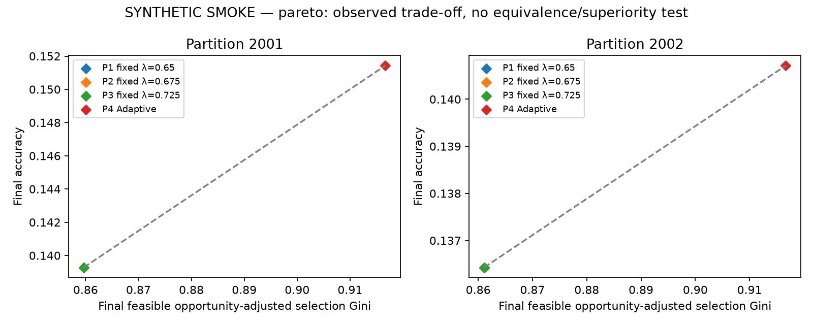
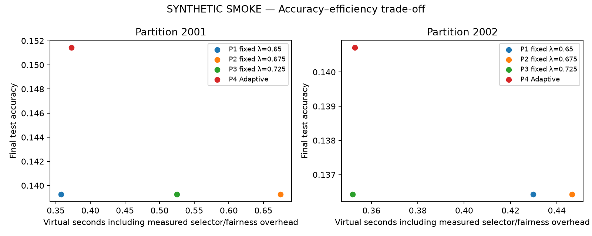
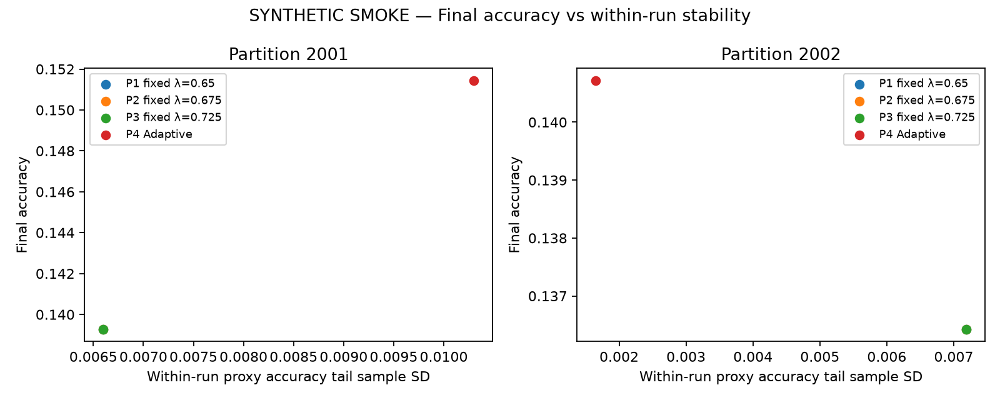
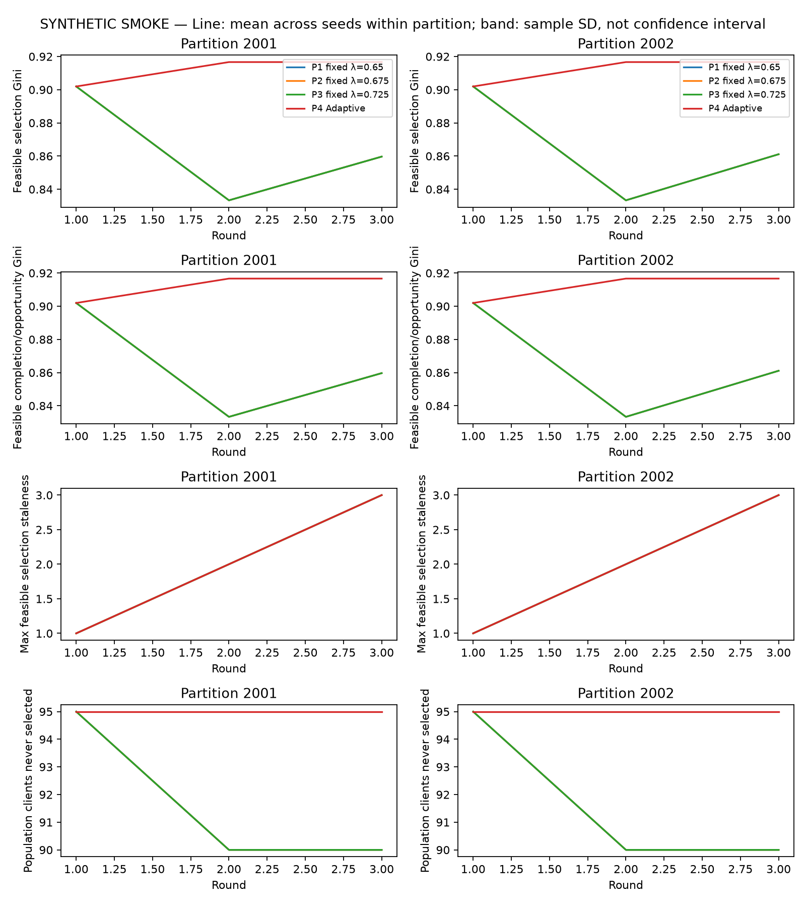
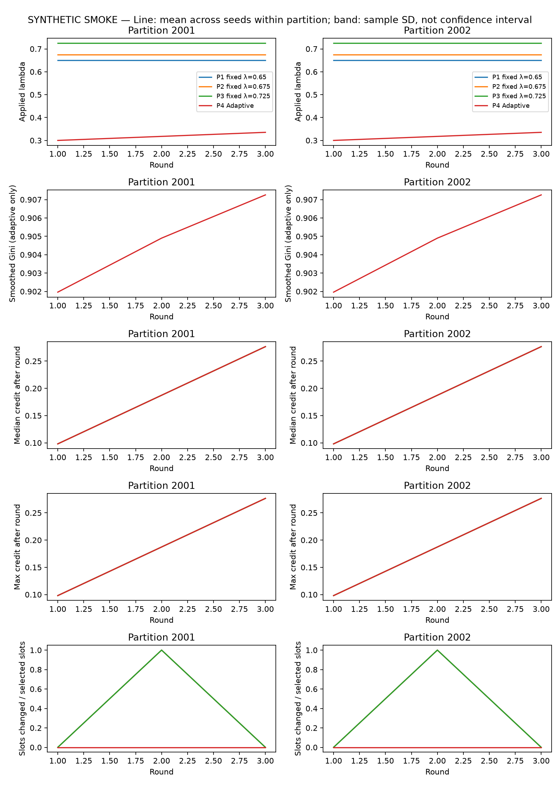

# Held-out Pareto Trade-off Evaluation

Phase A: **NO_MATCH**. Phase B: **PARETO_COMPARISON**. Complete: true; runs=8/8; smoke=true.

Compare partition-specific nondominated sets, paired differences and cross-partition variation. Non-dominance is not proof of superiority; no overall winner is selected.

Ratios except maximum accuracy drop in percentage points and times in seconds. Tail SD is within-run; summary sample SD is between training/scenario seeds inside each partition. Partitions are not treated as extra independent training seeds.

Population selection/completion coverage: all 100 logical clients. RAM denominator: static feasible RAM population (normally 60). Feasible coverage/Gini/staleness: clients with >=1 valid estimated-feasible opportunity, whose count and membership are policy-specific and exported. Completion Ginis are explicitly separated into population, RAM-feasible and feasible completion/opportunity versions.

P1=fixed .650, P2=fixed .675, P3=fixed .725; P4=Adaptive initial .300. Policies and adaptive parameters were locked from Phase A before held-out evaluation. No held-out tuning or best-checkpoint replacement.

Final Accuracy/F1/Loss/recalls use ONLY the final test checkpoint. Tail mean/SD, consecutive drops, final-round accuracy change and time-to-target use the proxy trajectory. These split-specific statistics must not be conflated.

## Per-partition mean ± sample SD across training/scenario seeds

| Partition:policy | Metric | Mean ± sample SD | Min | Max |
| --- | --- | --- | ---: | ---: |
| 2001:P1 | accuracy | 0.139286 ± N/A (n=1) | 0.139286 | 0.139286 |
| 2001:P1 | macroF1 | 0.105815 ± N/A (n=1) | 0.105815 | 0.105815 |
| 2001:P1 | loss | 1.948415 ± N/A (n=1) | 1.948415 | 1.948415 |
| 2001:P1 | worstClassRecall | 0.010000 ± N/A (n=1) | 0.010000 | 0.010000 |
| 2001:P1 | recall0 | 0.105000 ± N/A (n=1) | 0.105000 | 0.105000 |
| 2001:P1 | recall1 | 0.010000 ± N/A (n=1) | 0.010000 | 0.010000 |
| 2001:P1 | recall2 | 0.525000 ± N/A (n=1) | 0.525000 | 0.525000 |
| 2001:P1 | recall3 | 0.165000 ± N/A (n=1) | 0.165000 | 0.165000 |
| 2001:P1 | recall4 | 0.060000 ± N/A (n=1) | 0.060000 | 0.060000 |
| 2001:P1 | recall5 | 0.020000 ± N/A (n=1) | 0.020000 | 0.020000 |
| 2001:P1 | recall6 | 0.090000 ± N/A (n=1) | 0.090000 | 0.090000 |
| 2001:P1 | accuracyTailMean | 0.164762 ± N/A (n=1) | 0.164762 | 0.164762 |
| 2001:P1 | accuracyTailSd | 0.006598 ± N/A (n=1) | 0.006598 | 0.006598 |
| 2001:P1 | macroF1TailSd | 0.007215 ± N/A (n=1) | 0.007215 | 0.007215 |
| 2001:P1 | maxAccuracyDropPp | 0.000000 ± N/A (n=1) | 0.000000 | 0.000000 |
| 2001:P1 | finalAccuracyChangePp | 0.000000 ± N/A (n=1) | 0.000000 | 0.000000 |
| 2001:P1 | populationSelectionCoverage | 0.100000 ± N/A (n=1) | 0.100000 | 0.100000 |
| 2001:P1 | populationCompletionCoverage | 0.100000 ± N/A (n=1) | 0.100000 | 0.100000 |
| 2001:P1 | feasibleSelectionCoverage | 0.166667 ± N/A (n=1) | 0.166667 | 0.166667 |
| 2001:P1 | feasibleCompletionCoverage | 0.166667 ± N/A (n=1) | 0.166667 | 0.166667 |
| 2001:P1 | feasibleOpportunityAdjustedGini | 0.859677 ± N/A (n=1) | 0.859677 | 0.859677 |
| 2001:P1 | feasibleCompletionOpportunityAdjustedGini | 0.859677 ± N/A (n=1) | 0.859677 | 0.859677 |
| 2001:P1 | selectionGini | 0.916667 ± N/A (n=1) | 0.916667 | 0.916667 |
| 2001:P1 | completionGini | 0.916667 ± N/A (n=1) | 0.916667 | 0.916667 |
| 2001:P1 | ramFeasibleCompletionGini | 0.861111 ± N/A (n=1) | 0.861111 | 0.861111 |
| 2001:P1 | maxFeasibleSelectionStaleness | 3.000000 ± N/A (n=1) | 3.000000 | 3.000000 |
| 2001:P1 | meanFeasibleSelectionStaleness | 2.300000 ± N/A (n=1) | 2.300000 | 2.300000 |
| 2001:P1 | populationNeverSelected | 90.000000 ± N/A (n=1) | 90.000000 | 90.000000 |
| 2001:P1 | feasibleNeverSelected | 50.000000 ± N/A (n=1) | 50.000000 | 50.000000 |
| 2001:P1 | acceptedSelectedRatio | 1.000000 ± N/A (n=1) | 1.000000 | 1.000000 |
| 2001:P1 | virtualSeconds | 0.352627 ± N/A (n=1) | 0.352627 | 0.352627 |
| 2001:P1 | virtualSecondsWithSelector | 0.357715 ± N/A (n=1) | 0.357715 | 0.357715 |
| 2001:P1 | wallSeconds | 0.973271 ± N/A (n=1) | 0.973271 | 0.973271 |
| 2001:P1 | selectorSeconds | 0.004526 ± N/A (n=1) | 0.004526 | 0.004526 |
| 2001:P1 | fairnessUpdateSeconds | 0.000562 ± N/A (n=1) | 0.000562 | 0.000562 |
| 2001:P1 | slotsChangedVsTopsis | 5.000000 ± N/A (n=1) | 5.000000 | 5.000000 |
| 2001:P1 | slotsChangedVsTopsisRatio | 0.333333 ± N/A (n=1) | 0.333333 | 0.333333 |
| 2001:P1 | meanAppliedLambda | 0.650000 ± N/A (n=1) | 0.650000 | 0.650000 |
| 2001:P2 | accuracy | 0.139286 ± N/A (n=1) | 0.139286 | 0.139286 |
| 2001:P2 | macroF1 | 0.105815 ± N/A (n=1) | 0.105815 | 0.105815 |
| 2001:P2 | loss | 1.948415 ± N/A (n=1) | 1.948415 | 1.948415 |
| 2001:P2 | worstClassRecall | 0.010000 ± N/A (n=1) | 0.010000 | 0.010000 |
| 2001:P2 | recall0 | 0.105000 ± N/A (n=1) | 0.105000 | 0.105000 |
| 2001:P2 | recall1 | 0.010000 ± N/A (n=1) | 0.010000 | 0.010000 |
| 2001:P2 | recall2 | 0.525000 ± N/A (n=1) | 0.525000 | 0.525000 |
| 2001:P2 | recall3 | 0.165000 ± N/A (n=1) | 0.165000 | 0.165000 |
| 2001:P2 | recall4 | 0.060000 ± N/A (n=1) | 0.060000 | 0.060000 |
| 2001:P2 | recall5 | 0.020000 ± N/A (n=1) | 0.020000 | 0.020000 |
| 2001:P2 | recall6 | 0.090000 ± N/A (n=1) | 0.090000 | 0.090000 |
| 2001:P2 | accuracyTailMean | 0.164762 ± N/A (n=1) | 0.164762 | 0.164762 |
| 2001:P2 | accuracyTailSd | 0.006598 ± N/A (n=1) | 0.006598 | 0.006598 |
| 2001:P2 | macroF1TailSd | 0.007215 ± N/A (n=1) | 0.007215 | 0.007215 |
| 2001:P2 | maxAccuracyDropPp | 0.000000 ± N/A (n=1) | 0.000000 | 0.000000 |
| 2001:P2 | finalAccuracyChangePp | 0.000000 ± N/A (n=1) | 0.000000 | 0.000000 |
| 2001:P2 | populationSelectionCoverage | 0.100000 ± N/A (n=1) | 0.100000 | 0.100000 |
| 2001:P2 | populationCompletionCoverage | 0.100000 ± N/A (n=1) | 0.100000 | 0.100000 |
| 2001:P2 | feasibleSelectionCoverage | 0.166667 ± N/A (n=1) | 0.166667 | 0.166667 |
| 2001:P2 | feasibleCompletionCoverage | 0.166667 ± N/A (n=1) | 0.166667 | 0.166667 |
| 2001:P2 | feasibleOpportunityAdjustedGini | 0.859677 ± N/A (n=1) | 0.859677 | 0.859677 |
| 2001:P2 | feasibleCompletionOpportunityAdjustedGini | 0.859677 ± N/A (n=1) | 0.859677 | 0.859677 |
| 2001:P2 | selectionGini | 0.916667 ± N/A (n=1) | 0.916667 | 0.916667 |
| 2001:P2 | completionGini | 0.916667 ± N/A (n=1) | 0.916667 | 0.916667 |
| 2001:P2 | ramFeasibleCompletionGini | 0.861111 ± N/A (n=1) | 0.861111 | 0.861111 |
| 2001:P2 | maxFeasibleSelectionStaleness | 3.000000 ± N/A (n=1) | 3.000000 | 3.000000 |
| 2001:P2 | meanFeasibleSelectionStaleness | 2.300000 ± N/A (n=1) | 2.300000 | 2.300000 |
| 2001:P2 | populationNeverSelected | 90.000000 ± N/A (n=1) | 90.000000 | 90.000000 |
| 2001:P2 | feasibleNeverSelected | 50.000000 ± N/A (n=1) | 50.000000 | 50.000000 |
| 2001:P2 | acceptedSelectedRatio | 1.000000 ± N/A (n=1) | 1.000000 | 1.000000 |
| 2001:P2 | virtualSeconds | 0.559704 ± N/A (n=1) | 0.559704 | 0.559704 |
| 2001:P2 | virtualSecondsWithSelector | 0.674817 ± N/A (n=1) | 0.674817 | 0.674817 |
| 2001:P2 | wallSeconds | 1.434801 ± N/A (n=1) | 1.434801 | 1.434801 |
| 2001:P2 | selectorSeconds | 0.112544 ± N/A (n=1) | 0.112544 | 0.112544 |
| 2001:P2 | fairnessUpdateSeconds | 0.002570 ± N/A (n=1) | 0.002570 | 0.002570 |
| 2001:P2 | slotsChangedVsTopsis | 5.000000 ± N/A (n=1) | 5.000000 | 5.000000 |
| 2001:P2 | slotsChangedVsTopsisRatio | 0.333333 ± N/A (n=1) | 0.333333 | 0.333333 |
| 2001:P2 | meanAppliedLambda | 0.675000 ± N/A (n=1) | 0.675000 | 0.675000 |
| 2001:P3 | accuracy | 0.139286 ± N/A (n=1) | 0.139286 | 0.139286 |
| 2001:P3 | macroF1 | 0.105815 ± N/A (n=1) | 0.105815 | 0.105815 |
| 2001:P3 | loss | 1.948415 ± N/A (n=1) | 1.948415 | 1.948415 |
| 2001:P3 | worstClassRecall | 0.010000 ± N/A (n=1) | 0.010000 | 0.010000 |
| 2001:P3 | recall0 | 0.105000 ± N/A (n=1) | 0.105000 | 0.105000 |
| 2001:P3 | recall1 | 0.010000 ± N/A (n=1) | 0.010000 | 0.010000 |
| 2001:P3 | recall2 | 0.525000 ± N/A (n=1) | 0.525000 | 0.525000 |
| 2001:P3 | recall3 | 0.165000 ± N/A (n=1) | 0.165000 | 0.165000 |
| 2001:P3 | recall4 | 0.060000 ± N/A (n=1) | 0.060000 | 0.060000 |
| 2001:P3 | recall5 | 0.020000 ± N/A (n=1) | 0.020000 | 0.020000 |
| 2001:P3 | recall6 | 0.090000 ± N/A (n=1) | 0.090000 | 0.090000 |
| 2001:P3 | accuracyTailMean | 0.164762 ± N/A (n=1) | 0.164762 | 0.164762 |
| 2001:P3 | accuracyTailSd | 0.006598 ± N/A (n=1) | 0.006598 | 0.006598 |
| 2001:P3 | macroF1TailSd | 0.007215 ± N/A (n=1) | 0.007215 | 0.007215 |
| 2001:P3 | maxAccuracyDropPp | 0.000000 ± N/A (n=1) | 0.000000 | 0.000000 |
| 2001:P3 | finalAccuracyChangePp | 0.000000 ± N/A (n=1) | 0.000000 | 0.000000 |
| 2001:P3 | populationSelectionCoverage | 0.100000 ± N/A (n=1) | 0.100000 | 0.100000 |
| 2001:P3 | populationCompletionCoverage | 0.100000 ± N/A (n=1) | 0.100000 | 0.100000 |
| 2001:P3 | feasibleSelectionCoverage | 0.166667 ± N/A (n=1) | 0.166667 | 0.166667 |
| 2001:P3 | feasibleCompletionCoverage | 0.166667 ± N/A (n=1) | 0.166667 | 0.166667 |
| 2001:P3 | feasibleOpportunityAdjustedGini | 0.859677 ± N/A (n=1) | 0.859677 | 0.859677 |
| 2001:P3 | feasibleCompletionOpportunityAdjustedGini | 0.859677 ± N/A (n=1) | 0.859677 | 0.859677 |
| 2001:P3 | selectionGini | 0.916667 ± N/A (n=1) | 0.916667 | 0.916667 |
| 2001:P3 | completionGini | 0.916667 ± N/A (n=1) | 0.916667 | 0.916667 |
| 2001:P3 | ramFeasibleCompletionGini | 0.861111 ± N/A (n=1) | 0.861111 | 0.861111 |
| 2001:P3 | maxFeasibleSelectionStaleness | 3.000000 ± N/A (n=1) | 3.000000 | 3.000000 |
| 2001:P3 | meanFeasibleSelectionStaleness | 2.300000 ± N/A (n=1) | 2.300000 | 2.300000 |
| 2001:P3 | populationNeverSelected | 90.000000 ± N/A (n=1) | 90.000000 | 90.000000 |
| 2001:P3 | feasibleNeverSelected | 50.000000 ± N/A (n=1) | 50.000000 | 50.000000 |
| 2001:P3 | acceptedSelectedRatio | 1.000000 ± N/A (n=1) | 1.000000 | 1.000000 |
| 2001:P3 | virtualSeconds | 0.483156 ± N/A (n=1) | 0.483156 | 0.483156 |
| 2001:P3 | virtualSecondsWithSelector | 0.525241 ± N/A (n=1) | 0.525241 | 0.525241 |
| 2001:P3 | wallSeconds | 1.237666 ± N/A (n=1) | 1.237666 | 1.237666 |
| 2001:P3 | selectorSeconds | 0.039930 ± N/A (n=1) | 0.039930 | 0.039930 |
| 2001:P3 | fairnessUpdateSeconds | 0.002155 ± N/A (n=1) | 0.002155 | 0.002155 |
| 2001:P3 | slotsChangedVsTopsis | 5.000000 ± N/A (n=1) | 5.000000 | 5.000000 |
| 2001:P3 | slotsChangedVsTopsisRatio | 0.333333 ± N/A (n=1) | 0.333333 | 0.333333 |
| 2001:P3 | meanAppliedLambda | 0.725000 ± N/A (n=1) | 0.725000 | 0.725000 |
| 2001:P4 | accuracy | 0.151429 ± N/A (n=1) | 0.151429 | 0.151429 |
| 2001:P4 | macroF1 | 0.124618 ± N/A (n=1) | 0.124618 | 0.124618 |
| 2001:P4 | loss | 1.948106 ± N/A (n=1) | 1.948106 | 1.948106 |
| 2001:P4 | worstClassRecall | 0.020000 ± N/A (n=1) | 0.020000 | 0.020000 |
| 2001:P4 | recall0 | 0.145000 ± N/A (n=1) | 0.145000 | 0.145000 |
| 2001:P4 | recall1 | 0.020000 ± N/A (n=1) | 0.020000 | 0.020000 |
| 2001:P4 | recall2 | 0.465000 ± N/A (n=1) | 0.465000 | 0.465000 |
| 2001:P4 | recall3 | 0.200000 ± N/A (n=1) | 0.200000 | 0.200000 |
| 2001:P4 | recall4 | 0.045000 ± N/A (n=1) | 0.045000 | 0.045000 |
| 2001:P4 | recall5 | 0.035000 ± N/A (n=1) | 0.035000 | 0.035000 |
| 2001:P4 | recall6 | 0.150000 ± N/A (n=1) | 0.150000 | 0.150000 |
| 2001:P4 | accuracyTailMean | 0.168571 ± N/A (n=1) | 0.168571 | 0.168571 |
| 2001:P4 | accuracyTailSd | 0.010302 ± N/A (n=1) | 0.010302 | 0.010302 |
| 2001:P4 | macroF1TailSd | 0.013814 ± N/A (n=1) | 0.013814 | 0.013814 |
| 2001:P4 | maxAccuracyDropPp | 0.000000 ± N/A (n=1) | 0.000000 | 0.000000 |
| 2001:P4 | finalAccuracyChangePp | 0.571429 ± N/A (n=1) | 0.571429 | 0.571429 |
| 2001:P4 | populationSelectionCoverage | 0.050000 ± N/A (n=1) | 0.050000 | 0.050000 |
| 2001:P4 | populationCompletionCoverage | 0.050000 ± N/A (n=1) | 0.050000 | 0.050000 |
| 2001:P4 | feasibleSelectionCoverage | 0.083333 ± N/A (n=1) | 0.083333 | 0.083333 |
| 2001:P4 | feasibleCompletionCoverage | 0.083333 ± N/A (n=1) | 0.083333 | 0.083333 |
| 2001:P4 | feasibleOpportunityAdjustedGini | 0.916667 ± N/A (n=1) | 0.916667 | 0.916667 |
| 2001:P4 | feasibleCompletionOpportunityAdjustedGini | 0.916667 ± N/A (n=1) | 0.916667 | 0.916667 |
| 2001:P4 | selectionGini | 0.950000 ± N/A (n=1) | 0.950000 | 0.950000 |
| 2001:P4 | completionGini | 0.950000 ± N/A (n=1) | 0.950000 | 0.950000 |
| 2001:P4 | ramFeasibleCompletionGini | 0.916667 ± N/A (n=1) | 0.916667 | 0.916667 |
| 2001:P4 | maxFeasibleSelectionStaleness | 3.000000 ± N/A (n=1) | 3.000000 | 3.000000 |
| 2001:P4 | meanFeasibleSelectionStaleness | 2.466667 ± N/A (n=1) | 2.466667 | 2.466667 |
| 2001:P4 | populationNeverSelected | 95.000000 ± N/A (n=1) | 95.000000 | 95.000000 |
| 2001:P4 | feasibleNeverSelected | 55.000000 ± N/A (n=1) | 55.000000 | 55.000000 |
| 2001:P4 | acceptedSelectedRatio | 1.000000 ± N/A (n=1) | 1.000000 | 1.000000 |
| 2001:P4 | virtualSeconds | 0.364393 ± N/A (n=1) | 0.364393 | 0.364393 |
| 2001:P4 | virtualSecondsWithSelector | 0.372532 ± N/A (n=1) | 0.372532 | 0.372532 |
| 2001:P4 | wallSeconds | 1.007885 ± N/A (n=1) | 1.007885 | 1.007885 |
| 2001:P4 | selectorSeconds | 0.006585 ± N/A (n=1) | 0.006585 | 0.006585 |
| 2001:P4 | fairnessUpdateSeconds | 0.001554 ± N/A (n=1) | 0.001554 | 0.001554 |
| 2001:P4 | slotsChangedVsTopsis | 0.000000 ± N/A (n=1) | 0.000000 | 0.000000 |
| 2001:P4 | slotsChangedVsTopsisRatio | 0.000000 ± N/A (n=1) | 0.000000 | 0.000000 |
| 2001:P4 | meanAppliedLambda | 0.317647 ± N/A (n=1) | 0.317647 | 0.317647 |
| 2002:P1 | accuracy | 0.136429 ± N/A (n=1) | 0.136429 | 0.136429 |
| 2002:P1 | macroF1 | 0.112875 ± N/A (n=1) | 0.112875 | 0.112875 |
| 2002:P1 | loss | 1.948554 ± N/A (n=1) | 1.948554 | 1.948554 |
| 2002:P1 | worstClassRecall | 0.010000 ± N/A (n=1) | 0.010000 | 0.010000 |
| 2002:P1 | recall0 | 0.080000 ± N/A (n=1) | 0.080000 | 0.080000 |
| 2002:P1 | recall1 | 0.010000 ± N/A (n=1) | 0.010000 | 0.010000 |
| 2002:P1 | recall2 | 0.325000 ± N/A (n=1) | 0.325000 | 0.325000 |
| 2002:P1 | recall3 | 0.310000 ± N/A (n=1) | 0.310000 | 0.310000 |
| 2002:P1 | recall4 | 0.120000 ± N/A (n=1) | 0.120000 | 0.120000 |
| 2002:P1 | recall5 | 0.040000 ± N/A (n=1) | 0.040000 | 0.040000 |
| 2002:P1 | recall6 | 0.070000 ± N/A (n=1) | 0.070000 | 0.070000 |
| 2002:P1 | accuracyTailMean | 0.155238 ± N/A (n=1) | 0.155238 | 0.155238 |
| 2002:P1 | accuracyTailSd | 0.007190 ± N/A (n=1) | 0.007190 | 0.007190 |
| 2002:P1 | macroF1TailSd | 0.004645 ± N/A (n=1) | 0.004645 | 0.004645 |
| 2002:P1 | maxAccuracyDropPp | 0.857143 ± N/A (n=1) | 0.857143 | 0.857143 |
| 2002:P1 | finalAccuracyChangePp | -0.571429 ± N/A (n=1) | -0.571429 | -0.571429 |
| 2002:P1 | populationSelectionCoverage | 0.100000 ± N/A (n=1) | 0.100000 | 0.100000 |
| 2002:P1 | populationCompletionCoverage | 0.100000 ± N/A (n=1) | 0.100000 | 0.100000 |
| 2002:P1 | feasibleSelectionCoverage | 0.166667 ± N/A (n=1) | 0.166667 | 0.166667 |
| 2002:P1 | feasibleCompletionCoverage | 0.166667 ± N/A (n=1) | 0.166667 | 0.166667 |
| 2002:P1 | feasibleOpportunityAdjustedGini | 0.861111 ± N/A (n=1) | 0.861111 | 0.861111 |
| 2002:P1 | feasibleCompletionOpportunityAdjustedGini | 0.861111 ± N/A (n=1) | 0.861111 | 0.861111 |
| 2002:P1 | selectionGini | 0.916667 ± N/A (n=1) | 0.916667 | 0.916667 |
| 2002:P1 | completionGini | 0.916667 ± N/A (n=1) | 0.916667 | 0.916667 |
| 2002:P1 | ramFeasibleCompletionGini | 0.861111 ± N/A (n=1) | 0.861111 | 0.861111 |
| 2002:P1 | maxFeasibleSelectionStaleness | 3.000000 ± N/A (n=1) | 3.000000 | 3.000000 |
| 2002:P1 | meanFeasibleSelectionStaleness | 2.300000 ± N/A (n=1) | 2.300000 | 2.300000 |
| 2002:P1 | populationNeverSelected | 90.000000 ± N/A (n=1) | 90.000000 | 90.000000 |
| 2002:P1 | feasibleNeverSelected | 50.000000 ± N/A (n=1) | 50.000000 | 50.000000 |
| 2002:P1 | acceptedSelectedRatio | 1.000000 ± N/A (n=1) | 1.000000 | 1.000000 |
| 2002:P1 | virtualSeconds | 0.423230 ± N/A (n=1) | 0.423230 | 0.423230 |
| 2002:P1 | virtualSecondsWithSelector | 0.429787 ± N/A (n=1) | 0.429787 | 0.429787 |
| 2002:P1 | wallSeconds | 1.104514 ± N/A (n=1) | 1.104514 | 1.104514 |
| 2002:P1 | selectorSeconds | 0.006152 ± N/A (n=1) | 0.006152 | 0.006152 |
| 2002:P1 | fairnessUpdateSeconds | 0.000405 ± N/A (n=1) | 0.000405 | 0.000405 |
| 2002:P1 | slotsChangedVsTopsis | 5.000000 ± N/A (n=1) | 5.000000 | 5.000000 |
| 2002:P1 | slotsChangedVsTopsisRatio | 0.333333 ± N/A (n=1) | 0.333333 | 0.333333 |
| 2002:P1 | meanAppliedLambda | 0.650000 ± N/A (n=1) | 0.650000 | 0.650000 |
| 2002:P2 | accuracy | 0.136429 ± N/A (n=1) | 0.136429 | 0.136429 |
| 2002:P2 | macroF1 | 0.112875 ± N/A (n=1) | 0.112875 | 0.112875 |
| 2002:P2 | loss | 1.948554 ± N/A (n=1) | 1.948554 | 1.948554 |
| 2002:P2 | worstClassRecall | 0.010000 ± N/A (n=1) | 0.010000 | 0.010000 |
| 2002:P2 | recall0 | 0.080000 ± N/A (n=1) | 0.080000 | 0.080000 |
| 2002:P2 | recall1 | 0.010000 ± N/A (n=1) | 0.010000 | 0.010000 |
| 2002:P2 | recall2 | 0.325000 ± N/A (n=1) | 0.325000 | 0.325000 |
| 2002:P2 | recall3 | 0.310000 ± N/A (n=1) | 0.310000 | 0.310000 |
| 2002:P2 | recall4 | 0.120000 ± N/A (n=1) | 0.120000 | 0.120000 |
| 2002:P2 | recall5 | 0.040000 ± N/A (n=1) | 0.040000 | 0.040000 |
| 2002:P2 | recall6 | 0.070000 ± N/A (n=1) | 0.070000 | 0.070000 |
| 2002:P2 | accuracyTailMean | 0.155238 ± N/A (n=1) | 0.155238 | 0.155238 |
| 2002:P2 | accuracyTailSd | 0.007190 ± N/A (n=1) | 0.007190 | 0.007190 |
| 2002:P2 | macroF1TailSd | 0.004645 ± N/A (n=1) | 0.004645 | 0.004645 |
| 2002:P2 | maxAccuracyDropPp | 0.857143 ± N/A (n=1) | 0.857143 | 0.857143 |
| 2002:P2 | finalAccuracyChangePp | -0.571429 ± N/A (n=1) | -0.571429 | -0.571429 |
| 2002:P2 | populationSelectionCoverage | 0.100000 ± N/A (n=1) | 0.100000 | 0.100000 |
| 2002:P2 | populationCompletionCoverage | 0.100000 ± N/A (n=1) | 0.100000 | 0.100000 |
| 2002:P2 | feasibleSelectionCoverage | 0.166667 ± N/A (n=1) | 0.166667 | 0.166667 |
| 2002:P2 | feasibleCompletionCoverage | 0.166667 ± N/A (n=1) | 0.166667 | 0.166667 |
| 2002:P2 | feasibleOpportunityAdjustedGini | 0.861111 ± N/A (n=1) | 0.861111 | 0.861111 |
| 2002:P2 | feasibleCompletionOpportunityAdjustedGini | 0.861111 ± N/A (n=1) | 0.861111 | 0.861111 |
| 2002:P2 | selectionGini | 0.916667 ± N/A (n=1) | 0.916667 | 0.916667 |
| 2002:P2 | completionGini | 0.916667 ± N/A (n=1) | 0.916667 | 0.916667 |
| 2002:P2 | ramFeasibleCompletionGini | 0.861111 ± N/A (n=1) | 0.861111 | 0.861111 |
| 2002:P2 | maxFeasibleSelectionStaleness | 3.000000 ± N/A (n=1) | 3.000000 | 3.000000 |
| 2002:P2 | meanFeasibleSelectionStaleness | 2.300000 ± N/A (n=1) | 2.300000 | 2.300000 |
| 2002:P2 | populationNeverSelected | 90.000000 ± N/A (n=1) | 90.000000 | 90.000000 |
| 2002:P2 | feasibleNeverSelected | 50.000000 ± N/A (n=1) | 50.000000 | 50.000000 |
| 2002:P2 | acceptedSelectedRatio | 1.000000 ± N/A (n=1) | 1.000000 | 1.000000 |
| 2002:P2 | virtualSeconds | 0.439316 ± N/A (n=1) | 0.439316 | 0.439316 |
| 2002:P2 | virtualSecondsWithSelector | 0.446602 ± N/A (n=1) | 0.446602 | 0.446602 |
| 2002:P2 | wallSeconds | 1.166857 ± N/A (n=1) | 1.166857 | 1.166857 |
| 2002:P2 | selectorSeconds | 0.006717 ± N/A (n=1) | 0.006717 | 0.006717 |
| 2002:P2 | fairnessUpdateSeconds | 0.000569 ± N/A (n=1) | 0.000569 | 0.000569 |
| 2002:P2 | slotsChangedVsTopsis | 5.000000 ± N/A (n=1) | 5.000000 | 5.000000 |
| 2002:P2 | slotsChangedVsTopsisRatio | 0.333333 ± N/A (n=1) | 0.333333 | 0.333333 |
| 2002:P2 | meanAppliedLambda | 0.675000 ± N/A (n=1) | 0.675000 | 0.675000 |
| 2002:P3 | accuracy | 0.136429 ± N/A (n=1) | 0.136429 | 0.136429 |
| 2002:P3 | macroF1 | 0.112875 ± N/A (n=1) | 0.112875 | 0.112875 |
| 2002:P3 | loss | 1.948554 ± N/A (n=1) | 1.948554 | 1.948554 |
| 2002:P3 | worstClassRecall | 0.010000 ± N/A (n=1) | 0.010000 | 0.010000 |
| 2002:P3 | recall0 | 0.080000 ± N/A (n=1) | 0.080000 | 0.080000 |
| 2002:P3 | recall1 | 0.010000 ± N/A (n=1) | 0.010000 | 0.010000 |
| 2002:P3 | recall2 | 0.325000 ± N/A (n=1) | 0.325000 | 0.325000 |
| 2002:P3 | recall3 | 0.310000 ± N/A (n=1) | 0.310000 | 0.310000 |
| 2002:P3 | recall4 | 0.120000 ± N/A (n=1) | 0.120000 | 0.120000 |
| 2002:P3 | recall5 | 0.040000 ± N/A (n=1) | 0.040000 | 0.040000 |
| 2002:P3 | recall6 | 0.070000 ± N/A (n=1) | 0.070000 | 0.070000 |
| 2002:P3 | accuracyTailMean | 0.155238 ± N/A (n=1) | 0.155238 | 0.155238 |
| 2002:P3 | accuracyTailSd | 0.007190 ± N/A (n=1) | 0.007190 | 0.007190 |
| 2002:P3 | macroF1TailSd | 0.004645 ± N/A (n=1) | 0.004645 | 0.004645 |
| 2002:P3 | maxAccuracyDropPp | 0.857143 ± N/A (n=1) | 0.857143 | 0.857143 |
| 2002:P3 | finalAccuracyChangePp | -0.571429 ± N/A (n=1) | -0.571429 | -0.571429 |
| 2002:P3 | populationSelectionCoverage | 0.100000 ± N/A (n=1) | 0.100000 | 0.100000 |
| 2002:P3 | populationCompletionCoverage | 0.100000 ± N/A (n=1) | 0.100000 | 0.100000 |
| 2002:P3 | feasibleSelectionCoverage | 0.166667 ± N/A (n=1) | 0.166667 | 0.166667 |
| 2002:P3 | feasibleCompletionCoverage | 0.166667 ± N/A (n=1) | 0.166667 | 0.166667 |
| 2002:P3 | feasibleOpportunityAdjustedGini | 0.861111 ± N/A (n=1) | 0.861111 | 0.861111 |
| 2002:P3 | feasibleCompletionOpportunityAdjustedGini | 0.861111 ± N/A (n=1) | 0.861111 | 0.861111 |
| 2002:P3 | selectionGini | 0.916667 ± N/A (n=1) | 0.916667 | 0.916667 |
| 2002:P3 | completionGini | 0.916667 ± N/A (n=1) | 0.916667 | 0.916667 |
| 2002:P3 | ramFeasibleCompletionGini | 0.861111 ± N/A (n=1) | 0.861111 | 0.861111 |
| 2002:P3 | maxFeasibleSelectionStaleness | 3.000000 ± N/A (n=1) | 3.000000 | 3.000000 |
| 2002:P3 | meanFeasibleSelectionStaleness | 2.300000 ± N/A (n=1) | 2.300000 | 2.300000 |
| 2002:P3 | populationNeverSelected | 90.000000 ± N/A (n=1) | 90.000000 | 90.000000 |
| 2002:P3 | feasibleNeverSelected | 50.000000 ± N/A (n=1) | 50.000000 | 50.000000 |
| 2002:P3 | acceptedSelectedRatio | 1.000000 ± N/A (n=1) | 1.000000 | 1.000000 |
| 2002:P3 | virtualSeconds | 0.345964 ± N/A (n=1) | 0.345964 | 0.345964 |
| 2002:P3 | virtualSecondsWithSelector | 0.351886 ± N/A (n=1) | 0.351886 | 0.351886 |
| 2002:P3 | wallSeconds | 0.953243 ± N/A (n=1) | 0.953243 | 0.953243 |
| 2002:P3 | selectorSeconds | 0.005577 ± N/A (n=1) | 0.005577 | 0.005577 |
| 2002:P3 | fairnessUpdateSeconds | 0.000344 ± N/A (n=1) | 0.000344 | 0.000344 |
| 2002:P3 | slotsChangedVsTopsis | 5.000000 ± N/A (n=1) | 5.000000 | 5.000000 |
| 2002:P3 | slotsChangedVsTopsisRatio | 0.333333 ± N/A (n=1) | 0.333333 | 0.333333 |
| 2002:P3 | meanAppliedLambda | 0.725000 ± N/A (n=1) | 0.725000 | 0.725000 |
| 2002:P4 | accuracy | 0.140714 ± N/A (n=1) | 0.140714 | 0.140714 |
| 2002:P4 | macroF1 | 0.111655 ± N/A (n=1) | 0.111655 | 0.111655 |
| 2002:P4 | loss | 1.948653 ± N/A (n=1) | 1.948653 | 1.948653 |
| 2002:P4 | worstClassRecall | 0.010000 ± N/A (n=1) | 0.010000 | 0.010000 |
| 2002:P4 | recall0 | 0.085000 ± N/A (n=1) | 0.085000 | 0.085000 |
| 2002:P4 | recall1 | 0.010000 ± N/A (n=1) | 0.010000 | 0.010000 |
| 2002:P4 | recall2 | 0.415000 ± N/A (n=1) | 0.415000 | 0.415000 |
| 2002:P4 | recall3 | 0.280000 ± N/A (n=1) | 0.280000 | 0.280000 |
| 2002:P4 | recall4 | 0.085000 ± N/A (n=1) | 0.085000 | 0.085000 |
| 2002:P4 | recall5 | 0.030000 ± N/A (n=1) | 0.030000 | 0.030000 |
| 2002:P4 | recall6 | 0.080000 ± N/A (n=1) | 0.080000 | 0.080000 |
| 2002:P4 | accuracyTailMean | 0.163810 ± N/A (n=1) | 0.163810 | 0.163810 |
| 2002:P4 | accuracyTailSd | 0.001650 ± N/A (n=1) | 0.001650 | 0.001650 |
| 2002:P4 | macroF1TailSd | 0.002924 ± N/A (n=1) | 0.002924 | 0.002924 |
| 2002:P4 | maxAccuracyDropPp | 0.285714 ± N/A (n=1) | 0.285714 | 0.285714 |
| 2002:P4 | finalAccuracyChangePp | -0.285714 ± N/A (n=1) | -0.285714 | -0.285714 |
| 2002:P4 | populationSelectionCoverage | 0.050000 ± N/A (n=1) | 0.050000 | 0.050000 |
| 2002:P4 | populationCompletionCoverage | 0.050000 ± N/A (n=1) | 0.050000 | 0.050000 |
| 2002:P4 | feasibleSelectionCoverage | 0.083333 ± N/A (n=1) | 0.083333 | 0.083333 |
| 2002:P4 | feasibleCompletionCoverage | 0.083333 ± N/A (n=1) | 0.083333 | 0.083333 |
| 2002:P4 | feasibleOpportunityAdjustedGini | 0.916667 ± N/A (n=1) | 0.916667 | 0.916667 |
| 2002:P4 | feasibleCompletionOpportunityAdjustedGini | 0.916667 ± N/A (n=1) | 0.916667 | 0.916667 |
| 2002:P4 | selectionGini | 0.950000 ± N/A (n=1) | 0.950000 | 0.950000 |
| 2002:P4 | completionGini | 0.950000 ± N/A (n=1) | 0.950000 | 0.950000 |
| 2002:P4 | ramFeasibleCompletionGini | 0.916667 ± N/A (n=1) | 0.916667 | 0.916667 |
| 2002:P4 | maxFeasibleSelectionStaleness | 3.000000 ± N/A (n=1) | 3.000000 | 3.000000 |
| 2002:P4 | meanFeasibleSelectionStaleness | 2.466667 ± N/A (n=1) | 2.466667 | 2.466667 |
| 2002:P4 | populationNeverSelected | 95.000000 ± N/A (n=1) | 95.000000 | 95.000000 |
| 2002:P4 | feasibleNeverSelected | 55.000000 ± N/A (n=1) | 55.000000 | 55.000000 |
| 2002:P4 | acceptedSelectedRatio | 1.000000 ± N/A (n=1) | 1.000000 | 1.000000 |
| 2002:P4 | virtualSeconds | 0.348346 ± N/A (n=1) | 0.348346 | 0.348346 |
| 2002:P4 | virtualSecondsWithSelector | 0.352786 ± N/A (n=1) | 0.352786 | 0.352786 |
| 2002:P4 | wallSeconds | 0.998597 ± N/A (n=1) | 0.998597 | 0.998597 |
| 2002:P4 | selectorSeconds | 0.003789 ± N/A (n=1) | 0.003789 | 0.003789 |
| 2002:P4 | fairnessUpdateSeconds | 0.000652 ± N/A (n=1) | 0.000652 | 0.000652 |
| 2002:P4 | slotsChangedVsTopsis | 0.000000 ± N/A (n=1) | 0.000000 | 0.000000 |
| 2002:P4 | slotsChangedVsTopsisRatio | 0.000000 ± N/A (n=1) | 0.000000 | 0.000000 |
| 2002:P4 | meanAppliedLambda | 0.317647 ± N/A (n=1) | 0.317647 | 0.317647 |

## Observed partition-specific frontiers

- Partition 2001: 7-objective nondominated=["P1","P4"]; dominated=["P2","P3"]; unassessed=[]; Accuracy–Gini frontier=["P1","P2","P3","P4"].
- Partition 2002: 7-objective nondominated=["P3","P4"]; dominated=["P1","P2"]; unassessed=[]; Accuracy–Gini frontier=["P1","P2","P3","P4"].

Maximize Accuracy, Macro-F1, feasible selection/completion coverage; minimize feasible opportunity-adjusted selection Gini, proxy accuracy tail SD and virtual seconds including selector/fairness overhead. Dominance requires no worse on every objective and strictly better on at least one; ties do not dominate. Missing objectives are unassessed.

## Paired differences: P4 minus Fixed

| Partition | Seed | Fixed policy | Accuracy Δ | Macro-F1 Δ | Gini Δ | Tail SD Δ | Virtual+selector Δ |
| --- | --- | --- | ---: | ---: | ---: | ---: | ---: |
| 2001 | 42 | P2 | 0.012143 | 0.018803 | 0.056989 | 0.003703 | -0.302286 |
| 2001 | 42 | P3 | 0.012143 | 0.018803 | 0.056989 | 0.003703 | -0.152709 |
| 2001 | 42 | P1 | 0.012143 | 0.018803 | 0.056989 | 0.003703 | 0.014817 |
| 2002 | 42 | P2 | 0.004286 | -0.001220 | 0.055556 | -0.005541 | -0.093815 |
| 2002 | 42 | P3 | 0.004286 | -0.001220 | 0.055556 | -0.005541 | 0.000901 |
| 2002 | 42 | P1 | 0.004286 | -0.001220 | 0.055556 | -0.005541 | -0.077001 |

All paired metrics and their within-partition sample SD are in JSON.

## Cross-partition summary

Equal-weight means of partition means; the SD below describes variation across partitions, not 15 independent training seeds.

| Policy | Metric | Mean of partition means ± SD across partition means |
| --- | --- | --- |
| P1 | accuracy | 0.137857 ± 0.002020 (n=2) |
| P1 | macroF1 | 0.109345 ± 0.004992 (n=2) |
| P1 | feasibleSelectionCoverage | 0.166667 ± 0.000000 (n=2) |
| P1 | feasibleCompletionCoverage | 0.166667 ± 0.000000 (n=2) |
| P1 | feasibleOpportunityAdjustedGini | 0.860394 ± 0.001014 (n=2) |
| P1 | accuracyTailSd | 0.006894 ± 0.000419 (n=2) |
| P1 | virtualSecondsWithSelector | 0.393751 ± 0.050963 (n=2) |
| P2 | accuracy | 0.137857 ± 0.002020 (n=2) |
| P2 | macroF1 | 0.109345 ± 0.004992 (n=2) |
| P2 | feasibleSelectionCoverage | 0.166667 ± 0.000000 (n=2) |
| P2 | feasibleCompletionCoverage | 0.166667 ± 0.000000 (n=2) |
| P2 | feasibleOpportunityAdjustedGini | 0.860394 ± 0.001014 (n=2) |
| P2 | accuracyTailSd | 0.006894 ± 0.000419 (n=2) |
| P2 | virtualSecondsWithSelector | 0.560710 ± 0.161373 (n=2) |
| P3 | accuracy | 0.137857 ± 0.002020 (n=2) |
| P3 | macroF1 | 0.109345 ± 0.004992 (n=2) |
| P3 | feasibleSelectionCoverage | 0.166667 ± 0.000000 (n=2) |
| P3 | feasibleCompletionCoverage | 0.166667 ± 0.000000 (n=2) |
| P3 | feasibleOpportunityAdjustedGini | 0.860394 ± 0.001014 (n=2) |
| P3 | accuracyTailSd | 0.006894 ± 0.000419 (n=2) |
| P3 | virtualSecondsWithSelector | 0.438563 ± 0.122581 (n=2) |
| P4 | accuracy | 0.146071 ± 0.007576 (n=2) |
| P4 | macroF1 | 0.118136 ± 0.009166 (n=2) |
| P4 | feasibleSelectionCoverage | 0.083333 ± 0.000000 (n=2) |
| P4 | feasibleCompletionCoverage | 0.083333 ± 0.000000 (n=2) |
| P4 | feasibleOpportunityAdjustedGini | 0.916667 ± 0.000000 (n=2) |
| P4 | accuracyTailSd | 0.005976 ± 0.006118 (n=2) |
| P4 | virtualSecondsWithSelector | 0.362659 ± 0.013962 (n=2) |

## Consistency of Adaptive comparisons

- P4 vs P1: {"2001":"NEITHER_DOMINATES","2002":"NEITHER_DOMINATES"}; inconsistent across partitions=false.
- P4 vs P2: {"2001":"NEITHER_DOMINATES","2002":"NEITHER_DOMINATES"}; inconsistent across partitions=false.
- P4 vs P3: {"2001":"NEITHER_DOMINATES","2002":"NEITHER_DOMINATES"}; inconsistent across partitions=false.

## Large proxy-trajectory accuracy drops

Threshold=10.0 percentage points, predeclared. All flagged and unflagged outcomes are retained.

No run exceeded the declared threshold.

## Evidence limits

These are descriptive sample-mean frontiers, not statistical equivalence or superiority tests. No weighted score or automatic overall winner is constructed. Non-dominance may vary by partition or by seed; the aggregate frontier does not override inconsistent partition results. Test pools remain the fixed Covertype split used by this project, not a globally untouched dataset. Deterministic simulated durations are uncalibrated assumptions; server/selector overhead and wall time remain measured. See the immutable config and E0 evidence for the exact runtime scope.
