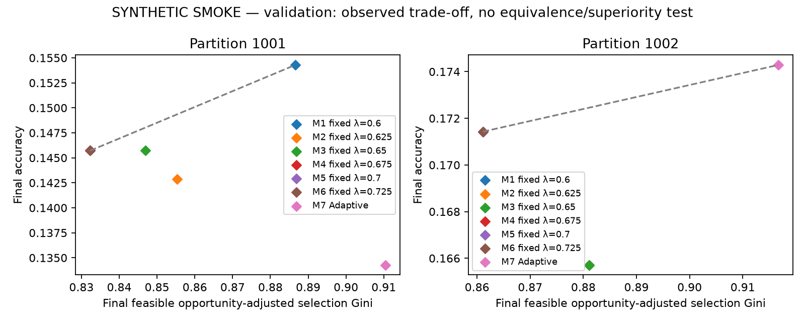
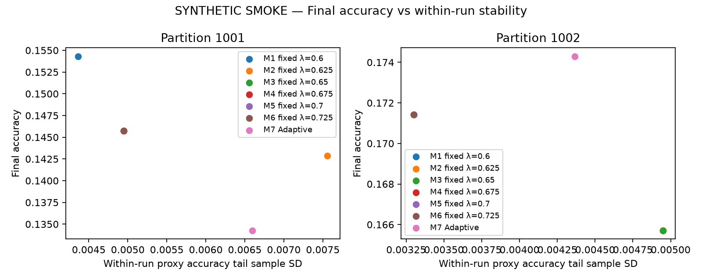
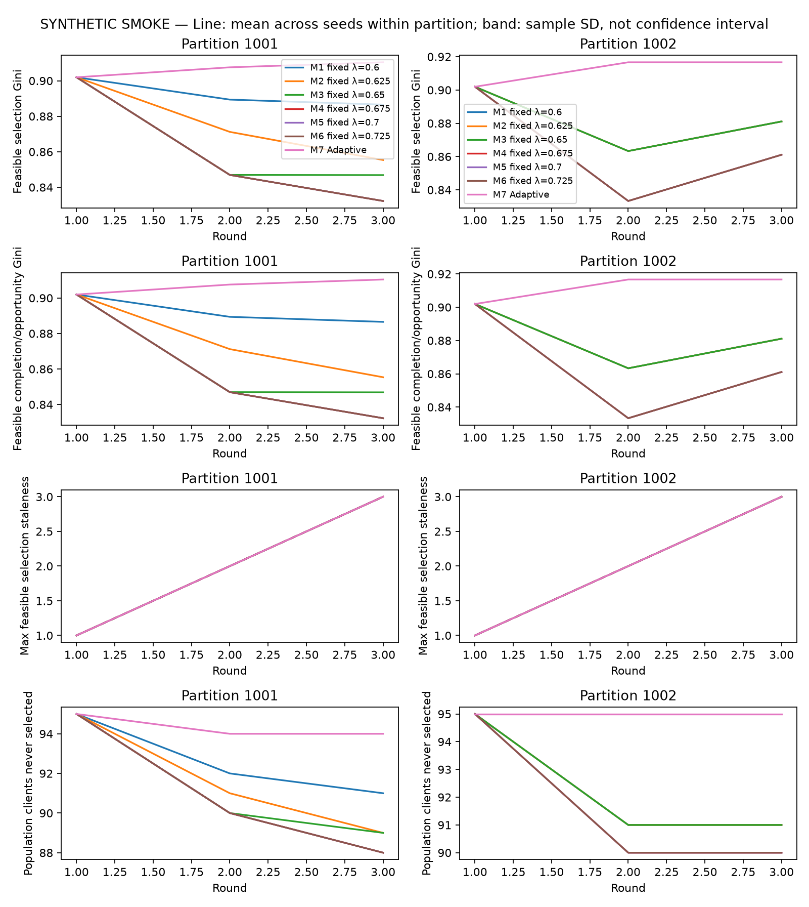
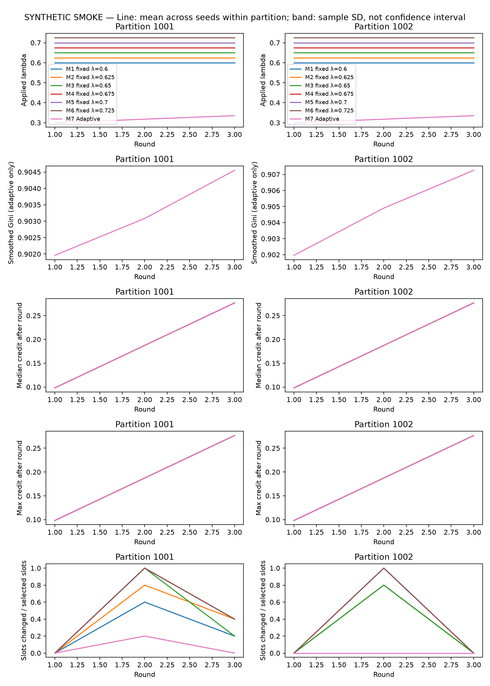

# Fairness-matched lambda experiments — validation

Complete: true; smoke: true.

Fairness status: **MATCHED**. Operational tolerances passed; this is not statistical equivalence.

Ratios except maximum accuracy drop in percentage points and times in seconds. Tail SD is within-run; summary sample SD is between training/scenario seeds inside each partition. Partitions are not treated as extra independent training seeds.

Population selection/completion coverage: all 100 logical clients. RAM denominator: static feasible RAM population (normally 60). Feasible coverage/Gini/staleness: clients with >=1 valid estimated-feasible opportunity, whose count and membership are policy-specific and exported. Completion Ginis are explicitly separated into population, RAM-feasible and feasible completion/opportunity versions.

Phase A reports proxy validation outcomes. Phase B reports test ONLY at the final checkpoint; tail stability, drift/drop and time-to-target use the independently held-out proxy trajectory, as labelled in every record. Final accuracy always uses the final checkpoint, including low accuracy/drift runs.

## Per-partition mean ± sample SD across training/scenario seeds

| Partition:policy | Metric | Mean | Sample SD | n | Min / worst case | Max |
| --- | --- | ---: | ---: | ---: | ---: | ---: |
| 1001:M1 | accuracy | 0.154286 | N/A | 1 | 0.154286 | 0.154286 |
| 1001:M1 | macroF1 | 0.117209 | N/A | 1 | 0.117209 | 0.117209 |
| 1001:M1 | loss | 1.943848 | N/A | 1 | 1.943848 | 1.943848 |
| 1001:M1 | worstClassRecall | 0.000000 | N/A | 1 | 0.000000 | 0.000000 |
| 1001:M1 | recall0 | 0.140000 | N/A | 1 | 0.140000 | 0.140000 |
| 1001:M1 | recall1 | 0.000000 | N/A | 1 | 0.000000 | 0.000000 |
| 1001:M1 | recall2 | 0.360000 | N/A | 1 | 0.360000 | 0.360000 |
| 1001:M1 | recall3 | 0.460000 | N/A | 1 | 0.460000 | 0.460000 |
| 1001:M1 | recall4 | 0.020000 | N/A | 1 | 0.020000 | 0.020000 |
| 1001:M1 | recall5 | 0.060000 | N/A | 1 | 0.060000 | 0.060000 |
| 1001:M1 | recall6 | 0.040000 | N/A | 1 | 0.040000 | 0.040000 |
| 1001:M1 | accuracyTailMean | 0.150476 | N/A | 1 | 0.150476 | 0.150476 |
| 1001:M1 | accuracyTailSd | 0.004364 | N/A | 1 | 0.004364 | 0.004364 |
| 1001:M1 | macroF1TailSd | 0.004572 | N/A | 1 | 0.004572 | 0.004572 |
| 1001:M1 | maxAccuracyDropPp | 0.000000 | N/A | 1 | 0.000000 | 0.000000 |
| 1001:M1 | populationSelectionCoverage | 0.090000 | N/A | 1 | 0.090000 | 0.090000 |
| 1001:M1 | populationCompletionCoverage | 0.090000 | N/A | 1 | 0.090000 | 0.090000 |
| 1001:M1 | feasibleSelectionCoverage | 0.150000 | N/A | 1 | 0.150000 | 0.150000 |
| 1001:M1 | feasibleCompletionCoverage | 0.150000 | N/A | 1 | 0.150000 | 0.150000 |
| 1001:M1 | feasibleOpportunityAdjustedGini | 0.886559 | N/A | 1 | 0.886559 | 0.886559 |
| 1001:M1 | feasibleCompletionOpportunityAdjustedGini | 0.886559 | N/A | 1 | 0.886559 | 0.886559 |
| 1001:M1 | selectionGini | 0.932667 | N/A | 1 | 0.932667 | 0.932667 |
| 1001:M1 | completionGini | 0.932667 | N/A | 1 | 0.932667 | 0.932667 |
| 1001:M1 | ramFeasibleCompletionGini | 0.887778 | N/A | 1 | 0.887778 | 0.887778 |
| 1001:M1 | maxFeasibleSelectionStaleness | 3.000000 | N/A | 1 | 3.000000 | 3.000000 |
| 1001:M1 | meanFeasibleSelectionStaleness | 2.350000 | N/A | 1 | 2.350000 | 2.350000 |
| 1001:M1 | populationNeverSelected | 91.000000 | N/A | 1 | 91.000000 | 91.000000 |
| 1001:M1 | feasibleNeverSelected | 51.000000 | N/A | 1 | 51.000000 | 51.000000 |
| 1001:M1 | acceptedSelectedRatio | 1.000000 | N/A | 1 | 1.000000 | 1.000000 |
| 1001:M1 | virtualSeconds | 0.321334 | N/A | 1 | 0.321334 | 0.321334 |
| 1001:M1 | virtualSecondsWithSelector | 0.357301 | N/A | 1 | 0.357301 | 0.357301 |
| 1001:M1 | wallSeconds | 0.662834 | N/A | 1 | 0.662834 | 0.662834 |
| 1001:M1 | selectorSeconds | 0.034778 | N/A | 1 | 0.034778 | 0.034778 |
| 1001:M1 | fairnessUpdateSeconds | 0.001190 | N/A | 1 | 0.001190 | 0.001190 |
| 1001:M1 | slotsChangedVsTopsis | 4.000000 | N/A | 1 | 4.000000 | 4.000000 |
| 1001:M1 | slotsChangedVsTopsisRatio | 0.266667 | N/A | 1 | 0.266667 | 0.266667 |
| 1001:M1 | meanAppliedLambda | 0.600000 | N/A | 1 | 0.600000 | 0.600000 |
| 1001:M2 | accuracy | 0.142857 | N/A | 1 | 0.142857 | 0.142857 |
| 1001:M2 | macroF1 | 0.107214 | N/A | 1 | 0.107214 | 0.107214 |
| 1001:M2 | loss | 1.943909 | N/A | 1 | 1.943909 | 1.943909 |
| 1001:M2 | worstClassRecall | 0.000000 | N/A | 1 | 0.000000 | 0.000000 |
| 1001:M2 | recall0 | 0.080000 | N/A | 1 | 0.080000 | 0.080000 |
| 1001:M2 | recall1 | 0.000000 | N/A | 1 | 0.000000 | 0.000000 |
| 1001:M2 | recall2 | 0.360000 | N/A | 1 | 0.360000 | 0.360000 |
| 1001:M2 | recall3 | 0.420000 | N/A | 1 | 0.420000 | 0.420000 |
| 1001:M2 | recall4 | 0.040000 | N/A | 1 | 0.040000 | 0.040000 |
| 1001:M2 | recall5 | 0.060000 | N/A | 1 | 0.060000 | 0.060000 |
| 1001:M2 | recall6 | 0.040000 | N/A | 1 | 0.040000 | 0.040000 |
| 1001:M2 | accuracyTailMean | 0.148571 | N/A | 1 | 0.148571 | 0.148571 |
| 1001:M2 | accuracyTailSd | 0.007559 | N/A | 1 | 0.007559 | 0.007559 |
| 1001:M2 | macroF1TailSd | 0.009135 | N/A | 1 | 0.009135 | 0.009135 |
| 1001:M2 | maxAccuracyDropPp | 1.428571 | N/A | 1 | 1.428571 | 1.428571 |
| 1001:M2 | populationSelectionCoverage | 0.110000 | N/A | 1 | 0.110000 | 0.110000 |
| 1001:M2 | populationCompletionCoverage | 0.110000 | N/A | 1 | 0.110000 | 0.110000 |
| 1001:M2 | feasibleSelectionCoverage | 0.183333 | N/A | 1 | 0.183333 | 0.183333 |
| 1001:M2 | feasibleCompletionCoverage | 0.183333 | N/A | 1 | 0.183333 | 0.183333 |
| 1001:M2 | feasibleOpportunityAdjustedGini | 0.855376 | N/A | 1 | 0.855376 | 0.855376 |
| 1001:M2 | feasibleCompletionOpportunityAdjustedGini | 0.855376 | N/A | 1 | 0.855376 | 0.855376 |
| 1001:M2 | selectionGini | 0.912667 | N/A | 1 | 0.912667 | 0.912667 |
| 1001:M2 | completionGini | 0.912667 | N/A | 1 | 0.912667 | 0.912667 |
| 1001:M2 | ramFeasibleCompletionGini | 0.854444 | N/A | 1 | 0.854444 | 0.854444 |
| 1001:M2 | maxFeasibleSelectionStaleness | 3.000000 | N/A | 1 | 3.000000 | 3.000000 |
| 1001:M2 | meanFeasibleSelectionStaleness | 2.300000 | N/A | 1 | 2.300000 | 2.300000 |
| 1001:M2 | populationNeverSelected | 89.000000 | N/A | 1 | 89.000000 | 89.000000 |
| 1001:M2 | feasibleNeverSelected | 49.000000 | N/A | 1 | 49.000000 | 49.000000 |
| 1001:M2 | acceptedSelectedRatio | 1.000000 | N/A | 1 | 1.000000 | 1.000000 |
| 1001:M2 | virtualSeconds | 0.277857 | N/A | 1 | 0.277857 | 0.277857 |
| 1001:M2 | virtualSecondsWithSelector | 0.283948 | N/A | 1 | 0.283948 | 0.283948 |
| 1001:M2 | wallSeconds | 0.575560 | N/A | 1 | 0.575560 | 0.575560 |
| 1001:M2 | selectorSeconds | 0.005572 | N/A | 1 | 0.005572 | 0.005572 |
| 1001:M2 | fairnessUpdateSeconds | 0.000520 | N/A | 1 | 0.000520 | 0.000520 |
| 1001:M2 | slotsChangedVsTopsis | 6.000000 | N/A | 1 | 6.000000 | 6.000000 |
| 1001:M2 | slotsChangedVsTopsisRatio | 0.400000 | N/A | 1 | 0.400000 | 0.400000 |
| 1001:M2 | meanAppliedLambda | 0.625000 | N/A | 1 | 0.625000 | 0.625000 |
| 1001:M3 | accuracy | 0.145714 | N/A | 1 | 0.145714 | 0.145714 |
| 1001:M3 | macroF1 | 0.107456 | N/A | 1 | 0.107456 | 0.107456 |
| 1001:M3 | loss | 1.943777 | N/A | 1 | 1.943777 | 1.943777 |
| 1001:M3 | worstClassRecall | 0.000000 | N/A | 1 | 0.000000 | 0.000000 |
| 1001:M3 | recall0 | 0.100000 | N/A | 1 | 0.100000 | 0.100000 |
| 1001:M3 | recall1 | 0.000000 | N/A | 1 | 0.000000 | 0.000000 |
| 1001:M3 | recall2 | 0.380000 | N/A | 1 | 0.380000 | 0.380000 |
| 1001:M3 | recall3 | 0.420000 | N/A | 1 | 0.420000 | 0.420000 |
| 1001:M3 | recall4 | 0.020000 | N/A | 1 | 0.020000 | 0.020000 |
| 1001:M3 | recall5 | 0.060000 | N/A | 1 | 0.060000 | 0.060000 |
| 1001:M3 | recall6 | 0.040000 | N/A | 1 | 0.040000 | 0.040000 |
| 1001:M3 | accuracyTailMean | 0.148571 | N/A | 1 | 0.148571 | 0.148571 |
| 1001:M3 | accuracyTailSd | 0.004949 | N/A | 1 | 0.004949 | 0.004949 |
| 1001:M3 | macroF1TailSd | 0.005447 | N/A | 1 | 0.005447 | 0.005447 |
| 1001:M3 | maxAccuracyDropPp | 0.857143 | N/A | 1 | 0.857143 | 0.857143 |
| 1001:M3 | populationSelectionCoverage | 0.110000 | N/A | 1 | 0.110000 | 0.110000 |
| 1001:M3 | populationCompletionCoverage | 0.110000 | N/A | 1 | 0.110000 | 0.110000 |
| 1001:M3 | feasibleSelectionCoverage | 0.183333 | N/A | 1 | 0.183333 | 0.183333 |
| 1001:M3 | feasibleCompletionCoverage | 0.183333 | N/A | 1 | 0.183333 | 0.183333 |
| 1001:M3 | feasibleOpportunityAdjustedGini | 0.846875 | N/A | 1 | 0.846875 | 0.846875 |
| 1001:M3 | feasibleCompletionOpportunityAdjustedGini | 0.846875 | N/A | 1 | 0.846875 | 0.846875 |
| 1001:M3 | selectionGini | 0.908667 | N/A | 1 | 0.908667 | 0.908667 |
| 1001:M3 | completionGini | 0.908667 | N/A | 1 | 0.908667 | 0.908667 |
| 1001:M3 | ramFeasibleCompletionGini | 0.847778 | N/A | 1 | 0.847778 | 0.847778 |
| 1001:M3 | maxFeasibleSelectionStaleness | 3.000000 | N/A | 1 | 3.000000 | 3.000000 |
| 1001:M3 | meanFeasibleSelectionStaleness | 2.283333 | N/A | 1 | 2.283333 | 2.283333 |
| 1001:M3 | populationNeverSelected | 89.000000 | N/A | 1 | 89.000000 | 89.000000 |
| 1001:M3 | feasibleNeverSelected | 49.000000 | N/A | 1 | 49.000000 | 49.000000 |
| 1001:M3 | acceptedSelectedRatio | 1.000000 | N/A | 1 | 1.000000 | 1.000000 |
| 1001:M3 | virtualSeconds | 0.255844 | N/A | 1 | 0.255844 | 0.255844 |
| 1001:M3 | virtualSecondsWithSelector | 0.260609 | N/A | 1 | 0.260609 | 0.260609 |
| 1001:M3 | wallSeconds | 0.528441 | N/A | 1 | 0.528441 | 0.528441 |
| 1001:M3 | selectorSeconds | 0.004291 | N/A | 1 | 0.004291 | 0.004291 |
| 1001:M3 | fairnessUpdateSeconds | 0.000474 | N/A | 1 | 0.000474 | 0.000474 |
| 1001:M3 | slotsChangedVsTopsis | 6.000000 | N/A | 1 | 6.000000 | 6.000000 |
| 1001:M3 | slotsChangedVsTopsisRatio | 0.400000 | N/A | 1 | 0.400000 | 0.400000 |
| 1001:M3 | meanAppliedLambda | 0.650000 | N/A | 1 | 0.650000 | 0.650000 |
| 1001:M4 | accuracy | 0.145714 | N/A | 1 | 0.145714 | 0.145714 |
| 1001:M4 | macroF1 | 0.108679 | N/A | 1 | 0.108679 | 0.108679 |
| 1001:M4 | loss | 1.943925 | N/A | 1 | 1.943925 | 1.943925 |
| 1001:M4 | worstClassRecall | 0.000000 | N/A | 1 | 0.000000 | 0.000000 |
| 1001:M4 | recall0 | 0.080000 | N/A | 1 | 0.080000 | 0.080000 |
| 1001:M4 | recall1 | 0.000000 | N/A | 1 | 0.000000 | 0.000000 |
| 1001:M4 | recall2 | 0.380000 | N/A | 1 | 0.380000 | 0.380000 |
| 1001:M4 | recall3 | 0.420000 | N/A | 1 | 0.420000 | 0.420000 |
| 1001:M4 | recall4 | 0.040000 | N/A | 1 | 0.040000 | 0.040000 |
| 1001:M4 | recall5 | 0.060000 | N/A | 1 | 0.060000 | 0.060000 |
| 1001:M4 | recall6 | 0.040000 | N/A | 1 | 0.040000 | 0.040000 |
| 1001:M4 | accuracyTailMean | 0.148571 | N/A | 1 | 0.148571 | 0.148571 |
| 1001:M4 | accuracyTailSd | 0.004949 | N/A | 1 | 0.004949 | 0.004949 |
| 1001:M4 | macroF1TailSd | 0.005059 | N/A | 1 | 0.005059 | 0.005059 |
| 1001:M4 | maxAccuracyDropPp | 0.857143 | N/A | 1 | 0.857143 | 0.857143 |
| 1001:M4 | populationSelectionCoverage | 0.120000 | N/A | 1 | 0.120000 | 0.120000 |
| 1001:M4 | populationCompletionCoverage | 0.120000 | N/A | 1 | 0.120000 | 0.120000 |
| 1001:M4 | feasibleSelectionCoverage | 0.200000 | N/A | 1 | 0.200000 | 0.200000 |
| 1001:M4 | feasibleCompletionCoverage | 0.200000 | N/A | 1 | 0.200000 | 0.200000 |
| 1001:M4 | feasibleOpportunityAdjustedGini | 0.832292 | N/A | 1 | 0.832292 | 0.832292 |
| 1001:M4 | feasibleCompletionOpportunityAdjustedGini | 0.832292 | N/A | 1 | 0.832292 | 0.832292 |
| 1001:M4 | selectionGini | 0.898000 | N/A | 1 | 0.898000 | 0.898000 |
| 1001:M4 | completionGini | 0.898000 | N/A | 1 | 0.898000 | 0.898000 |
| 1001:M4 | ramFeasibleCompletionGini | 0.830000 | N/A | 1 | 0.830000 | 0.830000 |
| 1001:M4 | maxFeasibleSelectionStaleness | 3.000000 | N/A | 1 | 3.000000 | 3.000000 |
| 1001:M4 | meanFeasibleSelectionStaleness | 2.266667 | N/A | 1 | 2.266667 | 2.266667 |
| 1001:M4 | populationNeverSelected | 88.000000 | N/A | 1 | 88.000000 | 88.000000 |
| 1001:M4 | feasibleNeverSelected | 48.000000 | N/A | 1 | 48.000000 | 48.000000 |
| 1001:M4 | acceptedSelectedRatio | 1.000000 | N/A | 1 | 1.000000 | 1.000000 |
| 1001:M4 | virtualSeconds | 0.264079 | N/A | 1 | 0.264079 | 0.264079 |
| 1001:M4 | virtualSecondsWithSelector | 0.267844 | N/A | 1 | 0.267844 | 0.267844 |
| 1001:M4 | wallSeconds | 0.500653 | N/A | 1 | 0.500653 | 0.500653 |
| 1001:M4 | selectorSeconds | 0.003427 | N/A | 1 | 0.003427 | 0.003427 |
| 1001:M4 | fairnessUpdateSeconds | 0.000338 | N/A | 1 | 0.000338 | 0.000338 |
| 1001:M4 | slotsChangedVsTopsis | 7.000000 | N/A | 1 | 7.000000 | 7.000000 |
| 1001:M4 | slotsChangedVsTopsisRatio | 0.466667 | N/A | 1 | 0.466667 | 0.466667 |
| 1001:M4 | meanAppliedLambda | 0.675000 | N/A | 1 | 0.675000 | 0.675000 |
| 1001:M5 | accuracy | 0.145714 | N/A | 1 | 0.145714 | 0.145714 |
| 1001:M5 | macroF1 | 0.108679 | N/A | 1 | 0.108679 | 0.108679 |
| 1001:M5 | loss | 1.943925 | N/A | 1 | 1.943925 | 1.943925 |
| 1001:M5 | worstClassRecall | 0.000000 | N/A | 1 | 0.000000 | 0.000000 |
| 1001:M5 | recall0 | 0.080000 | N/A | 1 | 0.080000 | 0.080000 |
| 1001:M5 | recall1 | 0.000000 | N/A | 1 | 0.000000 | 0.000000 |
| 1001:M5 | recall2 | 0.380000 | N/A | 1 | 0.380000 | 0.380000 |
| 1001:M5 | recall3 | 0.420000 | N/A | 1 | 0.420000 | 0.420000 |
| 1001:M5 | recall4 | 0.040000 | N/A | 1 | 0.040000 | 0.040000 |
| 1001:M5 | recall5 | 0.060000 | N/A | 1 | 0.060000 | 0.060000 |
| 1001:M5 | recall6 | 0.040000 | N/A | 1 | 0.040000 | 0.040000 |
| 1001:M5 | accuracyTailMean | 0.148571 | N/A | 1 | 0.148571 | 0.148571 |
| 1001:M5 | accuracyTailSd | 0.004949 | N/A | 1 | 0.004949 | 0.004949 |
| 1001:M5 | macroF1TailSd | 0.005059 | N/A | 1 | 0.005059 | 0.005059 |
| 1001:M5 | maxAccuracyDropPp | 0.857143 | N/A | 1 | 0.857143 | 0.857143 |
| 1001:M5 | populationSelectionCoverage | 0.120000 | N/A | 1 | 0.120000 | 0.120000 |
| 1001:M5 | populationCompletionCoverage | 0.120000 | N/A | 1 | 0.120000 | 0.120000 |
| 1001:M5 | feasibleSelectionCoverage | 0.200000 | N/A | 1 | 0.200000 | 0.200000 |
| 1001:M5 | feasibleCompletionCoverage | 0.200000 | N/A | 1 | 0.200000 | 0.200000 |
| 1001:M5 | feasibleOpportunityAdjustedGini | 0.832292 | N/A | 1 | 0.832292 | 0.832292 |
| 1001:M5 | feasibleCompletionOpportunityAdjustedGini | 0.832292 | N/A | 1 | 0.832292 | 0.832292 |
| 1001:M5 | selectionGini | 0.898000 | N/A | 1 | 0.898000 | 0.898000 |
| 1001:M5 | completionGini | 0.898000 | N/A | 1 | 0.898000 | 0.898000 |
| 1001:M5 | ramFeasibleCompletionGini | 0.830000 | N/A | 1 | 0.830000 | 0.830000 |
| 1001:M5 | maxFeasibleSelectionStaleness | 3.000000 | N/A | 1 | 3.000000 | 3.000000 |
| 1001:M5 | meanFeasibleSelectionStaleness | 2.266667 | N/A | 1 | 2.266667 | 2.266667 |
| 1001:M5 | populationNeverSelected | 88.000000 | N/A | 1 | 88.000000 | 88.000000 |
| 1001:M5 | feasibleNeverSelected | 48.000000 | N/A | 1 | 48.000000 | 48.000000 |
| 1001:M5 | acceptedSelectedRatio | 1.000000 | N/A | 1 | 1.000000 | 1.000000 |
| 1001:M5 | virtualSeconds | 0.265481 | N/A | 1 | 0.265481 | 0.265481 |
| 1001:M5 | virtualSecondsWithSelector | 0.269254 | N/A | 1 | 0.269254 | 0.269254 |
| 1001:M5 | wallSeconds | 0.511841 | N/A | 1 | 0.511841 | 0.511841 |
| 1001:M5 | selectorSeconds | 0.003353 | N/A | 1 | 0.003353 | 0.003353 |
| 1001:M5 | fairnessUpdateSeconds | 0.000421 | N/A | 1 | 0.000421 | 0.000421 |
| 1001:M5 | slotsChangedVsTopsis | 7.000000 | N/A | 1 | 7.000000 | 7.000000 |
| 1001:M5 | slotsChangedVsTopsisRatio | 0.466667 | N/A | 1 | 0.466667 | 0.466667 |
| 1001:M5 | meanAppliedLambda | 0.700000 | N/A | 1 | 0.700000 | 0.700000 |
| 1001:M6 | accuracy | 0.145714 | N/A | 1 | 0.145714 | 0.145714 |
| 1001:M6 | macroF1 | 0.108679 | N/A | 1 | 0.108679 | 0.108679 |
| 1001:M6 | loss | 1.943925 | N/A | 1 | 1.943925 | 1.943925 |
| 1001:M6 | worstClassRecall | 0.000000 | N/A | 1 | 0.000000 | 0.000000 |
| 1001:M6 | recall0 | 0.080000 | N/A | 1 | 0.080000 | 0.080000 |
| 1001:M6 | recall1 | 0.000000 | N/A | 1 | 0.000000 | 0.000000 |
| 1001:M6 | recall2 | 0.380000 | N/A | 1 | 0.380000 | 0.380000 |
| 1001:M6 | recall3 | 0.420000 | N/A | 1 | 0.420000 | 0.420000 |
| 1001:M6 | recall4 | 0.040000 | N/A | 1 | 0.040000 | 0.040000 |
| 1001:M6 | recall5 | 0.060000 | N/A | 1 | 0.060000 | 0.060000 |
| 1001:M6 | recall6 | 0.040000 | N/A | 1 | 0.040000 | 0.040000 |
| 1001:M6 | accuracyTailMean | 0.148571 | N/A | 1 | 0.148571 | 0.148571 |
| 1001:M6 | accuracyTailSd | 0.004949 | N/A | 1 | 0.004949 | 0.004949 |
| 1001:M6 | macroF1TailSd | 0.005059 | N/A | 1 | 0.005059 | 0.005059 |
| 1001:M6 | maxAccuracyDropPp | 0.857143 | N/A | 1 | 0.857143 | 0.857143 |
| 1001:M6 | populationSelectionCoverage | 0.120000 | N/A | 1 | 0.120000 | 0.120000 |
| 1001:M6 | populationCompletionCoverage | 0.120000 | N/A | 1 | 0.120000 | 0.120000 |
| 1001:M6 | feasibleSelectionCoverage | 0.200000 | N/A | 1 | 0.200000 | 0.200000 |
| 1001:M6 | feasibleCompletionCoverage | 0.200000 | N/A | 1 | 0.200000 | 0.200000 |
| 1001:M6 | feasibleOpportunityAdjustedGini | 0.832292 | N/A | 1 | 0.832292 | 0.832292 |
| 1001:M6 | feasibleCompletionOpportunityAdjustedGini | 0.832292 | N/A | 1 | 0.832292 | 0.832292 |
| 1001:M6 | selectionGini | 0.898000 | N/A | 1 | 0.898000 | 0.898000 |
| 1001:M6 | completionGini | 0.898000 | N/A | 1 | 0.898000 | 0.898000 |
| 1001:M6 | ramFeasibleCompletionGini | 0.830000 | N/A | 1 | 0.830000 | 0.830000 |
| 1001:M6 | maxFeasibleSelectionStaleness | 3.000000 | N/A | 1 | 3.000000 | 3.000000 |
| 1001:M6 | meanFeasibleSelectionStaleness | 2.266667 | N/A | 1 | 2.266667 | 2.266667 |
| 1001:M6 | populationNeverSelected | 88.000000 | N/A | 1 | 88.000000 | 88.000000 |
| 1001:M6 | feasibleNeverSelected | 48.000000 | N/A | 1 | 48.000000 | 48.000000 |
| 1001:M6 | acceptedSelectedRatio | 1.000000 | N/A | 1 | 1.000000 | 1.000000 |
| 1001:M6 | virtualSeconds | 0.265559 | N/A | 1 | 0.265559 | 0.265559 |
| 1001:M6 | virtualSecondsWithSelector | 0.269635 | N/A | 1 | 0.269635 | 0.269635 |
| 1001:M6 | wallSeconds | 0.621395 | N/A | 1 | 0.621395 | 0.621395 |
| 1001:M6 | selectorSeconds | 0.003688 | N/A | 1 | 0.003688 | 0.003688 |
| 1001:M6 | fairnessUpdateSeconds | 0.000389 | N/A | 1 | 0.000389 | 0.000389 |
| 1001:M6 | slotsChangedVsTopsis | 7.000000 | N/A | 1 | 7.000000 | 7.000000 |
| 1001:M6 | slotsChangedVsTopsisRatio | 0.466667 | N/A | 1 | 0.466667 | 0.466667 |
| 1001:M6 | meanAppliedLambda | 0.725000 | N/A | 1 | 0.725000 | 0.725000 |
| 1001:M7 | accuracy | 0.134286 | N/A | 1 | 0.134286 | 0.134286 |
| 1001:M7 | macroF1 | 0.088486 | N/A | 1 | 0.088486 | 0.088486 |
| 1001:M7 | loss | 1.944297 | N/A | 1 | 1.944297 | 1.944297 |
| 1001:M7 | worstClassRecall | 0.000000 | N/A | 1 | 0.000000 | 0.000000 |
| 1001:M7 | recall0 | 0.060000 | N/A | 1 | 0.060000 | 0.060000 |
| 1001:M7 | recall1 | 0.000000 | N/A | 1 | 0.000000 | 0.000000 |
| 1001:M7 | recall2 | 0.240000 | N/A | 1 | 0.240000 | 0.240000 |
| 1001:M7 | recall3 | 0.560000 | N/A | 1 | 0.560000 | 0.560000 |
| 1001:M7 | recall4 | 0.000000 | N/A | 1 | 0.000000 | 0.000000 |
| 1001:M7 | recall5 | 0.060000 | N/A | 1 | 0.060000 | 0.060000 |
| 1001:M7 | recall6 | 0.020000 | N/A | 1 | 0.020000 | 0.020000 |
| 1001:M7 | accuracyTailMean | 0.141905 | N/A | 1 | 0.141905 | 0.141905 |
| 1001:M7 | accuracyTailSd | 0.006598 | N/A | 1 | 0.006598 | 0.006598 |
| 1001:M7 | macroF1TailSd | 0.011610 | N/A | 1 | 0.011610 | 0.011610 |
| 1001:M7 | maxAccuracyDropPp | 1.142857 | N/A | 1 | 1.142857 | 1.142857 |
| 1001:M7 | populationSelectionCoverage | 0.060000 | N/A | 1 | 0.060000 | 0.060000 |
| 1001:M7 | populationCompletionCoverage | 0.060000 | N/A | 1 | 0.060000 | 0.060000 |
| 1001:M7 | feasibleSelectionCoverage | 0.100000 | N/A | 1 | 0.100000 | 0.100000 |
| 1001:M7 | feasibleCompletionCoverage | 0.100000 | N/A | 1 | 0.100000 | 0.100000 |
| 1001:M7 | feasibleOpportunityAdjustedGini | 0.910417 | N/A | 1 | 0.910417 | 0.910417 |
| 1001:M7 | feasibleCompletionOpportunityAdjustedGini | 0.910417 | N/A | 1 | 0.910417 | 0.910417 |
| 1001:M7 | selectionGini | 0.948667 | N/A | 1 | 0.948667 | 0.948667 |
| 1001:M7 | completionGini | 0.948667 | N/A | 1 | 0.948667 | 0.948667 |
| 1001:M7 | ramFeasibleCompletionGini | 0.914444 | N/A | 1 | 0.914444 | 0.914444 |
| 1001:M7 | maxFeasibleSelectionStaleness | 3.000000 | N/A | 1 | 3.000000 | 3.000000 |
| 1001:M7 | meanFeasibleSelectionStaleness | 2.450000 | N/A | 1 | 2.450000 | 2.450000 |
| 1001:M7 | populationNeverSelected | 94.000000 | N/A | 1 | 94.000000 | 94.000000 |
| 1001:M7 | feasibleNeverSelected | 54.000000 | N/A | 1 | 54.000000 | 54.000000 |
| 1001:M7 | acceptedSelectedRatio | 1.000000 | N/A | 1 | 1.000000 | 1.000000 |
| 1001:M7 | virtualSeconds | 0.255292 | N/A | 1 | 0.255292 | 0.255292 |
| 1001:M7 | virtualSecondsWithSelector | 0.263103 | N/A | 1 | 0.263103 | 0.263103 |
| 1001:M7 | wallSeconds | 0.500900 | N/A | 1 | 0.500900 | 0.500900 |
| 1001:M7 | selectorSeconds | 0.006674 | N/A | 1 | 0.006674 | 0.006674 |
| 1001:M7 | fairnessUpdateSeconds | 0.001136 | N/A | 1 | 0.001136 | 0.001136 |
| 1001:M7 | slotsChangedVsTopsis | 1.000000 | N/A | 1 | 1.000000 | 1.000000 |
| 1001:M7 | slotsChangedVsTopsisRatio | 0.066667 | N/A | 1 | 0.066667 | 0.066667 |
| 1001:M7 | meanAppliedLambda | 0.317617 | N/A | 1 | 0.317617 | 0.317617 |
| 1002:M1 | accuracy | 0.165714 | N/A | 1 | 0.165714 | 0.165714 |
| 1002:M1 | macroF1 | 0.121365 | N/A | 1 | 0.121365 | 0.121365 |
| 1002:M1 | loss | 1.943486 | N/A | 1 | 1.943486 | 1.943486 |
| 1002:M1 | worstClassRecall | 0.000000 | N/A | 1 | 0.000000 | 0.000000 |
| 1002:M1 | recall0 | 0.060000 | N/A | 1 | 0.060000 | 0.060000 |
| 1002:M1 | recall1 | 0.000000 | N/A | 1 | 0.000000 | 0.000000 |
| 1002:M1 | recall2 | 0.580000 | N/A | 1 | 0.580000 | 0.580000 |
| 1002:M1 | recall3 | 0.300000 | N/A | 1 | 0.300000 | 0.300000 |
| 1002:M1 | recall4 | 0.040000 | N/A | 1 | 0.040000 | 0.040000 |
| 1002:M1 | recall5 | 0.040000 | N/A | 1 | 0.040000 | 0.040000 |
| 1002:M1 | recall6 | 0.140000 | N/A | 1 | 0.140000 | 0.140000 |
| 1002:M1 | accuracyTailMean | 0.162857 | N/A | 1 | 0.162857 | 0.162857 |
| 1002:M1 | accuracyTailSd | 0.004949 | N/A | 1 | 0.004949 | 0.004949 |
| 1002:M1 | macroF1TailSd | 0.000890 | N/A | 1 | 0.000890 | 0.000890 |
| 1002:M1 | maxAccuracyDropPp | 0.857143 | N/A | 1 | 0.857143 | 0.857143 |
| 1002:M1 | populationSelectionCoverage | 0.090000 | N/A | 1 | 0.090000 | 0.090000 |
| 1002:M1 | populationCompletionCoverage | 0.090000 | N/A | 1 | 0.090000 | 0.090000 |
| 1002:M1 | feasibleSelectionCoverage | 0.150000 | N/A | 1 | 0.150000 | 0.150000 |
| 1002:M1 | feasibleCompletionCoverage | 0.150000 | N/A | 1 | 0.150000 | 0.150000 |
| 1002:M1 | feasibleOpportunityAdjustedGini | 0.881111 | N/A | 1 | 0.881111 | 0.881111 |
| 1002:M1 | feasibleCompletionOpportunityAdjustedGini | 0.881111 | N/A | 1 | 0.881111 | 0.881111 |
| 1002:M1 | selectionGini | 0.928667 | N/A | 1 | 0.928667 | 0.928667 |
| 1002:M1 | completionGini | 0.928667 | N/A | 1 | 0.928667 | 0.928667 |
| 1002:M1 | ramFeasibleCompletionGini | 0.881111 | N/A | 1 | 0.881111 | 0.881111 |
| 1002:M1 | maxFeasibleSelectionStaleness | 3.000000 | N/A | 1 | 3.000000 | 3.000000 |
| 1002:M1 | meanFeasibleSelectionStaleness | 2.333333 | N/A | 1 | 2.333333 | 2.333333 |
| 1002:M1 | populationNeverSelected | 91.000000 | N/A | 1 | 91.000000 | 91.000000 |
| 1002:M1 | feasibleNeverSelected | 51.000000 | N/A | 1 | 51.000000 | 51.000000 |
| 1002:M1 | acceptedSelectedRatio | 1.000000 | N/A | 1 | 1.000000 | 1.000000 |
| 1002:M1 | virtualSeconds | 0.243385 | N/A | 1 | 0.243385 | 0.243385 |
| 1002:M1 | virtualSecondsWithSelector | 0.247007 | N/A | 1 | 0.247007 | 0.247007 |
| 1002:M1 | wallSeconds | 0.493425 | N/A | 1 | 0.493425 | 0.493425 |
| 1002:M1 | selectorSeconds | 0.003261 | N/A | 1 | 0.003261 | 0.003261 |
| 1002:M1 | fairnessUpdateSeconds | 0.000362 | N/A | 1 | 0.000362 | 0.000362 |
| 1002:M1 | slotsChangedVsTopsis | 4.000000 | N/A | 1 | 4.000000 | 4.000000 |
| 1002:M1 | slotsChangedVsTopsisRatio | 0.266667 | N/A | 1 | 0.266667 | 0.266667 |
| 1002:M1 | meanAppliedLambda | 0.600000 | N/A | 1 | 0.600000 | 0.600000 |
| 1002:M2 | accuracy | 0.165714 | N/A | 1 | 0.165714 | 0.165714 |
| 1002:M2 | macroF1 | 0.121365 | N/A | 1 | 0.121365 | 0.121365 |
| 1002:M2 | loss | 1.943486 | N/A | 1 | 1.943486 | 1.943486 |
| 1002:M2 | worstClassRecall | 0.000000 | N/A | 1 | 0.000000 | 0.000000 |
| 1002:M2 | recall0 | 0.060000 | N/A | 1 | 0.060000 | 0.060000 |
| 1002:M2 | recall1 | 0.000000 | N/A | 1 | 0.000000 | 0.000000 |
| 1002:M2 | recall2 | 0.580000 | N/A | 1 | 0.580000 | 0.580000 |
| 1002:M2 | recall3 | 0.300000 | N/A | 1 | 0.300000 | 0.300000 |
| 1002:M2 | recall4 | 0.040000 | N/A | 1 | 0.040000 | 0.040000 |
| 1002:M2 | recall5 | 0.040000 | N/A | 1 | 0.040000 | 0.040000 |
| 1002:M2 | recall6 | 0.140000 | N/A | 1 | 0.140000 | 0.140000 |
| 1002:M2 | accuracyTailMean | 0.162857 | N/A | 1 | 0.162857 | 0.162857 |
| 1002:M2 | accuracyTailSd | 0.004949 | N/A | 1 | 0.004949 | 0.004949 |
| 1002:M2 | macroF1TailSd | 0.000890 | N/A | 1 | 0.000890 | 0.000890 |
| 1002:M2 | maxAccuracyDropPp | 0.857143 | N/A | 1 | 0.857143 | 0.857143 |
| 1002:M2 | populationSelectionCoverage | 0.090000 | N/A | 1 | 0.090000 | 0.090000 |
| 1002:M2 | populationCompletionCoverage | 0.090000 | N/A | 1 | 0.090000 | 0.090000 |
| 1002:M2 | feasibleSelectionCoverage | 0.150000 | N/A | 1 | 0.150000 | 0.150000 |
| 1002:M2 | feasibleCompletionCoverage | 0.150000 | N/A | 1 | 0.150000 | 0.150000 |
| 1002:M2 | feasibleOpportunityAdjustedGini | 0.881111 | N/A | 1 | 0.881111 | 0.881111 |
| 1002:M2 | feasibleCompletionOpportunityAdjustedGini | 0.881111 | N/A | 1 | 0.881111 | 0.881111 |
| 1002:M2 | selectionGini | 0.928667 | N/A | 1 | 0.928667 | 0.928667 |
| 1002:M2 | completionGini | 0.928667 | N/A | 1 | 0.928667 | 0.928667 |
| 1002:M2 | ramFeasibleCompletionGini | 0.881111 | N/A | 1 | 0.881111 | 0.881111 |
| 1002:M2 | maxFeasibleSelectionStaleness | 3.000000 | N/A | 1 | 3.000000 | 3.000000 |
| 1002:M2 | meanFeasibleSelectionStaleness | 2.333333 | N/A | 1 | 2.333333 | 2.333333 |
| 1002:M2 | populationNeverSelected | 91.000000 | N/A | 1 | 91.000000 | 91.000000 |
| 1002:M2 | feasibleNeverSelected | 51.000000 | N/A | 1 | 51.000000 | 51.000000 |
| 1002:M2 | acceptedSelectedRatio | 1.000000 | N/A | 1 | 1.000000 | 1.000000 |
| 1002:M2 | virtualSeconds | 0.256320 | N/A | 1 | 0.256320 | 0.256320 |
| 1002:M2 | virtualSecondsWithSelector | 0.259503 | N/A | 1 | 0.259503 | 0.259503 |
| 1002:M2 | wallSeconds | 0.485432 | N/A | 1 | 0.485432 | 0.485432 |
| 1002:M2 | selectorSeconds | 0.002885 | N/A | 1 | 0.002885 | 0.002885 |
| 1002:M2 | fairnessUpdateSeconds | 0.000298 | N/A | 1 | 0.000298 | 0.000298 |
| 1002:M2 | slotsChangedVsTopsis | 4.000000 | N/A | 1 | 4.000000 | 4.000000 |
| 1002:M2 | slotsChangedVsTopsisRatio | 0.266667 | N/A | 1 | 0.266667 | 0.266667 |
| 1002:M2 | meanAppliedLambda | 0.625000 | N/A | 1 | 0.625000 | 0.625000 |
| 1002:M3 | accuracy | 0.165714 | N/A | 1 | 0.165714 | 0.165714 |
| 1002:M3 | macroF1 | 0.121365 | N/A | 1 | 0.121365 | 0.121365 |
| 1002:M3 | loss | 1.943486 | N/A | 1 | 1.943486 | 1.943486 |
| 1002:M3 | worstClassRecall | 0.000000 | N/A | 1 | 0.000000 | 0.000000 |
| 1002:M3 | recall0 | 0.060000 | N/A | 1 | 0.060000 | 0.060000 |
| 1002:M3 | recall1 | 0.000000 | N/A | 1 | 0.000000 | 0.000000 |
| 1002:M3 | recall2 | 0.580000 | N/A | 1 | 0.580000 | 0.580000 |
| 1002:M3 | recall3 | 0.300000 | N/A | 1 | 0.300000 | 0.300000 |
| 1002:M3 | recall4 | 0.040000 | N/A | 1 | 0.040000 | 0.040000 |
| 1002:M3 | recall5 | 0.040000 | N/A | 1 | 0.040000 | 0.040000 |
| 1002:M3 | recall6 | 0.140000 | N/A | 1 | 0.140000 | 0.140000 |
| 1002:M3 | accuracyTailMean | 0.162857 | N/A | 1 | 0.162857 | 0.162857 |
| 1002:M3 | accuracyTailSd | 0.004949 | N/A | 1 | 0.004949 | 0.004949 |
| 1002:M3 | macroF1TailSd | 0.000890 | N/A | 1 | 0.000890 | 0.000890 |
| 1002:M3 | maxAccuracyDropPp | 0.857143 | N/A | 1 | 0.857143 | 0.857143 |
| 1002:M3 | populationSelectionCoverage | 0.090000 | N/A | 1 | 0.090000 | 0.090000 |
| 1002:M3 | populationCompletionCoverage | 0.090000 | N/A | 1 | 0.090000 | 0.090000 |
| 1002:M3 | feasibleSelectionCoverage | 0.150000 | N/A | 1 | 0.150000 | 0.150000 |
| 1002:M3 | feasibleCompletionCoverage | 0.150000 | N/A | 1 | 0.150000 | 0.150000 |
| 1002:M3 | feasibleOpportunityAdjustedGini | 0.881111 | N/A | 1 | 0.881111 | 0.881111 |
| 1002:M3 | feasibleCompletionOpportunityAdjustedGini | 0.881111 | N/A | 1 | 0.881111 | 0.881111 |
| 1002:M3 | selectionGini | 0.928667 | N/A | 1 | 0.928667 | 0.928667 |
| 1002:M3 | completionGini | 0.928667 | N/A | 1 | 0.928667 | 0.928667 |
| 1002:M3 | ramFeasibleCompletionGini | 0.881111 | N/A | 1 | 0.881111 | 0.881111 |
| 1002:M3 | maxFeasibleSelectionStaleness | 3.000000 | N/A | 1 | 3.000000 | 3.000000 |
| 1002:M3 | meanFeasibleSelectionStaleness | 2.333333 | N/A | 1 | 2.333333 | 2.333333 |
| 1002:M3 | populationNeverSelected | 91.000000 | N/A | 1 | 91.000000 | 91.000000 |
| 1002:M3 | feasibleNeverSelected | 51.000000 | N/A | 1 | 51.000000 | 51.000000 |
| 1002:M3 | acceptedSelectedRatio | 1.000000 | N/A | 1 | 1.000000 | 1.000000 |
| 1002:M3 | virtualSeconds | 0.235709 | N/A | 1 | 0.235709 | 0.235709 |
| 1002:M3 | virtualSecondsWithSelector | 0.239010 | N/A | 1 | 0.239010 | 0.239010 |
| 1002:M3 | wallSeconds | 0.469735 | N/A | 1 | 0.469735 | 0.469735 |
| 1002:M3 | selectorSeconds | 0.003001 | N/A | 1 | 0.003001 | 0.003001 |
| 1002:M3 | fairnessUpdateSeconds | 0.000300 | N/A | 1 | 0.000300 | 0.000300 |
| 1002:M3 | slotsChangedVsTopsis | 4.000000 | N/A | 1 | 4.000000 | 4.000000 |
| 1002:M3 | slotsChangedVsTopsisRatio | 0.266667 | N/A | 1 | 0.266667 | 0.266667 |
| 1002:M3 | meanAppliedLambda | 0.650000 | N/A | 1 | 0.650000 | 0.650000 |
| 1002:M4 | accuracy | 0.171429 | N/A | 1 | 0.171429 | 0.171429 |
| 1002:M4 | macroF1 | 0.134020 | N/A | 1 | 0.134020 | 0.134020 |
| 1002:M4 | loss | 1.943326 | N/A | 1 | 1.943326 | 1.943326 |
| 1002:M4 | worstClassRecall | 0.000000 | N/A | 1 | 0.000000 | 0.000000 |
| 1002:M4 | recall0 | 0.100000 | N/A | 1 | 0.100000 | 0.100000 |
| 1002:M4 | recall1 | 0.000000 | N/A | 1 | 0.000000 | 0.000000 |
| 1002:M4 | recall2 | 0.560000 | N/A | 1 | 0.560000 | 0.560000 |
| 1002:M4 | recall3 | 0.280000 | N/A | 1 | 0.280000 | 0.280000 |
| 1002:M4 | recall4 | 0.040000 | N/A | 1 | 0.040000 | 0.040000 |
| 1002:M4 | recall5 | 0.080000 | N/A | 1 | 0.080000 | 0.080000 |
| 1002:M4 | recall6 | 0.140000 | N/A | 1 | 0.140000 | 0.140000 |
| 1002:M4 | accuracyTailMean | 0.167619 | N/A | 1 | 0.167619 | 0.167619 |
| 1002:M4 | accuracyTailSd | 0.003299 | N/A | 1 | 0.003299 | 0.003299 |
| 1002:M4 | macroF1TailSd | 0.008027 | N/A | 1 | 0.008027 | 0.008027 |
| 1002:M4 | maxAccuracyDropPp | 0.000000 | N/A | 1 | 0.000000 | 0.000000 |
| 1002:M4 | populationSelectionCoverage | 0.100000 | N/A | 1 | 0.100000 | 0.100000 |
| 1002:M4 | populationCompletionCoverage | 0.100000 | N/A | 1 | 0.100000 | 0.100000 |
| 1002:M4 | feasibleSelectionCoverage | 0.166667 | N/A | 1 | 0.166667 | 0.166667 |
| 1002:M4 | feasibleCompletionCoverage | 0.166667 | N/A | 1 | 0.166667 | 0.166667 |
| 1002:M4 | feasibleOpportunityAdjustedGini | 0.861111 | N/A | 1 | 0.861111 | 0.861111 |
| 1002:M4 | feasibleCompletionOpportunityAdjustedGini | 0.861111 | N/A | 1 | 0.861111 | 0.861111 |
| 1002:M4 | selectionGini | 0.916667 | N/A | 1 | 0.916667 | 0.916667 |
| 1002:M4 | completionGini | 0.916667 | N/A | 1 | 0.916667 | 0.916667 |
| 1002:M4 | ramFeasibleCompletionGini | 0.861111 | N/A | 1 | 0.861111 | 0.861111 |
| 1002:M4 | maxFeasibleSelectionStaleness | 3.000000 | N/A | 1 | 3.000000 | 3.000000 |
| 1002:M4 | meanFeasibleSelectionStaleness | 2.300000 | N/A | 1 | 2.300000 | 2.300000 |
| 1002:M4 | populationNeverSelected | 90.000000 | N/A | 1 | 90.000000 | 90.000000 |
| 1002:M4 | feasibleNeverSelected | 50.000000 | N/A | 1 | 50.000000 | 50.000000 |
| 1002:M4 | acceptedSelectedRatio | 1.000000 | N/A | 1 | 1.000000 | 1.000000 |
| 1002:M4 | virtualSeconds | 0.240794 | N/A | 1 | 0.240794 | 0.240794 |
| 1002:M4 | virtualSecondsWithSelector | 0.244301 | N/A | 1 | 0.244301 | 0.244301 |
| 1002:M4 | wallSeconds | 0.472319 | N/A | 1 | 0.472319 | 0.472319 |
| 1002:M4 | selectorSeconds | 0.003119 | N/A | 1 | 0.003119 | 0.003119 |
| 1002:M4 | fairnessUpdateSeconds | 0.000388 | N/A | 1 | 0.000388 | 0.000388 |
| 1002:M4 | slotsChangedVsTopsis | 5.000000 | N/A | 1 | 5.000000 | 5.000000 |
| 1002:M4 | slotsChangedVsTopsisRatio | 0.333333 | N/A | 1 | 0.333333 | 0.333333 |
| 1002:M4 | meanAppliedLambda | 0.675000 | N/A | 1 | 0.675000 | 0.675000 |
| 1002:M5 | accuracy | 0.171429 | N/A | 1 | 0.171429 | 0.171429 |
| 1002:M5 | macroF1 | 0.134020 | N/A | 1 | 0.134020 | 0.134020 |
| 1002:M5 | loss | 1.943326 | N/A | 1 | 1.943326 | 1.943326 |
| 1002:M5 | worstClassRecall | 0.000000 | N/A | 1 | 0.000000 | 0.000000 |
| 1002:M5 | recall0 | 0.100000 | N/A | 1 | 0.100000 | 0.100000 |
| 1002:M5 | recall1 | 0.000000 | N/A | 1 | 0.000000 | 0.000000 |
| 1002:M5 | recall2 | 0.560000 | N/A | 1 | 0.560000 | 0.560000 |
| 1002:M5 | recall3 | 0.280000 | N/A | 1 | 0.280000 | 0.280000 |
| 1002:M5 | recall4 | 0.040000 | N/A | 1 | 0.040000 | 0.040000 |
| 1002:M5 | recall5 | 0.080000 | N/A | 1 | 0.080000 | 0.080000 |
| 1002:M5 | recall6 | 0.140000 | N/A | 1 | 0.140000 | 0.140000 |
| 1002:M5 | accuracyTailMean | 0.167619 | N/A | 1 | 0.167619 | 0.167619 |
| 1002:M5 | accuracyTailSd | 0.003299 | N/A | 1 | 0.003299 | 0.003299 |
| 1002:M5 | macroF1TailSd | 0.008027 | N/A | 1 | 0.008027 | 0.008027 |
| 1002:M5 | maxAccuracyDropPp | 0.000000 | N/A | 1 | 0.000000 | 0.000000 |
| 1002:M5 | populationSelectionCoverage | 0.100000 | N/A | 1 | 0.100000 | 0.100000 |
| 1002:M5 | populationCompletionCoverage | 0.100000 | N/A | 1 | 0.100000 | 0.100000 |
| 1002:M5 | feasibleSelectionCoverage | 0.166667 | N/A | 1 | 0.166667 | 0.166667 |
| 1002:M5 | feasibleCompletionCoverage | 0.166667 | N/A | 1 | 0.166667 | 0.166667 |
| 1002:M5 | feasibleOpportunityAdjustedGini | 0.861111 | N/A | 1 | 0.861111 | 0.861111 |
| 1002:M5 | feasibleCompletionOpportunityAdjustedGini | 0.861111 | N/A | 1 | 0.861111 | 0.861111 |
| 1002:M5 | selectionGini | 0.916667 | N/A | 1 | 0.916667 | 0.916667 |
| 1002:M5 | completionGini | 0.916667 | N/A | 1 | 0.916667 | 0.916667 |
| 1002:M5 | ramFeasibleCompletionGini | 0.861111 | N/A | 1 | 0.861111 | 0.861111 |
| 1002:M5 | maxFeasibleSelectionStaleness | 3.000000 | N/A | 1 | 3.000000 | 3.000000 |
| 1002:M5 | meanFeasibleSelectionStaleness | 2.300000 | N/A | 1 | 2.300000 | 2.300000 |
| 1002:M5 | populationNeverSelected | 90.000000 | N/A | 1 | 90.000000 | 90.000000 |
| 1002:M5 | feasibleNeverSelected | 50.000000 | N/A | 1 | 50.000000 | 50.000000 |
| 1002:M5 | acceptedSelectedRatio | 1.000000 | N/A | 1 | 1.000000 | 1.000000 |
| 1002:M5 | virtualSeconds | 0.236739 | N/A | 1 | 0.236739 | 0.236739 |
| 1002:M5 | virtualSecondsWithSelector | 0.239759 | N/A | 1 | 0.239759 | 0.239759 |
| 1002:M5 | wallSeconds | 0.468810 | N/A | 1 | 0.468810 | 0.468810 |
| 1002:M5 | selectorSeconds | 0.002622 | N/A | 1 | 0.002622 | 0.002622 |
| 1002:M5 | fairnessUpdateSeconds | 0.000397 | N/A | 1 | 0.000397 | 0.000397 |
| 1002:M5 | slotsChangedVsTopsis | 5.000000 | N/A | 1 | 5.000000 | 5.000000 |
| 1002:M5 | slotsChangedVsTopsisRatio | 0.333333 | N/A | 1 | 0.333333 | 0.333333 |
| 1002:M5 | meanAppliedLambda | 0.700000 | N/A | 1 | 0.700000 | 0.700000 |
| 1002:M6 | accuracy | 0.171429 | N/A | 1 | 0.171429 | 0.171429 |
| 1002:M6 | macroF1 | 0.134020 | N/A | 1 | 0.134020 | 0.134020 |
| 1002:M6 | loss | 1.943326 | N/A | 1 | 1.943326 | 1.943326 |
| 1002:M6 | worstClassRecall | 0.000000 | N/A | 1 | 0.000000 | 0.000000 |
| 1002:M6 | recall0 | 0.100000 | N/A | 1 | 0.100000 | 0.100000 |
| 1002:M6 | recall1 | 0.000000 | N/A | 1 | 0.000000 | 0.000000 |
| 1002:M6 | recall2 | 0.560000 | N/A | 1 | 0.560000 | 0.560000 |
| 1002:M6 | recall3 | 0.280000 | N/A | 1 | 0.280000 | 0.280000 |
| 1002:M6 | recall4 | 0.040000 | N/A | 1 | 0.040000 | 0.040000 |
| 1002:M6 | recall5 | 0.080000 | N/A | 1 | 0.080000 | 0.080000 |
| 1002:M6 | recall6 | 0.140000 | N/A | 1 | 0.140000 | 0.140000 |
| 1002:M6 | accuracyTailMean | 0.167619 | N/A | 1 | 0.167619 | 0.167619 |
| 1002:M6 | accuracyTailSd | 0.003299 | N/A | 1 | 0.003299 | 0.003299 |
| 1002:M6 | macroF1TailSd | 0.008027 | N/A | 1 | 0.008027 | 0.008027 |
| 1002:M6 | maxAccuracyDropPp | 0.000000 | N/A | 1 | 0.000000 | 0.000000 |
| 1002:M6 | populationSelectionCoverage | 0.100000 | N/A | 1 | 0.100000 | 0.100000 |
| 1002:M6 | populationCompletionCoverage | 0.100000 | N/A | 1 | 0.100000 | 0.100000 |
| 1002:M6 | feasibleSelectionCoverage | 0.166667 | N/A | 1 | 0.166667 | 0.166667 |
| 1002:M6 | feasibleCompletionCoverage | 0.166667 | N/A | 1 | 0.166667 | 0.166667 |
| 1002:M6 | feasibleOpportunityAdjustedGini | 0.861111 | N/A | 1 | 0.861111 | 0.861111 |
| 1002:M6 | feasibleCompletionOpportunityAdjustedGini | 0.861111 | N/A | 1 | 0.861111 | 0.861111 |
| 1002:M6 | selectionGini | 0.916667 | N/A | 1 | 0.916667 | 0.916667 |
| 1002:M6 | completionGini | 0.916667 | N/A | 1 | 0.916667 | 0.916667 |
| 1002:M6 | ramFeasibleCompletionGini | 0.861111 | N/A | 1 | 0.861111 | 0.861111 |
| 1002:M6 | maxFeasibleSelectionStaleness | 3.000000 | N/A | 1 | 3.000000 | 3.000000 |
| 1002:M6 | meanFeasibleSelectionStaleness | 2.300000 | N/A | 1 | 2.300000 | 2.300000 |
| 1002:M6 | populationNeverSelected | 90.000000 | N/A | 1 | 90.000000 | 90.000000 |
| 1002:M6 | feasibleNeverSelected | 50.000000 | N/A | 1 | 50.000000 | 50.000000 |
| 1002:M6 | acceptedSelectedRatio | 1.000000 | N/A | 1 | 1.000000 | 1.000000 |
| 1002:M6 | virtualSeconds | 0.241872 | N/A | 1 | 0.241872 | 0.241872 |
| 1002:M6 | virtualSecondsWithSelector | 0.245362 | N/A | 1 | 0.245362 | 0.245362 |
| 1002:M6 | wallSeconds | 0.478025 | N/A | 1 | 0.478025 | 0.478025 |
| 1002:M6 | selectorSeconds | 0.003145 | N/A | 1 | 0.003145 | 0.003145 |
| 1002:M6 | fairnessUpdateSeconds | 0.000345 | N/A | 1 | 0.000345 | 0.000345 |
| 1002:M6 | slotsChangedVsTopsis | 5.000000 | N/A | 1 | 5.000000 | 5.000000 |
| 1002:M6 | slotsChangedVsTopsisRatio | 0.333333 | N/A | 1 | 0.333333 | 0.333333 |
| 1002:M6 | meanAppliedLambda | 0.725000 | N/A | 1 | 0.725000 | 0.725000 |
| 1002:M7 | accuracy | 0.174286 | N/A | 1 | 0.174286 | 0.174286 |
| 1002:M7 | macroF1 | 0.124425 | N/A | 1 | 0.124425 | 0.124425 |
| 1002:M7 | loss | 1.943822 | N/A | 1 | 1.943822 | 1.943822 |
| 1002:M7 | worstClassRecall | 0.000000 | N/A | 1 | 0.000000 | 0.000000 |
| 1002:M7 | recall0 | 0.040000 | N/A | 1 | 0.040000 | 0.040000 |
| 1002:M7 | recall1 | 0.000000 | N/A | 1 | 0.000000 | 0.000000 |
| 1002:M7 | recall2 | 0.640000 | N/A | 1 | 0.640000 | 0.640000 |
| 1002:M7 | recall3 | 0.280000 | N/A | 1 | 0.280000 | 0.280000 |
| 1002:M7 | recall4 | 0.040000 | N/A | 1 | 0.040000 | 0.040000 |
| 1002:M7 | recall5 | 0.040000 | N/A | 1 | 0.040000 | 0.040000 |
| 1002:M7 | recall6 | 0.180000 | N/A | 1 | 0.180000 | 0.180000 |
| 1002:M7 | accuracyTailMean | 0.170476 | N/A | 1 | 0.170476 | 0.170476 |
| 1002:M7 | accuracyTailSd | 0.004364 | N/A | 1 | 0.004364 | 0.004364 |
| 1002:M7 | macroF1TailSd | 0.002282 | N/A | 1 | 0.002282 | 0.002282 |
| 1002:M7 | maxAccuracyDropPp | 0.000000 | N/A | 1 | 0.000000 | 0.000000 |
| 1002:M7 | populationSelectionCoverage | 0.050000 | N/A | 1 | 0.050000 | 0.050000 |
| 1002:M7 | populationCompletionCoverage | 0.050000 | N/A | 1 | 0.050000 | 0.050000 |
| 1002:M7 | feasibleSelectionCoverage | 0.083333 | N/A | 1 | 0.083333 | 0.083333 |
| 1002:M7 | feasibleCompletionCoverage | 0.083333 | N/A | 1 | 0.083333 | 0.083333 |
| 1002:M7 | feasibleOpportunityAdjustedGini | 0.916667 | N/A | 1 | 0.916667 | 0.916667 |
| 1002:M7 | feasibleCompletionOpportunityAdjustedGini | 0.916667 | N/A | 1 | 0.916667 | 0.916667 |
| 1002:M7 | selectionGini | 0.950000 | N/A | 1 | 0.950000 | 0.950000 |
| 1002:M7 | completionGini | 0.950000 | N/A | 1 | 0.950000 | 0.950000 |
| 1002:M7 | ramFeasibleCompletionGini | 0.916667 | N/A | 1 | 0.916667 | 0.916667 |
| 1002:M7 | maxFeasibleSelectionStaleness | 3.000000 | N/A | 1 | 3.000000 | 3.000000 |
| 1002:M7 | meanFeasibleSelectionStaleness | 2.466667 | N/A | 1 | 2.466667 | 2.466667 |
| 1002:M7 | populationNeverSelected | 95.000000 | N/A | 1 | 95.000000 | 95.000000 |
| 1002:M7 | feasibleNeverSelected | 55.000000 | N/A | 1 | 55.000000 | 55.000000 |
| 1002:M7 | acceptedSelectedRatio | 1.000000 | N/A | 1 | 1.000000 | 1.000000 |
| 1002:M7 | virtualSeconds | 0.247980 | N/A | 1 | 0.247980 | 0.247980 |
| 1002:M7 | virtualSecondsWithSelector | 0.251744 | N/A | 1 | 0.251744 | 0.251744 |
| 1002:M7 | wallSeconds | 0.481036 | N/A | 1 | 0.481036 | 0.481036 |
| 1002:M7 | selectorSeconds | 0.003159 | N/A | 1 | 0.003159 | 0.003159 |
| 1002:M7 | fairnessUpdateSeconds | 0.000605 | N/A | 1 | 0.000605 | 0.000605 |
| 1002:M7 | slotsChangedVsTopsis | 0.000000 | N/A | 1 | 0.000000 | 0.000000 |
| 1002:M7 | slotsChangedVsTopsisRatio | 0.000000 | N/A | 1 | 0.000000 | 0.000000 |
| 1002:M7 | meanAppliedLambda | 0.317647 | N/A | 1 | 0.317647 | 0.317647 |

## Candidate fairness gaps

Coverage uses maximum absolute paired gap; selection/completion Gini and staleness use mean absolute paired gaps. Coverage and all other tolerances must pass; among qualified policies minimize selection-Gini gap, tie smaller lambda. Completion Gini here is feasible completion/opportunity Gini. This is an operational match, not statistical equivalence.

| Policy | Lambda | Selection coverage max gap | Completion coverage max gap | Selection Gini mean gap | Completion Gini mean gap | Max staleness mean gap | Mean staleness mean gap | All tolerances pass |
| --- | ---: | ---: | ---: | ---: | ---: | ---: | ---: | --- |
| M1 | 0.600000 | 0.066667 | 0.066667 | 0.029707 | 0.029707 | 0.000000 | 0.116667 | true |
| M2 | 0.625000 | 0.083333 | 0.083333 | 0.045298 | 0.045298 | 0.000000 | 0.141667 | true |
| M3 | 0.650000 | 0.083333 | 0.083333 | 0.049549 | 0.049549 | 0.000000 | 0.150000 | true |
| M4 | 0.675000 | 0.100000 | 0.100000 | 0.066840 | 0.066840 | 0.000000 | 0.175000 | true |
| M5 | 0.700000 | 0.100000 | 0.100000 | 0.066840 | 0.066840 | 0.000000 | 0.175000 | true |
| M6 | 0.725000 | 0.100000 | 0.100000 | 0.066840 | 0.066840 | 0.000000 | 0.175000 | true |

Configured tolerances: `{"selectionCoverageAbs":1,"completionCoverageAbs":1,"selectionGiniMeanAbs":1,"completionGiniMeanAbs":1,"maxStalenessMeanAbs":100,"meanStalenessMeanAbs":100}`. Selected policy: "M1"; lambda: 0.6.

## Paired differences: Adaptive minus Fixed

| Partition | Seed | Fixed policy | Accuracy difference | Tail SD difference | Selection Gini difference |
| --- | --- | --- | ---: | ---: | ---: |
| 1001 | 42 | M1 | -0.020000 | 0.002234 | 0.023858 |
| 1001 | 42 | M2 | -0.008571 | -0.000961 | 0.055040 |
| 1001 | 42 | M3 | -0.011429 | 0.001650 | 0.063542 |
| 1001 | 42 | M6 | -0.011429 | 0.001650 | 0.078125 |
| 1001 | 42 | M5 | -0.011429 | 0.001650 | 0.078125 |
| 1001 | 42 | M4 | -0.011429 | 0.001650 | 0.078125 |
| 1002 | 42 | M1 | 0.008571 | -0.000584 | 0.035556 |
| 1002 | 42 | M2 | 0.008571 | -0.000584 | 0.035556 |
| 1002 | 42 | M4 | 0.002857 | 0.001065 | 0.055556 |
| 1002 | 42 | M3 | 0.008571 | -0.000584 | 0.035556 |
| 1002 | 42 | M6 | 0.002857 | 0.001065 | 0.055556 |
| 1002 | 42 | M5 | 0.002857 | 0.001065 | 0.055556 |

All paired metric differences and their sample SD within each partition are in JSON. Accuracy–Gini points below are descriptive means across balanced partition/seed cells, not a significance or superiority test.

## Observed Accuracy–Gini Pareto analysis

| Policy | Mean accuracy | Mean selection Gini | On observed mean frontier |
| --- | ---: | ---: | --- |
| M1 | 0.160000 | 0.883835 | true |
| M2 | 0.154286 | 0.868244 | false |
| M3 | 0.155714 | 0.863993 | false |
| M4 | 0.158571 | 0.846701 | true |
| M5 | 0.158571 | 0.846701 | true |
| M6 | 0.158571 | 0.846701 | true |
| M7 | 0.154286 | 0.913542 | false |

## Fairness and adaptive trajectories

Per-round Gini/staleness, population never-selected count, applied/next lambda, smoothed Gini, full credit distributions and slots changed vs raw TOPSIS on the same pre-round history are retained under `trajectories` in JSON. Matching tolerances and each candidate's exact gaps are under `fairnessMatching`.

Virtual time includes measured server overhead; virtual time with selector additionally includes measured selector/fairness overhead. Deterministic simulated duration does not make those measured overheads deterministic. No best-test-checkpoint selection, statistical equivalence, or adaptive-superiority claim is made.
