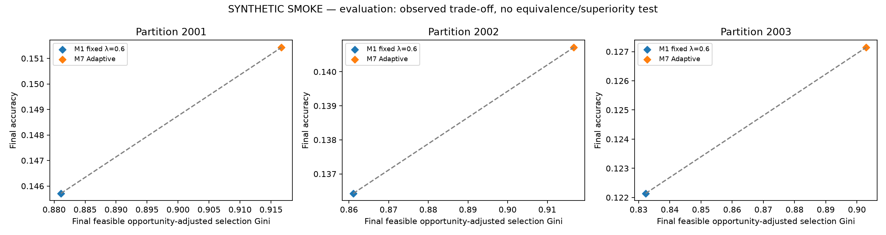
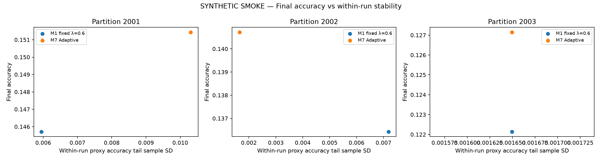
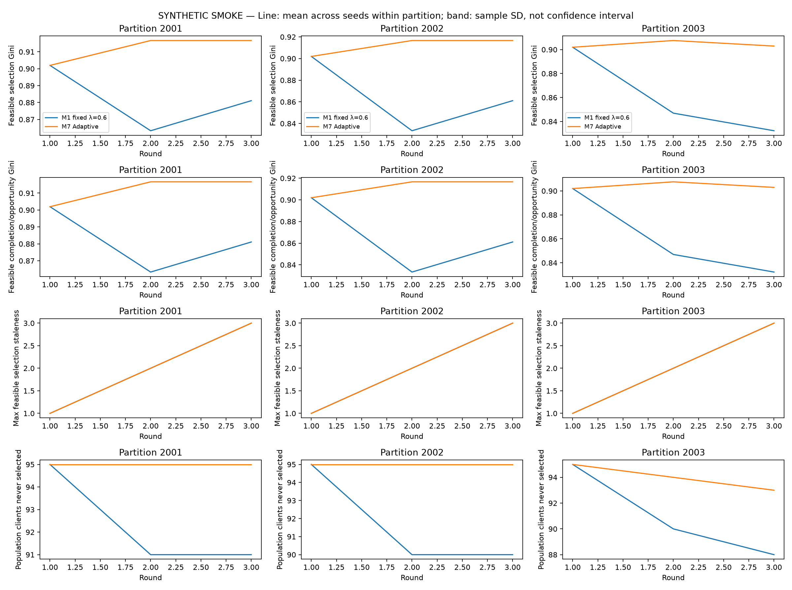
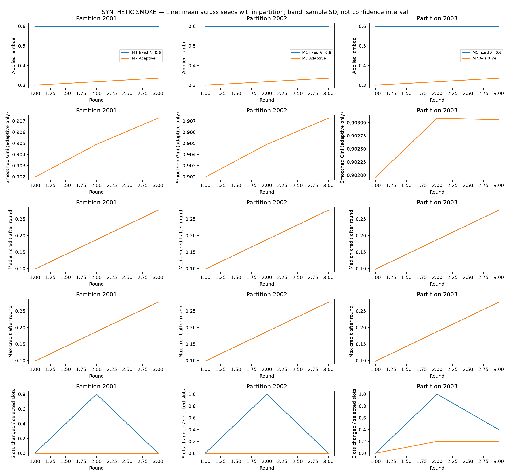

# Fairness-matched lambda experiments — evaluation

Complete: true; smoke: true.

Fairness status: **MATCHED**. Operational tolerances passed; this is not statistical equivalence.

Ratios except maximum accuracy drop in percentage points and times in seconds. Tail SD is within-run; summary sample SD is between training/scenario seeds inside each partition. Partitions are not treated as extra independent training seeds.

Population selection/completion coverage: all 100 logical clients. RAM denominator: static feasible RAM population (normally 60). Feasible coverage/Gini/staleness: clients with >=1 valid estimated-feasible opportunity, whose count and membership are policy-specific and exported. Completion Ginis are explicitly separated into population, RAM-feasible and feasible completion/opportunity versions.

Phase A reports proxy validation outcomes. Phase B reports test ONLY at the final checkpoint; tail stability, drift/drop and time-to-target use the independently held-out proxy trajectory, as labelled in every record. Final accuracy always uses the final checkpoint, including low accuracy/drift runs.

## Per-partition mean ± sample SD across training/scenario seeds

| Partition:policy | Metric | Mean | Sample SD | n | Min / worst case | Max |
| --- | --- | ---: | ---: | ---: | ---: | ---: |
| 2001:M1 | accuracy | 0.145714 | N/A | 1 | 0.145714 | 0.145714 |
| 2001:M1 | macroF1 | 0.112113 | N/A | 1 | 0.112113 | 0.112113 |
| 2001:M1 | loss | 1.948396 | N/A | 1 | 1.948396 | 1.948396 |
| 2001:M1 | worstClassRecall | 0.020000 | N/A | 1 | 0.020000 | 0.020000 |
| 2001:M1 | recall0 | 0.090000 | N/A | 1 | 0.090000 | 0.090000 |
| 2001:M1 | recall1 | 0.030000 | N/A | 1 | 0.030000 | 0.030000 |
| 2001:M1 | recall2 | 0.570000 | N/A | 1 | 0.570000 | 0.570000 |
| 2001:M1 | recall3 | 0.145000 | N/A | 1 | 0.145000 | 0.145000 |
| 2001:M1 | recall4 | 0.060000 | N/A | 1 | 0.060000 | 0.060000 |
| 2001:M1 | recall5 | 0.020000 | N/A | 1 | 0.020000 | 0.020000 |
| 2001:M1 | recall6 | 0.105000 | N/A | 1 | 0.105000 | 0.105000 |
| 2001:M1 | accuracyTailMean | 0.163810 | N/A | 1 | 0.163810 | 0.163810 |
| 2001:M1 | accuracyTailSd | 0.005948 | N/A | 1 | 0.005948 | 0.005948 |
| 2001:M1 | macroF1TailSd | 0.006618 | N/A | 1 | 0.006618 | 0.006618 |
| 2001:M1 | maxAccuracyDropPp | 0.285714 | N/A | 1 | 0.285714 | 0.285714 |
| 2001:M1 | populationSelectionCoverage | 0.090000 | N/A | 1 | 0.090000 | 0.090000 |
| 2001:M1 | populationCompletionCoverage | 0.090000 | N/A | 1 | 0.090000 | 0.090000 |
| 2001:M1 | feasibleSelectionCoverage | 0.150000 | N/A | 1 | 0.150000 | 0.150000 |
| 2001:M1 | feasibleCompletionCoverage | 0.150000 | N/A | 1 | 0.150000 | 0.150000 |
| 2001:M1 | feasibleOpportunityAdjustedGini | 0.881111 | N/A | 1 | 0.881111 | 0.881111 |
| 2001:M1 | feasibleCompletionOpportunityAdjustedGini | 0.881111 | N/A | 1 | 0.881111 | 0.881111 |
| 2001:M1 | selectionGini | 0.928667 | N/A | 1 | 0.928667 | 0.928667 |
| 2001:M1 | completionGini | 0.928667 | N/A | 1 | 0.928667 | 0.928667 |
| 2001:M1 | ramFeasibleCompletionGini | 0.881111 | N/A | 1 | 0.881111 | 0.881111 |
| 2001:M1 | maxFeasibleSelectionStaleness | 3.000000 | N/A | 1 | 3.000000 | 3.000000 |
| 2001:M1 | meanFeasibleSelectionStaleness | 2.333333 | N/A | 1 | 2.333333 | 2.333333 |
| 2001:M1 | populationNeverSelected | 91.000000 | N/A | 1 | 91.000000 | 91.000000 |
| 2001:M1 | feasibleNeverSelected | 51.000000 | N/A | 1 | 51.000000 | 51.000000 |
| 2001:M1 | acceptedSelectedRatio | 1.000000 | N/A | 1 | 1.000000 | 1.000000 |
| 2001:M1 | virtualSeconds | 0.548415 | N/A | 1 | 0.548415 | 0.548415 |
| 2001:M1 | virtualSecondsWithSelector | 0.561794 | N/A | 1 | 0.561794 | 0.561794 |
| 2001:M1 | wallSeconds | 0.994067 | N/A | 1 | 0.994067 | 0.994067 |
| 2001:M1 | selectorSeconds | 0.012681 | N/A | 1 | 0.012681 | 0.012681 |
| 2001:M1 | fairnessUpdateSeconds | 0.000698 | N/A | 1 | 0.000698 | 0.000698 |
| 2001:M1 | slotsChangedVsTopsis | 4.000000 | N/A | 1 | 4.000000 | 4.000000 |
| 2001:M1 | slotsChangedVsTopsisRatio | 0.266667 | N/A | 1 | 0.266667 | 0.266667 |
| 2001:M1 | meanAppliedLambda | 0.600000 | N/A | 1 | 0.600000 | 0.600000 |
| 2001:M7 | accuracy | 0.151429 | N/A | 1 | 0.151429 | 0.151429 |
| 2001:M7 | macroF1 | 0.124618 | N/A | 1 | 0.124618 | 0.124618 |
| 2001:M7 | loss | 1.948106 | N/A | 1 | 1.948106 | 1.948106 |
| 2001:M7 | worstClassRecall | 0.020000 | N/A | 1 | 0.020000 | 0.020000 |
| 2001:M7 | recall0 | 0.145000 | N/A | 1 | 0.145000 | 0.145000 |
| 2001:M7 | recall1 | 0.020000 | N/A | 1 | 0.020000 | 0.020000 |
| 2001:M7 | recall2 | 0.465000 | N/A | 1 | 0.465000 | 0.465000 |
| 2001:M7 | recall3 | 0.200000 | N/A | 1 | 0.200000 | 0.200000 |
| 2001:M7 | recall4 | 0.045000 | N/A | 1 | 0.045000 | 0.045000 |
| 2001:M7 | recall5 | 0.035000 | N/A | 1 | 0.035000 | 0.035000 |
| 2001:M7 | recall6 | 0.150000 | N/A | 1 | 0.150000 | 0.150000 |
| 2001:M7 | accuracyTailMean | 0.168571 | N/A | 1 | 0.168571 | 0.168571 |
| 2001:M7 | accuracyTailSd | 0.010302 | N/A | 1 | 0.010302 | 0.010302 |
| 2001:M7 | macroF1TailSd | 0.013814 | N/A | 1 | 0.013814 | 0.013814 |
| 2001:M7 | maxAccuracyDropPp | 0.000000 | N/A | 1 | 0.000000 | 0.000000 |
| 2001:M7 | populationSelectionCoverage | 0.050000 | N/A | 1 | 0.050000 | 0.050000 |
| 2001:M7 | populationCompletionCoverage | 0.050000 | N/A | 1 | 0.050000 | 0.050000 |
| 2001:M7 | feasibleSelectionCoverage | 0.083333 | N/A | 1 | 0.083333 | 0.083333 |
| 2001:M7 | feasibleCompletionCoverage | 0.083333 | N/A | 1 | 0.083333 | 0.083333 |
| 2001:M7 | feasibleOpportunityAdjustedGini | 0.916667 | N/A | 1 | 0.916667 | 0.916667 |
| 2001:M7 | feasibleCompletionOpportunityAdjustedGini | 0.916667 | N/A | 1 | 0.916667 | 0.916667 |
| 2001:M7 | selectionGini | 0.950000 | N/A | 1 | 0.950000 | 0.950000 |
| 2001:M7 | completionGini | 0.950000 | N/A | 1 | 0.950000 | 0.950000 |
| 2001:M7 | ramFeasibleCompletionGini | 0.916667 | N/A | 1 | 0.916667 | 0.916667 |
| 2001:M7 | maxFeasibleSelectionStaleness | 3.000000 | N/A | 1 | 3.000000 | 3.000000 |
| 2001:M7 | meanFeasibleSelectionStaleness | 2.466667 | N/A | 1 | 2.466667 | 2.466667 |
| 2001:M7 | populationNeverSelected | 95.000000 | N/A | 1 | 95.000000 | 95.000000 |
| 2001:M7 | feasibleNeverSelected | 55.000000 | N/A | 1 | 55.000000 | 55.000000 |
| 2001:M7 | acceptedSelectedRatio | 1.000000 | N/A | 1 | 1.000000 | 1.000000 |
| 2001:M7 | virtualSeconds | 0.331367 | N/A | 1 | 0.331367 | 0.331367 |
| 2001:M7 | virtualSecondsWithSelector | 0.375365 | N/A | 1 | 0.375365 | 0.375365 |
| 2001:M7 | wallSeconds | 0.755249 | N/A | 1 | 0.755249 | 0.755249 |
| 2001:M7 | selectorSeconds | 0.039006 | N/A | 1 | 0.039006 | 0.039006 |
| 2001:M7 | fairnessUpdateSeconds | 0.004992 | N/A | 1 | 0.004992 | 0.004992 |
| 2001:M7 | slotsChangedVsTopsis | 0.000000 | N/A | 1 | 0.000000 | 0.000000 |
| 2001:M7 | slotsChangedVsTopsisRatio | 0.000000 | N/A | 1 | 0.000000 | 0.000000 |
| 2001:M7 | meanAppliedLambda | 0.317647 | N/A | 1 | 0.317647 | 0.317647 |
| 2002:M1 | accuracy | 0.136429 | N/A | 1 | 0.136429 | 0.136429 |
| 2002:M1 | macroF1 | 0.112875 | N/A | 1 | 0.112875 | 0.112875 |
| 2002:M1 | loss | 1.948554 | N/A | 1 | 1.948554 | 1.948554 |
| 2002:M1 | worstClassRecall | 0.010000 | N/A | 1 | 0.010000 | 0.010000 |
| 2002:M1 | recall0 | 0.080000 | N/A | 1 | 0.080000 | 0.080000 |
| 2002:M1 | recall1 | 0.010000 | N/A | 1 | 0.010000 | 0.010000 |
| 2002:M1 | recall2 | 0.325000 | N/A | 1 | 0.325000 | 0.325000 |
| 2002:M1 | recall3 | 0.310000 | N/A | 1 | 0.310000 | 0.310000 |
| 2002:M1 | recall4 | 0.120000 | N/A | 1 | 0.120000 | 0.120000 |
| 2002:M1 | recall5 | 0.040000 | N/A | 1 | 0.040000 | 0.040000 |
| 2002:M1 | recall6 | 0.070000 | N/A | 1 | 0.070000 | 0.070000 |
| 2002:M1 | accuracyTailMean | 0.155238 | N/A | 1 | 0.155238 | 0.155238 |
| 2002:M1 | accuracyTailSd | 0.007190 | N/A | 1 | 0.007190 | 0.007190 |
| 2002:M1 | macroF1TailSd | 0.004645 | N/A | 1 | 0.004645 | 0.004645 |
| 2002:M1 | maxAccuracyDropPp | 0.857143 | N/A | 1 | 0.857143 | 0.857143 |
| 2002:M1 | populationSelectionCoverage | 0.100000 | N/A | 1 | 0.100000 | 0.100000 |
| 2002:M1 | populationCompletionCoverage | 0.100000 | N/A | 1 | 0.100000 | 0.100000 |
| 2002:M1 | feasibleSelectionCoverage | 0.166667 | N/A | 1 | 0.166667 | 0.166667 |
| 2002:M1 | feasibleCompletionCoverage | 0.166667 | N/A | 1 | 0.166667 | 0.166667 |
| 2002:M1 | feasibleOpportunityAdjustedGini | 0.861111 | N/A | 1 | 0.861111 | 0.861111 |
| 2002:M1 | feasibleCompletionOpportunityAdjustedGini | 0.861111 | N/A | 1 | 0.861111 | 0.861111 |
| 2002:M1 | selectionGini | 0.916667 | N/A | 1 | 0.916667 | 0.916667 |
| 2002:M1 | completionGini | 0.916667 | N/A | 1 | 0.916667 | 0.916667 |
| 2002:M1 | ramFeasibleCompletionGini | 0.861111 | N/A | 1 | 0.861111 | 0.861111 |
| 2002:M1 | maxFeasibleSelectionStaleness | 3.000000 | N/A | 1 | 3.000000 | 3.000000 |
| 2002:M1 | meanFeasibleSelectionStaleness | 2.300000 | N/A | 1 | 2.300000 | 2.300000 |
| 2002:M1 | populationNeverSelected | 90.000000 | N/A | 1 | 90.000000 | 90.000000 |
| 2002:M1 | feasibleNeverSelected | 50.000000 | N/A | 1 | 50.000000 | 50.000000 |
| 2002:M1 | acceptedSelectedRatio | 1.000000 | N/A | 1 | 1.000000 | 1.000000 |
| 2002:M1 | virtualSeconds | 0.344808 | N/A | 1 | 0.344808 | 0.344808 |
| 2002:M1 | virtualSecondsWithSelector | 0.350859 | N/A | 1 | 0.350859 | 0.350859 |
| 2002:M1 | wallSeconds | 0.770064 | N/A | 1 | 0.770064 | 0.770064 |
| 2002:M1 | selectorSeconds | 0.005597 | N/A | 1 | 0.005597 | 0.005597 |
| 2002:M1 | fairnessUpdateSeconds | 0.000455 | N/A | 1 | 0.000455 | 0.000455 |
| 2002:M1 | slotsChangedVsTopsis | 5.000000 | N/A | 1 | 5.000000 | 5.000000 |
| 2002:M1 | slotsChangedVsTopsisRatio | 0.333333 | N/A | 1 | 0.333333 | 0.333333 |
| 2002:M1 | meanAppliedLambda | 0.600000 | N/A | 1 | 0.600000 | 0.600000 |
| 2002:M7 | accuracy | 0.140714 | N/A | 1 | 0.140714 | 0.140714 |
| 2002:M7 | macroF1 | 0.111655 | N/A | 1 | 0.111655 | 0.111655 |
| 2002:M7 | loss | 1.948653 | N/A | 1 | 1.948653 | 1.948653 |
| 2002:M7 | worstClassRecall | 0.010000 | N/A | 1 | 0.010000 | 0.010000 |
| 2002:M7 | recall0 | 0.085000 | N/A | 1 | 0.085000 | 0.085000 |
| 2002:M7 | recall1 | 0.010000 | N/A | 1 | 0.010000 | 0.010000 |
| 2002:M7 | recall2 | 0.415000 | N/A | 1 | 0.415000 | 0.415000 |
| 2002:M7 | recall3 | 0.280000 | N/A | 1 | 0.280000 | 0.280000 |
| 2002:M7 | recall4 | 0.085000 | N/A | 1 | 0.085000 | 0.085000 |
| 2002:M7 | recall5 | 0.030000 | N/A | 1 | 0.030000 | 0.030000 |
| 2002:M7 | recall6 | 0.080000 | N/A | 1 | 0.080000 | 0.080000 |
| 2002:M7 | accuracyTailMean | 0.163810 | N/A | 1 | 0.163810 | 0.163810 |
| 2002:M7 | accuracyTailSd | 0.001650 | N/A | 1 | 0.001650 | 0.001650 |
| 2002:M7 | macroF1TailSd | 0.002924 | N/A | 1 | 0.002924 | 0.002924 |
| 2002:M7 | maxAccuracyDropPp | 0.285714 | N/A | 1 | 0.285714 | 0.285714 |
| 2002:M7 | populationSelectionCoverage | 0.050000 | N/A | 1 | 0.050000 | 0.050000 |
| 2002:M7 | populationCompletionCoverage | 0.050000 | N/A | 1 | 0.050000 | 0.050000 |
| 2002:M7 | feasibleSelectionCoverage | 0.083333 | N/A | 1 | 0.083333 | 0.083333 |
| 2002:M7 | feasibleCompletionCoverage | 0.083333 | N/A | 1 | 0.083333 | 0.083333 |
| 2002:M7 | feasibleOpportunityAdjustedGini | 0.916667 | N/A | 1 | 0.916667 | 0.916667 |
| 2002:M7 | feasibleCompletionOpportunityAdjustedGini | 0.916667 | N/A | 1 | 0.916667 | 0.916667 |
| 2002:M7 | selectionGini | 0.950000 | N/A | 1 | 0.950000 | 0.950000 |
| 2002:M7 | completionGini | 0.950000 | N/A | 1 | 0.950000 | 0.950000 |
| 2002:M7 | ramFeasibleCompletionGini | 0.916667 | N/A | 1 | 0.916667 | 0.916667 |
| 2002:M7 | maxFeasibleSelectionStaleness | 3.000000 | N/A | 1 | 3.000000 | 3.000000 |
| 2002:M7 | meanFeasibleSelectionStaleness | 2.466667 | N/A | 1 | 2.466667 | 2.466667 |
| 2002:M7 | populationNeverSelected | 95.000000 | N/A | 1 | 95.000000 | 95.000000 |
| 2002:M7 | feasibleNeverSelected | 55.000000 | N/A | 1 | 55.000000 | 55.000000 |
| 2002:M7 | acceptedSelectedRatio | 1.000000 | N/A | 1 | 1.000000 | 1.000000 |
| 2002:M7 | virtualSeconds | 0.359790 | N/A | 1 | 0.359790 | 0.359790 |
| 2002:M7 | virtualSecondsWithSelector | 0.368153 | N/A | 1 | 0.368153 | 0.368153 |
| 2002:M7 | wallSeconds | 0.754002 | N/A | 1 | 0.754002 | 0.754002 |
| 2002:M7 | selectorSeconds | 0.007545 | N/A | 1 | 0.007545 | 0.007545 |
| 2002:M7 | fairnessUpdateSeconds | 0.000818 | N/A | 1 | 0.000818 | 0.000818 |
| 2002:M7 | slotsChangedVsTopsis | 0.000000 | N/A | 1 | 0.000000 | 0.000000 |
| 2002:M7 | slotsChangedVsTopsisRatio | 0.000000 | N/A | 1 | 0.000000 | 0.000000 |
| 2002:M7 | meanAppliedLambda | 0.317647 | N/A | 1 | 0.317647 | 0.317647 |
| 2003:M1 | accuracy | 0.122143 | N/A | 1 | 0.122143 | 0.122143 |
| 2003:M1 | macroF1 | 0.097438 | N/A | 1 | 0.097438 | 0.097438 |
| 2003:M1 | loss | 1.949084 | N/A | 1 | 1.949084 | 1.949084 |
| 2003:M1 | worstClassRecall | 0.010000 | N/A | 1 | 0.010000 | 0.010000 |
| 2003:M1 | recall0 | 0.060000 | N/A | 1 | 0.060000 | 0.060000 |
| 2003:M1 | recall1 | 0.010000 | N/A | 1 | 0.010000 | 0.010000 |
| 2003:M1 | recall2 | 0.185000 | N/A | 1 | 0.185000 | 0.185000 |
| 2003:M1 | recall3 | 0.380000 | N/A | 1 | 0.380000 | 0.380000 |
| 2003:M1 | recall4 | 0.130000 | N/A | 1 | 0.130000 | 0.130000 |
| 2003:M1 | recall5 | 0.015000 | N/A | 1 | 0.015000 | 0.015000 |
| 2003:M1 | recall6 | 0.075000 | N/A | 1 | 0.075000 | 0.075000 |
| 2003:M1 | accuracyTailMean | 0.150476 | N/A | 1 | 0.150476 | 0.150476 |
| 2003:M1 | accuracyTailSd | 0.001650 | N/A | 1 | 0.001650 | 0.001650 |
| 2003:M1 | macroF1TailSd | 0.006588 | N/A | 1 | 0.006588 | 0.006588 |
| 2003:M1 | maxAccuracyDropPp | 0.000000 | N/A | 1 | 0.000000 | 0.000000 |
| 2003:M1 | populationSelectionCoverage | 0.120000 | N/A | 1 | 0.120000 | 0.120000 |
| 2003:M1 | populationCompletionCoverage | 0.120000 | N/A | 1 | 0.120000 | 0.120000 |
| 2003:M1 | feasibleSelectionCoverage | 0.200000 | N/A | 1 | 0.200000 | 0.200000 |
| 2003:M1 | feasibleCompletionCoverage | 0.200000 | N/A | 1 | 0.200000 | 0.200000 |
| 2003:M1 | feasibleOpportunityAdjustedGini | 0.832292 | N/A | 1 | 0.832292 | 0.832292 |
| 2003:M1 | feasibleCompletionOpportunityAdjustedGini | 0.832292 | N/A | 1 | 0.832292 | 0.832292 |
| 2003:M1 | selectionGini | 0.898000 | N/A | 1 | 0.898000 | 0.898000 |
| 2003:M1 | completionGini | 0.898000 | N/A | 1 | 0.898000 | 0.898000 |
| 2003:M1 | ramFeasibleCompletionGini | 0.830000 | N/A | 1 | 0.830000 | 0.830000 |
| 2003:M1 | maxFeasibleSelectionStaleness | 3.000000 | N/A | 1 | 3.000000 | 3.000000 |
| 2003:M1 | meanFeasibleSelectionStaleness | 2.266667 | N/A | 1 | 2.266667 | 2.266667 |
| 2003:M1 | populationNeverSelected | 88.000000 | N/A | 1 | 88.000000 | 88.000000 |
| 2003:M1 | feasibleNeverSelected | 48.000000 | N/A | 1 | 48.000000 | 48.000000 |
| 2003:M1 | acceptedSelectedRatio | 1.000000 | N/A | 1 | 1.000000 | 1.000000 |
| 2003:M1 | virtualSeconds | 0.356750 | N/A | 1 | 0.356750 | 0.356750 |
| 2003:M1 | virtualSecondsWithSelector | 0.362602 | N/A | 1 | 0.362602 | 0.362602 |
| 2003:M1 | wallSeconds | 0.726267 | N/A | 1 | 0.726267 | 0.726267 |
| 2003:M1 | selectorSeconds | 0.005518 | N/A | 1 | 0.005518 | 0.005518 |
| 2003:M1 | fairnessUpdateSeconds | 0.000334 | N/A | 1 | 0.000334 | 0.000334 |
| 2003:M1 | slotsChangedVsTopsis | 7.000000 | N/A | 1 | 7.000000 | 7.000000 |
| 2003:M1 | slotsChangedVsTopsisRatio | 0.466667 | N/A | 1 | 0.466667 | 0.466667 |
| 2003:M1 | meanAppliedLambda | 0.600000 | N/A | 1 | 0.600000 | 0.600000 |
| 2003:M7 | accuracy | 0.127143 | N/A | 1 | 0.127143 | 0.127143 |
| 2003:M7 | macroF1 | 0.096343 | N/A | 1 | 0.096343 | 0.096343 |
| 2003:M7 | loss | 1.949073 | N/A | 1 | 1.949073 | 1.949073 |
| 2003:M7 | worstClassRecall | 0.010000 | N/A | 1 | 0.010000 | 0.010000 |
| 2003:M7 | recall0 | 0.020000 | N/A | 1 | 0.020000 | 0.020000 |
| 2003:M7 | recall1 | 0.010000 | N/A | 1 | 0.010000 | 0.010000 |
| 2003:M7 | recall2 | 0.265000 | N/A | 1 | 0.265000 | 0.265000 |
| 2003:M7 | recall3 | 0.375000 | N/A | 1 | 0.375000 | 0.375000 |
| 2003:M7 | recall4 | 0.125000 | N/A | 1 | 0.125000 | 0.125000 |
| 2003:M7 | recall5 | 0.020000 | N/A | 1 | 0.020000 | 0.020000 |
| 2003:M7 | recall6 | 0.075000 | N/A | 1 | 0.075000 | 0.075000 |
| 2003:M7 | accuracyTailMean | 0.149524 | N/A | 1 | 0.149524 | 0.149524 |
| 2003:M7 | accuracyTailSd | 0.001650 | N/A | 1 | 0.001650 | 0.001650 |
| 2003:M7 | macroF1TailSd | 0.002980 | N/A | 1 | 0.002980 | 0.002980 |
| 2003:M7 | maxAccuracyDropPp | 0.285714 | N/A | 1 | 0.285714 | 0.285714 |
| 2003:M7 | populationSelectionCoverage | 0.070000 | N/A | 1 | 0.070000 | 0.070000 |
| 2003:M7 | populationCompletionCoverage | 0.070000 | N/A | 1 | 0.070000 | 0.070000 |
| 2003:M7 | feasibleSelectionCoverage | 0.116667 | N/A | 1 | 0.116667 | 0.116667 |
| 2003:M7 | feasibleCompletionCoverage | 0.116667 | N/A | 1 | 0.116667 | 0.116667 |
| 2003:M7 | feasibleOpportunityAdjustedGini | 0.902941 | N/A | 1 | 0.902941 | 0.902941 |
| 2003:M7 | feasibleCompletionOpportunityAdjustedGini | 0.902941 | N/A | 1 | 0.902941 | 0.902941 |
| 2003:M7 | selectionGini | 0.944667 | N/A | 1 | 0.944667 | 0.944667 |
| 2003:M7 | completionGini | 0.944667 | N/A | 1 | 0.944667 | 0.944667 |
| 2003:M7 | ramFeasibleCompletionGini | 0.907778 | N/A | 1 | 0.907778 | 0.907778 |
| 2003:M7 | maxFeasibleSelectionStaleness | 3.000000 | N/A | 1 | 3.000000 | 3.000000 |
| 2003:M7 | meanFeasibleSelectionStaleness | 2.416667 | N/A | 1 | 2.416667 | 2.416667 |
| 2003:M7 | populationNeverSelected | 93.000000 | N/A | 1 | 93.000000 | 93.000000 |
| 2003:M7 | feasibleNeverSelected | 53.000000 | N/A | 1 | 53.000000 | 53.000000 |
| 2003:M7 | acceptedSelectedRatio | 1.000000 | N/A | 1 | 1.000000 | 1.000000 |
| 2003:M7 | virtualSeconds | 0.364933 | N/A | 1 | 0.364933 | 0.364933 |
| 2003:M7 | virtualSecondsWithSelector | 0.372931 | N/A | 1 | 0.372931 | 0.372931 |
| 2003:M7 | wallSeconds | 0.760572 | N/A | 1 | 0.760572 | 0.760572 |
| 2003:M7 | selectorSeconds | 0.006958 | N/A | 1 | 0.006958 | 0.006958 |
| 2003:M7 | fairnessUpdateSeconds | 0.001040 | N/A | 1 | 0.001040 | 0.001040 |
| 2003:M7 | slotsChangedVsTopsis | 2.000000 | N/A | 1 | 2.000000 | 2.000000 |
| 2003:M7 | slotsChangedVsTopsisRatio | 0.133333 | N/A | 1 | 0.133333 | 0.133333 |
| 2003:M7 | meanAppliedLambda | 0.317617 | N/A | 1 | 0.317617 | 0.317617 |

## Candidate fairness gaps

Coverage uses maximum absolute paired gap; selection/completion Gini and staleness use mean absolute paired gaps. Coverage and all other tolerances must pass; among qualified policies minimize selection-Gini gap, tie smaller lambda. Completion Gini here is feasible completion/opportunity Gini. This is an operational match, not statistical equivalence.

| Policy | Lambda | Selection coverage max gap | Completion coverage max gap | Selection Gini mean gap | Completion Gini mean gap | Max staleness mean gap | Mean staleness mean gap | All tolerances pass |
| --- | ---: | ---: | ---: | ---: | ---: | ---: | ---: | --- |
| M1 | 0.600000 | 0.083333 | 0.083333 | 0.053920 | 0.053920 | 0.000000 | 0.150000 | true |

Configured tolerances: `{"selectionCoverageAbs":1,"completionCoverageAbs":1,"selectionGiniMeanAbs":1,"completionGiniMeanAbs":1,"maxStalenessMeanAbs":100,"meanStalenessMeanAbs":100}`. Selected policy: "M1"; lambda: 0.6.

## Paired differences: Adaptive minus Fixed

| Partition | Seed | Fixed policy | Accuracy difference | Tail SD difference | Selection Gini difference |
| --- | --- | --- | ---: | ---: | ---: |
| 2001 | 42 | M1 | 0.005714 | 0.004354 | 0.035556 |
| 2002 | 42 | M1 | 0.004286 | -0.005541 | 0.055556 |
| 2003 | 42 | M1 | 0.005000 | 0.000000 | 0.070650 |

All paired metric differences and their sample SD within each partition are in JSON. Accuracy–Gini points below are descriptive means across balanced partition/seed cells, not a significance or superiority test.

## Observed Accuracy–Gini Pareto analysis

| Policy | Mean accuracy | Mean selection Gini | On observed mean frontier |
| --- | ---: | ---: | --- |
| M1 | 0.134762 | 0.858171 | true |
| M7 | 0.139762 | 0.912092 | true |

## Fairness and adaptive trajectories

Per-round Gini/staleness, population never-selected count, applied/next lambda, smoothed Gini, full credit distributions and slots changed vs raw TOPSIS on the same pre-round history are retained under `trajectories` in JSON. Matching tolerances and each candidate's exact gaps are under `fairnessMatching`.

Virtual time includes measured server overhead; virtual time with selector additionally includes measured selector/fairness overhead. Deterministic simulated duration does not make those measured overheads deterministic. No best-test-checkpoint selection, statistical equivalence, or adaptive-superiority claim is made.
