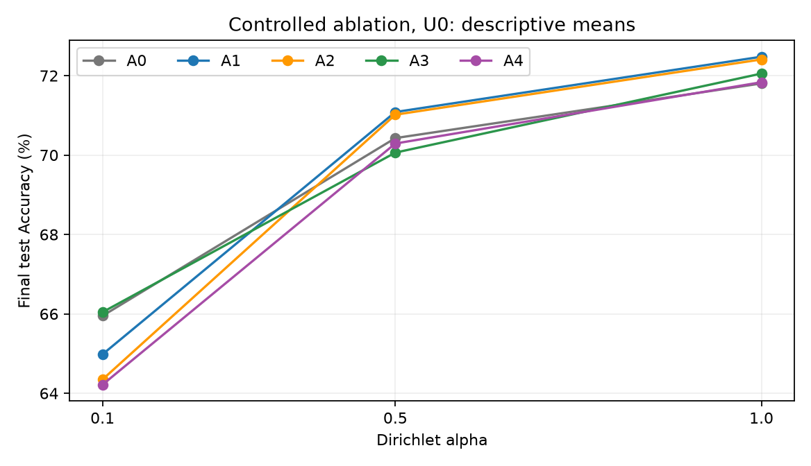
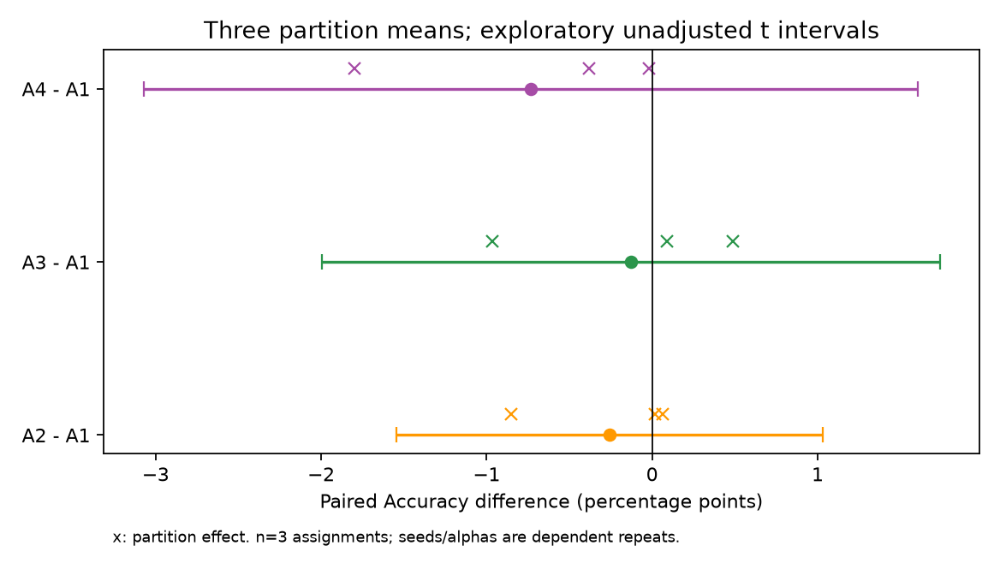
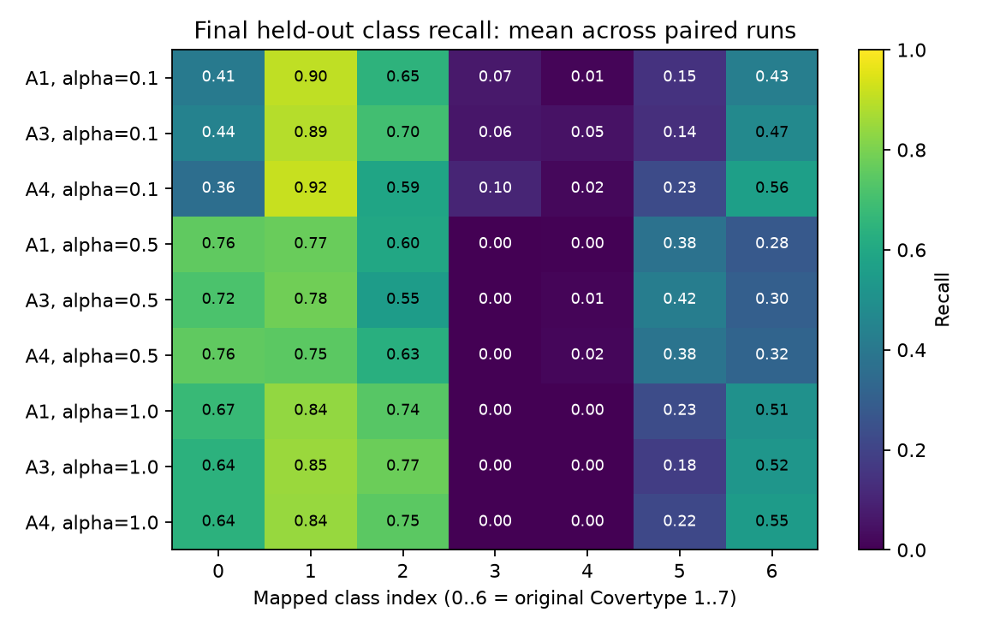
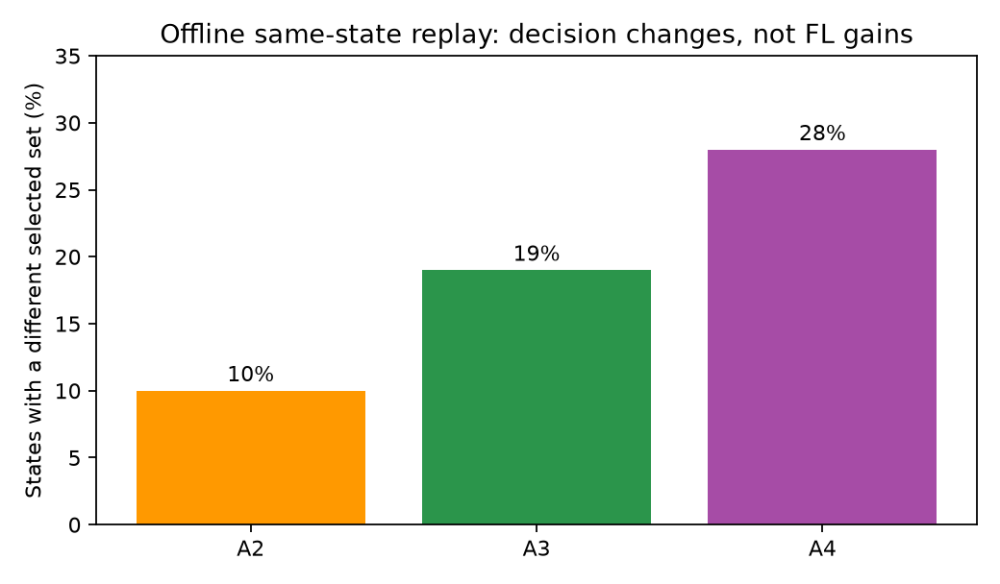

# Tổng hợp bằng chứng nghiên cứu FL — 4/11/2026

**Kết luận:** fuzzy uncertainty có thay đổi lựa chọn client, nhưng chưa có bằng
chứng đủ mạnh rằng nó cải thiện Accuracy cuối một cách nhất quán. Đây là kết quả
âm/không kết luận có giá trị; không cần viết lại thành khẳng định ưu thế.

Đọc [phân tích và kết luận đầy đủ bằng tiếng Việt](agent-analysis.vi.md).
Đây là tổng hợp hậu nghiệm, không phải nghiên cứu huấn luyện mới hoặc tối ưu
tham số theo test. Các kết quả công bố trước đó được giữ nguyên.

## Kết quả cốt lõi

| So sánh controlled dưới U0 | Mean Accuracy difference (điểm phần trăm) |
| --- | ---: |
| Fixed width A2 − zero-width A1 | −0,256 |
| History A3 − zero-width A1 | −0,128 |
| Calibrated A4 − zero-width A1 | −0,733 |
| A3 − A1 riêng alpha=0,1 | +1,062 |

Ở alpha=0,1, dấu hiệu thuận lợi của A3 xuất hiện ở cả ba partition means nhưng
khoảng bất định khám phá vẫn cắt 0. Không gọi đó là xác nhận robustness dưới U2:
toàn bộ controlled ablation dùng U0. So sánh C4/C5 với conventional Crisp C1 trong
E3 cũ khác cả normalization/distance, không tách riêng hiệu ứng uncertainty.

Trong replay cố định input, A2/A3/A4 đổi selected set ở 10%/19%/28% trạng thái.
Điều đó không chứng minh client mới có learning contribution tốt hơn. A4 có
coverage TFN cao hơn nhưng Accuracy thấp hơn; coverage không phải confidence
interval. Minority recall bằng 0 trong mọi controlled run A1–A4 ở alpha=1,0,
nên Accuracy phải được đọc cùng Macro-F1 và recall từng lớp.

## Phạm vi và kiểm chứng

- **450 research runs phân biệt:** 225 controlled, 165 fuzzy workflow
  (24 E2 + 6 E4 + 135 E3), 60 Pareto. Không cộng lại snapshot pilot cũ.
- **31.500 research rounds**, cộng 8 round của bốn audit riêng của hai study
  Fuzzy chính. Audit Pareto/F/L khác không cộng vào tổng này.
- Đọc từng dòng của **27.308 committed rounds** từ hai bộ gzip SQLite exports;
  thêm **4.200 rounds Pareto** từ JSON gốc. Kiểm tra thứ tự round liên tục,
  không trùng, final-only test và metric cuối khớp báo cáo.
- Kiểm tra paired model/partition/split/scenario identities cho 390 research runs
  của hai study Fuzzy chính; lịch sử sau khi policy chọn khác được phép khác nhau.
- Lập SHA-256 inventory cho **2.592 file công bố**; 2.140 file có checksum từ
  publication manifests được đối chiếu, không sai lệch. Hash file binary chỉ
  chứng minh tính toàn vẹn, không phải phân tích ý nghĩa tensor.
- Ba partition assignments trong mỗi nghiên cứu held-out là đơn vị suy luận;
  seeds và các alpha dùng cùng partition seed là các phép đo phụ thuộc.
- Không gộp causal effects qua các protocol, không chọn favorable seeds,
  không dùng 450 run như 450 independent samples.
- Ma trận final robustness **324 runs chưa chạy**. Synthetic smoke không được
  trình bày như kết quả Covertype. Test examples Covertype đã được xem ở study cũ.

Chi tiết máy đọc được: [evidence-audit.json](evidence-audit.json).
Các nghiên cứu F/L và fairness-matched cũ được đọc riêng trong
[phụ lục lịch sử](agent-legacy-context.vi.md); không cộng vào 450 runs hoặc
coi thay đổi fairness/model/aggregation là hiệu ứng riêng của fuzzy width.
Các giả định và giới hạn của khoảng t khám phá được ghi trong báo cáo agent;
không có kiểm định xác nhận mới hoặc kết luận tương đương thực tiễn.

## Dữ liệu gọn để viết paper và vẽ lại

| File | Nội dung |
| --- | --- |
| [run-metrics.csv](run-metrics.csv) | 450 run, stage/policy/alpha/scenario/partition/seed/split và metrics cuối |
| [condition-summaries.csv](condition-summaries.csv) | Mean, sample SD, median, min/max theo condition |
| [paired-effects.csv](paired-effects.csv) | Chênh lệch từng cặp cùng partition/seed/alpha/scenario |
| [partition-effects.csv](partition-effects.csv) | Hiệu ứng đã lấy trung bình trong partition |
| [synthesis-data.json](synthesis-data.json) | Cluster summaries, dấu hiệu, LOPO và exploratory t intervals |
| [round-metrics.csv.gz](round-metrics.csv.gz) | Trajectory, selected/accepted IDs, proxy/test tách riêng, virtual/physical times và hashes của hai study Fuzzy |
| [pareto-round-metrics.csv](pareto-round-metrics.csv) | Trajectory và fairness của Pareto lịch sử |
| [final-per-class-recall.csv](final-per-class-recall.csv) | Final recalls; audit/proxy được gắn nhãn riêng |
| [pareto-per-class-recall.csv](pareto-per-class-recall.csv) | Final test recalls của Pareto |
| [client-participation.csv](client-participation.csv) | Selection/completion/opportunity counts từng client cuối run |
| [paired-provenance.csv](paired-provenance.csv) | Initial-model, partition, split và scenario hashes |
| [run-provenance.csv](run-provenance.csv) | Model identities và checkpoint references; reference không có nghĩa binary đã backup |
| [published-file-inventory.csv](published-file-inventory.csv) | Từng file đã công bố, kích thước, SHA-256 và kết quả đối chiếu |
| [agent-metrics.json](agent-metrics.json) | Phép tính độc lập của agent về ablation, replay, calibration và E3 |

## Biểu đồ









SVG cũng có trong `figures/`. Error bars là khoảng t khám phá với ba partition,
không phải sai số chuẩn của 45 independent training runs.

## Tạo lại không cần model tensors hoặc training

Từ repository root, với môi trường Python của project:

```powershell
.\.venv\Scripts\python.exe scripts/synthesize_research_results.py
.\.venv\Scripts\python.exe scripts/plot_research_synthesis.py
.\.venv\Scripts\python.exe scripts/verify_research_synthesis.py
```

Script chỉ đọc các publication đã có trong Git và ghi vào thư mục synthesis mới
này; không gọi worker, không load PyTorch tensors và không thay đổi thí nghiệm.
Generator tái tạo các bảng/audit; báo cáo độc lập của agent là tài liệu phân tích
đã review, không được tự động viết lại để đưa ra kết luận thuận lợi.
`publication-manifest.json` niêm phong các file của bản công bố này bằng SHA-256.
Nếu chủ động tái tạo nội dung khác, cần bản công bố mới và checksum mới;
không coi manifest cũ là xác minh cho kết quả đã bị thay đổi.

## Trước khi tự xoá dữ liệu local

**Bản này giữ kết quả phân tích, không thay thế backup checkpoint.**
Upload model đã được dừng theo yêu cầu: sáu phần được xác minh, phần bảy chưa
hoàn tất; Release vẫn là draft, không có full-backup manifest. Không coi đó là
backup toàn bộ 52,5 GiB.

Các raw experiment/round exports, protocol, source snapshots và provenance trước
đó vẫn nằm trong `results/` trên Git; synthesis không xoá hoặc thay thế chúng.
Model binaries/receipts, dataset arrays và database mới không tự động được lưu
đầy đủ bởi bản tổng hợp này. Nếu xoá chúng, vẫn đọc/vẽ lại metric đã lưu nhưng
không thể bảo đảm đánh giá lại model, tính metric chưa ghi hoặc resume run cũ.

Không xoá `.git`, source/config hoặc `.venv` nếu còn muốn chạy tiếp. Các thay đổi
source của final robustness workflow đang có riêng ở working tree không phải là
artifact thí nghiệm; việc push synthesis không có nghĩa mọi thay đổi đó đã push.
Người dùng tự quyết định cleanup; công việc này không xoá file gốc nào.
