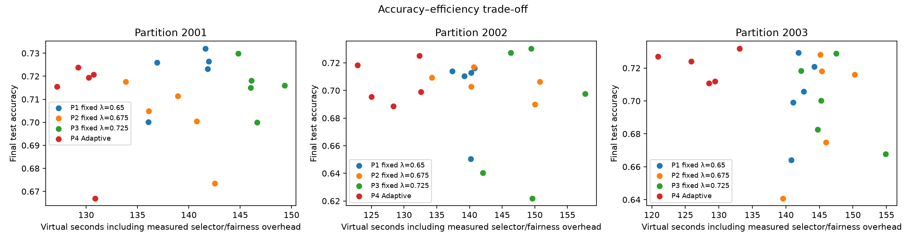
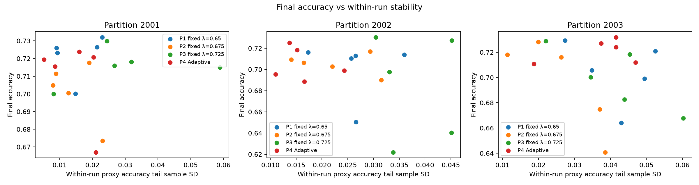
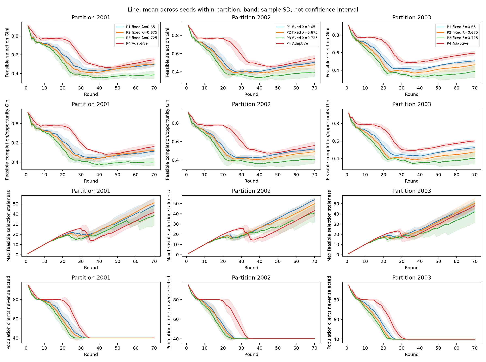
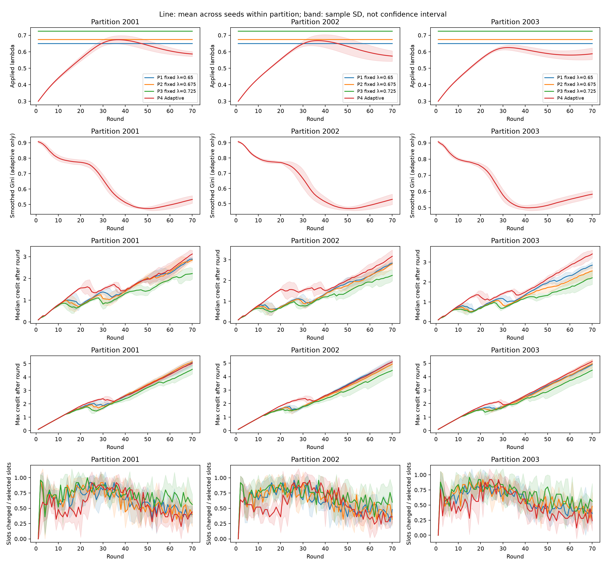

# Held-out Pareto Trade-off Evaluation

Phase A: **NO_MATCH**. Phase B: **PARETO_COMPARISON**. Complete: true; runs=60/60; smoke=false.

Compare partition-specific nondominated sets, paired differences and cross-partition variation. Non-dominance is not proof of superiority; no overall winner is selected.

Ratios except maximum accuracy drop in percentage points and times in seconds. Tail SD is within-run; summary sample SD is between training/scenario seeds inside each partition. Partitions are not treated as extra independent training seeds.

Population selection/completion coverage: all 100 logical clients. RAM denominator: static feasible RAM population (normally 60). Feasible coverage/Gini/staleness: clients with >=1 valid estimated-feasible opportunity, whose count and membership are policy-specific and exported. Completion Ginis are explicitly separated into population, RAM-feasible and feasible completion/opportunity versions.

P1=fixed .650, P2=fixed .675, P3=fixed .725; P4=Adaptive initial .300. Policies and adaptive parameters were locked from Phase A before held-out evaluation. No held-out tuning or best-checkpoint replacement.

Final Accuracy/F1/Loss/recalls use ONLY the final test checkpoint. Tail mean/SD, consecutive drops, final-round accuracy change and time-to-target use the proxy trajectory. These split-specific statistics must not be conflated.

## Per-partition mean ± sample SD across training/scenario seeds

| Partition:policy | Metric | Mean ± sample SD | Min | Max |
| --- | --- | --- | ---: | ---: |
| 2001:P1 | accuracy | 0.721544 ± 0.012390 (n=5) | 0.700134 | 0.731975 |
| 2001:P1 | macroF1 | 0.428471 ± 0.025768 (n=5) | 0.404047 | 0.466506 |
| 2001:P1 | loss | 0.652843 ± 0.024225 (n=5) | 0.635785 | 0.695483 |
| 2001:P1 | worstClassRecall | 0.000000 ± 0.000000 (n=5) | 0.000000 | 0.000000 |
| 2001:P1 | recall0 | 0.730122 ± 0.039689 (n=5) | 0.685565 | 0.790337 |
| 2001:P1 | recall1 | 0.806414 ± 0.035582 (n=5) | 0.760113 | 0.853583 |
| 2001:P1 | recall2 | 0.577402 ± 0.303898 (n=5) | 0.061250 | 0.790938 |
| 2001:P1 | recall3 | 0.056466 ± 0.126262 (n=5) | 0.000000 | 0.282332 |
| 2001:P1 | recall4 | 0.000000 ± 0.000000 (n=5) | 0.000000 | 0.000000 |
| 2001:P1 | recall5 | 0.361647 ± 0.288134 (n=5) | 0.087532 | 0.766196 |
| 2001:P1 | recall6 | 0.439688 ± 0.148239 (n=5) | 0.280595 | 0.661385 |
| 2001:P1 | accuracyTailMean | 0.715109 ± 0.003955 (n=5) | 0.709359 | 0.719184 |
| 2001:P1 | accuracyTailSd | 0.015536 ± 0.006569 (n=5) | 0.009062 | 0.023050 |
| 2001:P1 | macroF1TailSd | 0.029992 ± 0.007250 (n=5) | 0.022327 | 0.041026 |
| 2001:P1 | maxAccuracyDropPp | 15.373653 ± 3.787246 (n=5) | 12.433307 | 20.291900 |
| 2001:P1 | finalAccuracyChangePp | 0.020653 ± 0.541026 (n=5) | -0.554198 | 0.908747 |
| 2001:P1 | populationSelectionCoverage | 0.600000 ± 0.000000 (n=5) | 0.600000 | 0.600000 |
| 2001:P1 | populationCompletionCoverage | 0.582000 ± 0.014832 (n=5) | 0.560000 | 0.600000 |
| 2001:P1 | feasibleSelectionCoverage | 1.000000 ± 0.000000 (n=5) | 1.000000 | 1.000000 |
| 2001:P1 | feasibleCompletionCoverage | 0.970000 ± 0.024721 (n=5) | 0.933333 | 1.000000 |
| 2001:P1 | feasibleOpportunityAdjustedGini | 0.497956 ± 0.027017 (n=5) | 0.453382 | 0.521259 |
| 2001:P1 | feasibleCompletionOpportunityAdjustedGini | 0.511559 ± 0.034719 (n=5) | 0.452329 | 0.542507 |
| 2001:P1 | selectionGini | 0.698983 ± 0.015940 (n=5) | 0.672114 | 0.710971 |
| 2001:P1 | completionGini | 0.707343 ± 0.020655 (n=5) | 0.671497 | 0.724128 |
| 2001:P1 | ramFeasibleCompletionGini | 0.512238 ± 0.034426 (n=5) | 0.452495 | 0.540214 |
| 2001:P1 | maxFeasibleSelectionStaleness | 48.400000 ± 7.021396 (n=5) | 39.000000 | 57.000000 |
| 2001:P1 | meanFeasibleSelectionStaleness | 14.186667 ± 1.810517 (n=5) | 11.816667 | 16.633333 |
| 2001:P1 | populationNeverSelected | 40.000000 ± 0.000000 (n=5) | 40.000000 | 40.000000 |
| 2001:P1 | feasibleNeverSelected | 0.000000 ± 0.000000 (n=5) | 0.000000 | 0.000000 |
| 2001:P1 | acceptedSelectedRatio | 0.952000 ± 0.010182 (n=5) | 0.934286 | 0.960000 |
| 2001:P1 | virtualSeconds | 139.466573 ± 2.877735 (n=5) | 135.983752 | 141.688216 |
| 2001:P1 | virtualSecondsWithSelector | 139.665622 ± 2.927999 (n=5) | 136.054051 | 141.952648 |
| 2001:P1 | wallSeconds | 115.391699 ± 17.020890 (n=5) | 96.478764 | 140.535558 |
| 2001:P1 | selectorSeconds | 0.192017 ± 0.151438 (n=5) | 0.065446 | 0.442305 |
| 2001:P1 | fairnessUpdateSeconds | 0.007033 ± 0.002345 (n=5) | 0.004853 | 0.009940 |
| 2001:P1 | slotsChangedVsTopsis | 218.400000 ± 6.107373 (n=5) | 211.000000 | 228.000000 |
| 2001:P1 | slotsChangedVsTopsisRatio | 0.624000 ± 0.017450 (n=5) | 0.602857 | 0.651429 |
| 2001:P1 | meanAppliedLambda | 0.650000 ± 0.000000 (n=5) | 0.650000 | 0.650000 |
| 2001:P2 | accuracy | 0.701551 ± 0.016962 (n=5) | 0.673525 | 0.717604 |
| 2001:P2 | macroF1 | 0.399588 ± 0.027679 (n=5) | 0.374816 | 0.433472 |
| 2001:P2 | loss | 0.683785 ± 0.027460 (n=5) | 0.658445 | 0.729537 |
| 2001:P2 | worstClassRecall | 0.000000 ± 0.000000 (n=5) | 0.000000 | 0.000000 |
| 2001:P2 | recall0 | 0.813987 ± 0.099352 (n=5) | 0.649641 | 0.904126 |
| 2001:P2 | recall1 | 0.696573 ± 0.115075 (n=5) | 0.573156 | 0.870985 |
| 2001:P2 | recall2 | 0.748259 ± 0.251483 (n=5) | 0.314501 | 0.918053 |
| 2001:P2 | recall3 | 0.000000 ± 0.000000 (n=5) | 0.000000 | 0.000000 |
| 2001:P2 | recall4 | 0.000000 ± 0.000000 (n=5) | 0.000000 | 0.000000 |
| 2001:P2 | recall5 | 0.225338 ± 0.300525 (n=5) | 0.018428 | 0.754679 |
| 2001:P2 | recall6 | 0.349439 ± 0.185105 (n=5) | 0.187470 | 0.586543 |
| 2001:P2 | accuracyTailMean | 0.712965 ± 0.004634 (n=5) | 0.705738 | 0.717142 |
| 2001:P2 | accuracyTailSd | 0.014314 ± 0.006533 (n=5) | 0.008004 | 0.023068 |
| 2001:P2 | macroF1TailSd | 0.024904 ± 0.003423 (n=5) | 0.019868 | 0.028598 |
| 2001:P2 | maxAccuracyDropPp | 16.992186 ± 4.769748 (n=5) | 12.990947 | 25.066263 |
| 2001:P2 | finalAccuracyChangePp | -0.934219 ± 2.291196 (n=5) | -4.409487 | 1.576538 |
| 2001:P2 | populationSelectionCoverage | 0.600000 ± 0.000000 (n=5) | 0.600000 | 0.600000 |
| 2001:P2 | populationCompletionCoverage | 0.580000 ± 0.018708 (n=5) | 0.550000 | 0.600000 |
| 2001:P2 | feasibleSelectionCoverage | 1.000000 ± 0.000000 (n=5) | 1.000000 | 1.000000 |
| 2001:P2 | feasibleCompletionCoverage | 0.966667 ± 0.031180 (n=5) | 0.916667 | 1.000000 |
| 2001:P2 | feasibleOpportunityAdjustedGini | 0.502742 ± 0.025533 (n=5) | 0.468043 | 0.538209 |
| 2001:P2 | feasibleCompletionOpportunityAdjustedGini | 0.520531 ± 0.016796 (n=5) | 0.496855 | 0.540355 |
| 2001:P2 | selectionGini | 0.701554 ± 0.016314 (n=5) | 0.679771 | 0.725486 |
| 2001:P2 | completionGini | 0.712310 ± 0.010720 (n=5) | 0.696909 | 0.726627 |
| 2001:P2 | ramFeasibleCompletionGini | 0.520517 ± 0.017867 (n=5) | 0.494848 | 0.544379 |
| 2001:P2 | maxFeasibleSelectionStaleness | 51.000000 ± 3.741657 (n=5) | 48.000000 | 57.000000 |
| 2001:P2 | meanFeasibleSelectionStaleness | 14.803333 ± 0.936853 (n=5) | 13.783333 | 16.200000 |
| 2001:P2 | populationNeverSelected | 40.000000 ± 0.000000 (n=5) | 40.000000 | 40.000000 |
| 2001:P2 | feasibleNeverSelected | 0.000000 ± 0.000000 (n=5) | 0.000000 | 0.000000 |
| 2001:P2 | acceptedSelectedRatio | 0.950286 ± 0.010992 (n=5) | 0.937143 | 0.965714 |
| 2001:P2 | virtualSeconds | 138.235244 ± 3.471475 (n=5) | 133.530793 | 142.108554 |
| 2001:P2 | virtualSecondsWithSelector | 138.422835 ± 3.503897 (n=5) | 133.836068 | 142.539394 |
| 2001:P2 | wallSeconds | 102.257720 ± 19.969935 (n=5) | 83.725641 | 129.270211 |
| 2001:P2 | selectorSeconds | 0.174882 ± 0.162982 (n=5) | 0.041281 | 0.397378 |
| 2001:P2 | fairnessUpdateSeconds | 0.012709 ± 0.011779 (n=5) | 0.005515 | 0.033462 |
| 2001:P2 | slotsChangedVsTopsis | 217.800000 ± 8.843076 (n=5) | 206.000000 | 230.000000 |
| 2001:P2 | slotsChangedVsTopsisRatio | 0.622286 ± 0.025266 (n=5) | 0.588571 | 0.657143 |
| 2001:P2 | meanAppliedLambda | 0.675000 ± 0.000000 (n=5) | 0.675000 | 0.675000 |
| 2001:P3 | accuracy | 0.715786 ± 0.010642 (n=5) | 0.699988 | 0.729833 |
| 2001:P3 | macroF1 | 0.397054 ± 0.044007 (n=5) | 0.366035 | 0.466466 |
| 2001:P3 | loss | 0.666071 ± 0.021952 (n=5) | 0.634072 | 0.691359 |
| 2001:P3 | worstClassRecall | 0.000000 ± 0.000000 (n=5) | 0.000000 | 0.000000 |
| 2001:P3 | recall0 | 0.731996 ± 0.075118 (n=5) | 0.617919 | 0.823877 |
| 2001:P3 | recall1 | 0.801910 ± 0.062277 (n=5) | 0.718037 | 0.893011 |
| 2001:P3 | recall2 | 0.582548 ± 0.313199 (n=5) | 0.098727 | 0.911341 |
| 2001:P3 | recall3 | 0.000000 ± 0.000000 (n=5) | 0.000000 | 0.000000 |
| 2001:P3 | recall4 | 0.000000 ± 0.000000 (n=5) | 0.000000 | 0.000000 |
| 2001:P3 | recall5 | 0.330089 ± 0.333599 (n=5) | 0.000000 | 0.789231 |
| 2001:P3 | recall6 | 0.344759 ± 0.165889 (n=5) | 0.236958 | 0.632374 |
| 2001:P3 | accuracyTailMean | 0.702347 ± 0.012263 (n=5) | 0.683629 | 0.716671 |
| 2001:P3 | accuracyTailSd | 0.030046 ± 0.018435 (n=5) | 0.008202 | 0.058964 |
| 2001:P3 | macroF1TailSd | 0.032816 ± 0.006365 (n=5) | 0.025229 | 0.042191 |
| 2001:P3 | maxAccuracyDropPp | 14.818767 ± 4.312733 (n=5) | 10.047847 | 19.896045 |
| 2001:P3 | finalAccuracyChangePp | 1.992358 ± 3.122994 (n=5) | -2.554129 | 6.168462 |
| 2001:P3 | populationSelectionCoverage | 0.600000 ± 0.000000 (n=5) | 0.600000 | 0.600000 |
| 2001:P3 | populationCompletionCoverage | 0.586000 ± 0.008944 (n=5) | 0.570000 | 0.590000 |
| 2001:P3 | feasibleSelectionCoverage | 1.000000 ± 0.000000 (n=5) | 1.000000 | 1.000000 |
| 2001:P3 | feasibleCompletionCoverage | 0.976667 ± 0.014907 (n=5) | 0.950000 | 0.983333 |
| 2001:P3 | feasibleOpportunityAdjustedGini | 0.386002 ± 0.038850 (n=5) | 0.336457 | 0.432237 |
| 2001:P3 | feasibleCompletionOpportunityAdjustedGini | 0.401373 ± 0.040155 (n=5) | 0.352495 | 0.455361 |
| 2001:P3 | selectionGini | 0.631794 ± 0.023036 (n=5) | 0.603771 | 0.658743 |
| 2001:P3 | completionGini | 0.641125 ± 0.023687 (n=5) | 0.613867 | 0.672018 |
| 2001:P3 | ramFeasibleCompletionGini | 0.401875 ± 0.039479 (n=5) | 0.356445 | 0.453363 |
| 2001:P3 | maxFeasibleSelectionStaleness | 38.600000 ± 9.889388 (n=5) | 22.000000 | 46.000000 |
| 2001:P3 | meanFeasibleSelectionStaleness | 9.240000 ± 2.681951 (n=5) | 6.100000 | 12.733333 |
| 2001:P3 | populationNeverSelected | 40.000000 ± 0.000000 (n=5) | 40.000000 | 40.000000 |
| 2001:P3 | feasibleNeverSelected | 0.000000 ± 0.000000 (n=5) | 0.000000 | 0.000000 |
| 2001:P3 | acceptedSelectedRatio | 0.952571 ± 0.007171 (n=5) | 0.945714 | 0.962857 |
| 2001:P3 | virtualSeconds | 146.488599 ± 1.683431 (n=5) | 144.690505 | 149.243476 |
| 2001:P3 | virtualSecondsWithSelector | 146.577036 ± 1.677596 (n=5) | 144.801100 | 149.326108 |
| 2001:P3 | wallSeconds | 112.285564 ± 16.135552 (n=5) | 85.564486 | 128.880503 |
| 2001:P3 | selectorSeconds | 0.083076 ± 0.017096 (n=5) | 0.065027 | 0.104733 |
| 2001:P3 | fairnessUpdateSeconds | 0.005361 ± 0.000699 (n=5) | 0.004674 | 0.006324 |
| 2001:P3 | slotsChangedVsTopsis | 253.400000 ± 4.505552 (n=5) | 247.000000 | 258.000000 |
| 2001:P3 | slotsChangedVsTopsisRatio | 0.724000 ± 0.012873 (n=5) | 0.705714 | 0.737143 |
| 2001:P3 | meanAppliedLambda | 0.725000 ± 0.000000 (n=5) | 0.725000 | 0.725000 |
| 2001:P4 | accuracy | 0.709294 ± 0.023823 (n=5) | 0.667020 | 0.723886 |
| 2001:P4 | macroF1 | 0.425207 ± 0.028273 (n=5) | 0.391512 | 0.462694 |
| 2001:P4 | loss | 0.671938 ± 0.036943 (n=5) | 0.644267 | 0.736765 |
| 2001:P4 | worstClassRecall | 0.000000 ± 0.000000 (n=5) | 0.000000 | 0.000000 |
| 2001:P4 | recall0 | 0.826190 ± 0.049799 (n=5) | 0.768646 | 0.903654 |
| 2001:P4 | recall1 | 0.701698 ± 0.072281 (n=5) | 0.578397 | 0.757977 |
| 2001:P4 | recall2 | 0.680744 ± 0.169495 (n=5) | 0.438820 | 0.903930 |
| 2001:P4 | recall3 | 0.000000 ± 0.000000 (n=5) | 0.000000 | 0.000000 |
| 2001:P4 | recall4 | 0.000000 ± 0.000000 (n=5) | 0.000000 | 0.000000 |
| 2001:P4 | recall5 | 0.325597 ± 0.256248 (n=5) | 0.000576 | 0.602937 |
| 2001:P4 | recall6 | 0.404778 ± 0.092238 (n=5) | 0.297172 | 0.531204 |
| 2001:P4 | accuracyTailMean | 0.712922 ± 0.010281 (n=5) | 0.699849 | 0.724608 |
| 2001:P4 | accuracyTailSd | 0.014249 ± 0.007052 (n=5) | 0.005247 | 0.021047 |
| 2001:P4 | macroF1TailSd | 0.027684 ± 0.004243 (n=5) | 0.023866 | 0.033295 |
| 2001:P4 | maxAccuracyDropPp | 13.799181 ± 5.503996 (n=5) | 10.268149 | 23.341709 |
| 2001:P4 | finalAccuracyChangePp | -0.338715 ± 2.834361 (n=5) | -4.402602 | 2.884582 |
| 2001:P4 | populationSelectionCoverage | 0.600000 ± 0.000000 (n=5) | 0.600000 | 0.600000 |
| 2001:P4 | populationCompletionCoverage | 0.572000 ± 0.013038 (n=5) | 0.560000 | 0.590000 |
| 2001:P4 | feasibleSelectionCoverage | 1.000000 ± 0.000000 (n=5) | 1.000000 | 1.000000 |
| 2001:P4 | feasibleCompletionCoverage | 0.953333 ± 0.021731 (n=5) | 0.933333 | 0.983333 |
| 2001:P4 | feasibleOpportunityAdjustedGini | 0.545445 ± 0.022768 (n=5) | 0.526453 | 0.584060 |
| 2001:P4 | feasibleCompletionOpportunityAdjustedGini | 0.559741 ± 0.026639 (n=5) | 0.542527 | 0.606247 |
| 2001:P4 | selectionGini | 0.726823 ± 0.014148 (n=5) | 0.712571 | 0.749429 |
| 2001:P4 | completionGini | 0.735469 ± 0.016177 (n=5) | 0.721963 | 0.762635 |
| 2001:P4 | ramFeasibleCompletionGini | 0.559116 ± 0.026962 (n=5) | 0.536605 | 0.604391 |
| 2001:P4 | maxFeasibleSelectionStaleness | 41.800000 ± 3.701351 (n=5) | 37.000000 | 46.000000 |
| 2001:P4 | meanFeasibleSelectionStaleness | 16.750000 ± 1.508633 (n=5) | 15.550000 | 19.233333 |
| 2001:P4 | populationNeverSelected | 40.000000 ± 0.000000 (n=5) | 40.000000 | 40.000000 |
| 2001:P4 | feasibleNeverSelected | 0.000000 ± 0.000000 (n=5) | 0.000000 | 0.000000 |
| 2001:P4 | acceptedSelectedRatio | 0.947429 ± 0.010020 (n=5) | 0.931429 | 0.957143 |
| 2001:P4 | virtualSeconds | 129.326326 ± 1.420745 (n=5) | 127.102997 | 130.527645 |
| 2001:P4 | virtualSecondsWithSelector | 129.643319 ± 1.533615 (n=5) | 127.163082 | 130.874034 |
| 2001:P4 | wallSeconds | 131.612343 ± 17.385829 (n=5) | 104.368589 | 152.720971 |
| 2001:P4 | selectorSeconds | 0.302104 ± 0.194675 (n=5) | 0.053184 | 0.540038 |
| 2001:P4 | fairnessUpdateSeconds | 0.014888 ± 0.009051 (n=5) | 0.006901 | 0.029734 |
| 2001:P4 | slotsChangedVsTopsis | 197.800000 ± 10.256705 (n=5) | 187.000000 | 211.000000 |
| 2001:P4 | slotsChangedVsTopsisRatio | 0.565143 ± 0.029305 (n=5) | 0.534286 | 0.602857 |
| 2001:P4 | meanAppliedLambda | 0.576068 ± 0.016430 (n=5) | 0.556371 | 0.594258 |
| 2002:P1 | accuracy | 0.700797 ± 0.028180 (n=5) | 0.650522 | 0.716227 |
| 2002:P1 | macroF1 | 0.416993 ± 0.039924 (n=5) | 0.360979 | 0.460445 |
| 2002:P1 | loss | 0.686745 ± 0.044239 (n=5) | 0.659163 | 0.764897 |
| 2002:P1 | worstClassRecall | 0.001440 ± 0.003219 (n=5) | 0.000000 | 0.007198 |
| 2002:P1 | recall0 | 0.611598 ± 0.225763 (n=5) | 0.278229 | 0.821799 |
| 2002:P1 | recall1 | 0.834624 ± 0.113689 (n=5) | 0.693735 | 0.951606 |
| 2002:P1 | recall2 | 0.813537 ± 0.085731 (n=5) | 0.683820 | 0.899035 |
| 2002:P1 | recall3 | 0.061566 ± 0.090016 (n=5) | 0.000000 | 0.198543 |
| 2002:P1 | recall4 | 0.028120 ± 0.062584 (n=5) | 0.000000 | 0.140074 |
| 2002:P1 | recall5 | 0.120127 ± 0.129992 (n=5) | 0.000864 | 0.310394 |
| 2002:P1 | recall6 | 0.465627 ± 0.265846 (n=5) | 0.150171 | 0.841784 |
| 2002:P1 | accuracyTailMean | 0.703210 ± 0.006774 (n=5) | 0.694578 | 0.713597 |
| 2002:P1 | accuracyTailSd | 0.026425 ± 0.006602 (n=5) | 0.017319 | 0.035955 |
| 2002:P1 | macroF1TailSd | 0.028330 ± 0.004149 (n=5) | 0.022959 | 0.034322 |
| 2002:P1 | maxAccuracyDropPp | 15.202919 ± 2.537299 (n=5) | 13.225018 | 19.266118 |
| 2002:P1 | finalAccuracyChangePp | -0.679495 ± 4.684728 (n=5) | -7.676156 | 5.424942 |
| 2002:P1 | populationSelectionCoverage | 0.600000 ± 0.000000 (n=5) | 0.600000 | 0.600000 |
| 2002:P1 | populationCompletionCoverage | 0.576000 ± 0.011402 (n=5) | 0.560000 | 0.590000 |
| 2002:P1 | feasibleSelectionCoverage | 1.000000 ± 0.000000 (n=5) | 1.000000 | 1.000000 |
| 2002:P1 | feasibleCompletionCoverage | 0.960000 ± 0.019003 (n=5) | 0.933333 | 0.983333 |
| 2002:P1 | feasibleOpportunityAdjustedGini | 0.499657 ± 0.017759 (n=5) | 0.480458 | 0.523838 |
| 2002:P1 | feasibleCompletionOpportunityAdjustedGini | 0.517711 ± 0.015589 (n=5) | 0.503802 | 0.542061 |
| 2002:P1 | selectionGini | 0.698640 ± 0.011159 (n=5) | 0.686857 | 0.713143 |
| 2002:P1 | completionGini | 0.709456 ± 0.010305 (n=5) | 0.697012 | 0.724485 |
| 2002:P1 | ramFeasibleCompletionGini | 0.515760 ± 0.017175 (n=5) | 0.495020 | 0.540808 |
| 2002:P1 | maxFeasibleSelectionStaleness | 53.600000 ± 1.516575 (n=5) | 52.000000 | 56.000000 |
| 2002:P1 | meanFeasibleSelectionStaleness | 15.173333 ± 1.941706 (n=5) | 13.033333 | 17.250000 |
| 2002:P1 | populationNeverSelected | 40.000000 ± 0.000000 (n=5) | 40.000000 | 40.000000 |
| 2002:P1 | feasibleNeverSelected | 0.000000 ± 0.000000 (n=5) | 0.000000 | 0.000000 |
| 2002:P1 | acceptedSelectedRatio | 0.943429 ± 0.006515 (n=5) | 0.937143 | 0.954286 |
| 2002:P1 | virtualSeconds | 139.474401 ± 1.327506 (n=5) | 137.300081 | 140.648912 |
| 2002:P1 | virtualSecondsWithSelector | 139.573695 ± 1.365219 (n=5) | 137.348840 | 140.787243 |
| 2002:P1 | wallSeconds | 120.434421 ± 44.085156 (n=5) | 73.632970 | 177.229468 |
| 2002:P1 | selectorSeconds | 0.092219 ± 0.048268 (n=5) | 0.045486 | 0.158487 |
| 2002:P1 | fairnessUpdateSeconds | 0.007074 ± 0.003953 (n=5) | 0.003273 | 0.011724 |
| 2002:P1 | slotsChangedVsTopsis | 216.000000 ± 5.700877 (n=5) | 208.000000 | 222.000000 |
| 2002:P1 | slotsChangedVsTopsisRatio | 0.617143 ± 0.016288 (n=5) | 0.594286 | 0.634286 |
| 2002:P1 | meanAppliedLambda | 0.650000 ± 0.000000 (n=5) | 0.650000 | 0.650000 |
| 2002:P2 | accuracy | 0.705060 ± 0.009926 (n=5) | 0.689962 | 0.716976 |
| 2002:P2 | macroF1 | 0.399941 ± 0.038567 (n=5) | 0.340720 | 0.447577 |
| 2002:P2 | loss | 0.680492 ± 0.018492 (n=5) | 0.657937 | 0.708928 |
| 2002:P2 | worstClassRecall | 0.004107 ± 0.009184 (n=5) | 0.000000 | 0.020537 |
| 2002:P2 | recall0 | 0.640932 ± 0.196324 (n=5) | 0.434880 | 0.853828 |
| 2002:P2 | recall1 | 0.826333 ± 0.124792 (n=5) | 0.683198 | 0.938652 |
| 2002:P2 | recall2 | 0.818962 ± 0.073778 (n=5) | 0.712628 | 0.888687 |
| 2002:P2 | recall3 | 0.038980 ± 0.056958 (n=5) | 0.000000 | 0.134791 |
| 2002:P2 | recall4 | 0.004107 ± 0.009184 (n=5) | 0.000000 | 0.020537 |
| 2002:P2 | recall5 | 0.044630 ± 0.052277 (n=5) | 0.007198 | 0.135042 |
| 2002:P2 | recall6 | 0.466553 ± 0.282152 (n=5) | 0.094588 | 0.722087 |
| 2002:P2 | accuracyTailMean | 0.708226 ± 0.006336 (n=5) | 0.700978 | 0.717879 |
| 2002:P2 | accuracyTailSd | 0.022686 ± 0.007674 (n=5) | 0.014077 | 0.031513 |
| 2002:P2 | macroF1TailSd | 0.029349 ± 0.007605 (n=5) | 0.019862 | 0.038088 |
| 2002:P2 | maxAccuracyDropPp | 15.250422 ± 1.419391 (n=5) | 13.225018 | 17.090634 |
| 2002:P2 | finalAccuracyChangePp | 0.661595 ± 2.369655 (n=5) | -2.196138 | 3.965440 |
| 2002:P2 | populationSelectionCoverage | 0.600000 ± 0.000000 (n=5) | 0.600000 | 0.600000 |
| 2002:P2 | populationCompletionCoverage | 0.590000 ± 0.012247 (n=5) | 0.570000 | 0.600000 |
| 2002:P2 | feasibleSelectionCoverage | 1.000000 ± 0.000000 (n=5) | 1.000000 | 1.000000 |
| 2002:P2 | feasibleCompletionCoverage | 0.983333 ± 0.020412 (n=5) | 0.950000 | 1.000000 |
| 2002:P2 | feasibleOpportunityAdjustedGini | 0.476536 ± 0.039740 (n=5) | 0.426165 | 0.531257 |
| 2002:P2 | feasibleCompletionOpportunityAdjustedGini | 0.489341 ± 0.036984 (n=5) | 0.440671 | 0.533045 |
| 2002:P2 | selectionGini | 0.684880 ± 0.021856 (n=5) | 0.657200 | 0.714171 |
| 2002:P2 | completionGini | 0.692459 ± 0.020405 (n=5) | 0.665476 | 0.715015 |
| 2002:P2 | ramFeasibleCompletionGini | 0.487431 ± 0.034009 (n=5) | 0.442460 | 0.525025 |
| 2002:P2 | maxFeasibleSelectionStaleness | 49.800000 ± 5.215362 (n=5) | 43.000000 | 56.000000 |
| 2002:P2 | meanFeasibleSelectionStaleness | 14.216667 ± 2.617118 (n=5) | 11.850000 | 18.416667 |
| 2002:P2 | populationNeverSelected | 40.000000 ± 0.000000 (n=5) | 40.000000 | 40.000000 |
| 2002:P2 | feasibleNeverSelected | 0.000000 ± 0.000000 (n=5) | 0.000000 | 0.000000 |
| 2002:P2 | acceptedSelectedRatio | 0.941714 ± 0.013939 (n=5) | 0.922857 | 0.960000 |
| 2002:P2 | virtualSeconds | 142.893032 ± 6.929217 (n=5) | 134.164623 | 150.493223 |
| 2002:P2 | virtualSecondsWithSelector | 143.184263 ± 7.058629 (n=5) | 134.223119 | 150.778040 |
| 2002:P2 | wallSeconds | 144.019659 ± 58.247833 (n=5) | 90.427509 | 206.651638 |
| 2002:P2 | selectorSeconds | 0.282597 ± 0.219581 (n=5) | 0.053485 | 0.515524 |
| 2002:P2 | fairnessUpdateSeconds | 0.008634 ± 0.003165 (n=5) | 0.005010 | 0.011678 |
| 2002:P2 | slotsChangedVsTopsis | 222.000000 ± 10.793517 (n=5) | 208.000000 | 236.000000 |
| 2002:P2 | slotsChangedVsTopsisRatio | 0.634286 ± 0.030839 (n=5) | 0.594286 | 0.674286 |
| 2002:P2 | meanAppliedLambda | 0.675000 ± 0.000000 (n=5) | 0.675000 | 0.675000 |
| 2002:P3 | accuracy | 0.683475 ± 0.049840 (n=5) | 0.621943 | 0.730271 |
| 2002:P3 | macroF1 | 0.390536 ± 0.019860 (n=5) | 0.359062 | 0.409948 |
| 2002:P3 | loss | 0.721311 ± 0.088671 (n=5) | 0.641835 | 0.838134 |
| 2002:P3 | worstClassRecall | 0.003791 ± 0.008478 (n=5) | 0.000000 | 0.018957 |
| 2002:P3 | recall0 | 0.753715 ± 0.186401 (n=5) | 0.499929 | 0.943802 |
| 2002:P3 | recall1 | 0.703759 ± 0.226791 (n=5) | 0.433516 | 0.928239 |
| 2002:P3 | recall2 | 0.846875 ± 0.066266 (n=5) | 0.754720 | 0.924486 |
| 2002:P3 | recall3 | 0.025501 ± 0.057022 (n=5) | 0.000000 | 0.127505 |
| 2002:P3 | recall4 | 0.017588 ± 0.021082 (n=5) | 0.000000 | 0.051606 |
| 2002:P3 | recall5 | 0.062540 ± 0.059663 (n=5) | 0.000000 | 0.133602 |
| 2002:P3 | recall6 | 0.315017 ± 0.107050 (n=5) | 0.156997 | 0.417845 |
| 2002:P3 | accuracyTailMean | 0.695146 ± 0.006830 (n=5) | 0.685770 | 0.702933 |
| 2002:P3 | accuracyTailSd | 0.037516 ± 0.007069 (n=5) | 0.030409 | 0.045154 |
| 2002:P3 | macroF1TailSd | 0.026872 ± 0.007988 (n=5) | 0.016883 | 0.037847 |
| 2002:P3 | maxAccuracyDropPp | 14.247358 ± 0.963463 (n=5) | 13.428109 | 15.686207 |
| 2002:P3 | finalAccuracyChangePp | 1.862931 ± 10.033864 (n=5) | -10.416165 | 14.681078 |
| 2002:P3 | populationSelectionCoverage | 0.600000 ± 0.000000 (n=5) | 0.600000 | 0.600000 |
| 2002:P3 | populationCompletionCoverage | 0.598000 ± 0.004472 (n=5) | 0.590000 | 0.600000 |
| 2002:P3 | feasibleSelectionCoverage | 1.000000 ± 0.000000 (n=5) | 1.000000 | 1.000000 |
| 2002:P3 | feasibleCompletionCoverage | 0.996667 ± 0.007454 (n=5) | 0.983333 | 1.000000 |
| 2002:P3 | feasibleOpportunityAdjustedGini | 0.389051 ± 0.039284 (n=5) | 0.341294 | 0.428501 |
| 2002:P3 | feasibleCompletionOpportunityAdjustedGini | 0.402800 ± 0.036965 (n=5) | 0.355394 | 0.439256 |
| 2002:P3 | selectionGini | 0.633200 ± 0.022161 (n=5) | 0.605943 | 0.652514 |
| 2002:P3 | completionGini | 0.641395 ± 0.020655 (n=5) | 0.614940 | 0.663493 |
| 2002:P3 | ramFeasibleCompletionGini | 0.402326 ± 0.034426 (n=5) | 0.358233 | 0.439154 |
| 2002:P3 | maxFeasibleSelectionStaleness | 40.600000 ± 8.792042 (n=5) | 28.000000 | 49.000000 |
| 2002:P3 | meanFeasibleSelectionStaleness | 9.320000 ± 2.075197 (n=5) | 7.483333 | 11.966667 |
| 2002:P3 | populationNeverSelected | 40.000000 ± 0.000000 (n=5) | 40.000000 | 40.000000 |
| 2002:P3 | feasibleNeverSelected | 0.000000 ± 0.000000 (n=5) | 0.000000 | 0.000000 |
| 2002:P3 | acceptedSelectedRatio | 0.953714 ± 0.004695 (n=5) | 0.948571 | 0.957143 |
| 2002:P3 | virtualSeconds | 148.713011 ± 5.472179 (n=5) | 141.978963 | 156.939639 |
| 2002:P3 | virtualSecondsWithSelector | 149.016123 ± 5.732205 (n=5) | 142.068809 | 157.688403 |
| 2002:P3 | wallSeconds | 123.025860 ± 48.806323 (n=5) | 84.201028 | 203.886023 |
| 2002:P3 | selectorSeconds | 0.293447 ± 0.275669 (n=5) | 0.070468 | 0.733540 |
| 2002:P3 | fairnessUpdateSeconds | 0.009666 ± 0.004675 (n=5) | 0.005285 | 0.015224 |
| 2002:P3 | slotsChangedVsTopsis | 247.200000 ± 8.814760 (n=5) | 238.000000 | 258.000000 |
| 2002:P3 | slotsChangedVsTopsisRatio | 0.706286 ± 0.025185 (n=5) | 0.680000 | 0.737143 |
| 2002:P3 | meanAppliedLambda | 0.725000 ± 0.000000 (n=5) | 0.725000 | 0.725000 |
| 2002:P4 | accuracy | 0.705222 ± 0.015725 (n=5) | 0.688491 | 0.725228 |
| 2002:P4 | macroF1 | 0.436916 ± 0.028520 (n=5) | 0.404289 | 0.475429 |
| 2002:P4 | loss | 0.681389 ± 0.028221 (n=5) | 0.646488 | 0.709545 |
| 2002:P4 | worstClassRecall | 0.000211 ± 0.000288 (n=5) | 0.000000 | 0.000527 |
| 2002:P4 | recall0 | 0.563340 ± 0.150766 (n=5) | 0.434101 | 0.786608 |
| 2002:P4 | recall1 | 0.888147 ± 0.072245 (n=5) | 0.769343 | 0.938334 |
| 2002:P4 | recall2 | 0.682702 ± 0.066286 (n=5) | 0.624109 | 0.792756 |
| 2002:P4 | recall3 | 0.155920 ± 0.211303 (n=5) | 0.000000 | 0.402550 |
| 2002:P4 | recall4 | 0.000211 ± 0.000288 (n=5) | 0.000000 | 0.000527 |
| 2002:P4 | recall5 | 0.164066 ± 0.102230 (n=5) | 0.053844 | 0.294846 |
| 2002:P4 | recall6 | 0.541297 ± 0.186774 (n=5) | 0.311555 | 0.749391 |
| 2002:P4 | accuracyTailMean | 0.715807 ± 0.005297 (n=5) | 0.708585 | 0.722571 |
| 2002:P4 | accuracyTailSd | 0.016175 ± 0.005009 (n=5) | 0.011020 | 0.024341 |
| 2002:P4 | macroF1TailSd | 0.023008 ± 0.009142 (n=5) | 0.008004 | 0.032669 |
| 2002:P4 | maxAccuracyDropPp | 15.129944 ± 2.447648 (n=5) | 12.901449 | 18.966645 |
| 2002:P4 | finalAccuracyChangePp | -0.541117 ± 2.966029 (n=5) | -2.974080 | 4.326873 |
| 2002:P4 | populationSelectionCoverage | 0.600000 ± 0.000000 (n=5) | 0.600000 | 0.600000 |
| 2002:P4 | populationCompletionCoverage | 0.580000 ± 0.010000 (n=5) | 0.570000 | 0.590000 |
| 2002:P4 | feasibleSelectionCoverage | 1.000000 ± 0.000000 (n=5) | 1.000000 | 1.000000 |
| 2002:P4 | feasibleCompletionCoverage | 0.966667 ± 0.016667 (n=5) | 0.950000 | 0.983333 |
| 2002:P4 | feasibleOpportunityAdjustedGini | 0.543597 ± 0.036100 (n=5) | 0.486452 | 0.580009 |
| 2002:P4 | feasibleCompletionOpportunityAdjustedGini | 0.555355 ± 0.038585 (n=5) | 0.491686 | 0.587438 |
| 2002:P4 | selectionGini | 0.725120 ± 0.019697 (n=5) | 0.693143 | 0.743600 |
| 2002:P4 | completionGini | 0.732144 ± 0.021237 (n=5) | 0.696548 | 0.748090 |
| 2002:P4 | ramFeasibleCompletionGini | 0.553574 ± 0.035395 (n=5) | 0.494246 | 0.580149 |
| 2002:P4 | maxFeasibleSelectionStaleness | 43.000000 ± 5.049752 (n=5) | 37.000000 | 50.000000 |
| 2002:P4 | meanFeasibleSelectionStaleness | 17.373333 ± 3.540198 (n=5) | 12.766667 | 21.066667 |
| 2002:P4 | populationNeverSelected | 40.000000 ± 0.000000 (n=5) | 40.000000 | 40.000000 |
| 2002:P4 | feasibleNeverSelected | 0.000000 ± 0.000000 (n=5) | 0.000000 | 0.000000 |
| 2002:P4 | acceptedSelectedRatio | 0.953714 ± 0.008899 (n=5) | 0.942857 | 0.962857 |
| 2002:P4 | virtualSeconds | 127.856792 ± 4.205982 (n=5) | 122.811914 | 132.302746 |
| 2002:P4 | virtualSecondsWithSelector | 128.225604 ± 4.326691 (n=5) | 122.878158 | 132.591156 |
| 2002:P4 | wallSeconds | 122.595091 ± 48.697318 (n=5) | 86.968216 | 202.578100 |
| 2002:P4 | selectorSeconds | 0.355746 ± 0.338254 (n=5) | 0.059633 | 0.911707 |
| 2002:P4 | fairnessUpdateSeconds | 0.013066 ± 0.004553 (n=5) | 0.006612 | 0.018060 |
| 2002:P4 | slotsChangedVsTopsis | 199.000000 ± 8.602325 (n=5) | 190.000000 | 212.000000 |
| 2002:P4 | slotsChangedVsTopsisRatio | 0.568571 ± 0.024578 (n=5) | 0.542857 | 0.605714 |
| 2002:P4 | meanAppliedLambda | 0.570357 ± 0.023997 (n=5) | 0.543174 | 0.602010 |
| 2003:P1 | accuracy | 0.703809 ± 0.025168 (n=5) | 0.664171 | 0.729247 |
| 2003:P1 | macroF1 | 0.444641 ± 0.027596 (n=5) | 0.411958 | 0.483560 |
| 2003:P1 | loss | 0.680937 ± 0.036997 (n=5) | 0.644939 | 0.738584 |
| 2003:P1 | worstClassRecall | 0.000000 ± 0.000000 (n=5) | 0.000000 | 0.000000 |
| 2003:P1 | recall0 | 0.674740 ± 0.201464 (n=5) | 0.345048 | 0.839242 |
| 2003:P1 | recall1 | 0.783749 ± 0.128418 (n=5) | 0.645570 | 0.948323 |
| 2003:P1 | recall2 | 0.694868 ± 0.085771 (n=5) | 0.560901 | 0.791498 |
| 2003:P1 | recall3 | 0.098725 ± 0.190633 (n=5) | 0.000000 | 0.437158 |
| 2003:P1 | recall4 | 0.001264 ± 0.002826 (n=5) | 0.000000 | 0.006319 |
| 2003:P1 | recall5 | 0.187504 ± 0.098252 (n=5) | 0.038871 | 0.290239 |
| 2003:P1 | recall6 | 0.758801 ± 0.046284 (n=5) | 0.706728 | 0.832765 |
| 2003:P1 | accuracyTailMean | 0.689791 ± 0.005515 (n=5) | 0.682190 | 0.697160 |
| 2003:P1 | accuracyTailSd | 0.041428 ± 0.010374 (n=5) | 0.027372 | 0.052499 |
| 2003:P1 | macroF1TailSd | 0.037802 ± 0.012097 (n=5) | 0.026715 | 0.056458 |
| 2003:P1 | maxAccuracyDropPp | 17.246222 ± 2.102056 (n=5) | 14.419469 | 19.548380 |
| 2003:P1 | finalAccuracyChangePp | 0.914943 ± 4.146227 (n=5) | -2.994733 | 7.311280 |
| 2003:P1 | populationSelectionCoverage | 0.600000 ± 0.000000 (n=5) | 0.600000 | 0.600000 |
| 2003:P1 | populationCompletionCoverage | 0.576000 ± 0.026077 (n=5) | 0.540000 | 0.600000 |
| 2003:P1 | feasibleSelectionCoverage | 1.000000 ± 0.000000 (n=5) | 1.000000 | 1.000000 |
| 2003:P1 | feasibleCompletionCoverage | 0.960000 ± 0.043461 (n=5) | 0.900000 | 1.000000 |
| 2003:P1 | feasibleOpportunityAdjustedGini | 0.506710 ± 0.014652 (n=5) | 0.491639 | 0.526387 |
| 2003:P1 | feasibleCompletionOpportunityAdjustedGini | 0.523115 ± 0.020262 (n=5) | 0.499141 | 0.546696 |
| 2003:P1 | selectionGini | 0.704091 ± 0.007304 (n=5) | 0.696514 | 0.713314 |
| 2003:P1 | completionGini | 0.713738 ± 0.011050 (n=5) | 0.699970 | 0.727598 |
| 2003:P1 | ramFeasibleCompletionGini | 0.522897 ± 0.018416 (n=5) | 0.499950 | 0.545996 |
| 2003:P1 | maxFeasibleSelectionStaleness | 48.000000 ± 5.000000 (n=5) | 41.000000 | 53.000000 |
| 2003:P1 | meanFeasibleSelectionStaleness | 14.716667 ± 2.167532 (n=5) | 12.150000 | 16.883333 |
| 2003:P1 | populationNeverSelected | 40.000000 ± 0.000000 (n=5) | 40.000000 | 40.000000 |
| 2003:P1 | feasibleNeverSelected | 0.000000 ± 0.000000 (n=5) | 0.000000 | 0.000000 |
| 2003:P1 | acceptedSelectedRatio | 0.946857 ± 0.008476 (n=5) | 0.934286 | 0.957143 |
| 2003:P1 | virtualSeconds | 141.940121 ± 1.405362 (n=5) | 140.542641 | 144.079825 |
| 2003:P1 | virtualSecondsWithSelector | 142.117768 ± 1.383932 (n=5) | 140.776400 | 144.222793 |
| 2003:P1 | wallSeconds | 91.098902 ± 9.885859 (n=5) | 73.523936 | 97.357728 |
| 2003:P1 | selectorSeconds | 0.166252 ± 0.100736 (n=5) | 0.059038 | 0.313393 |
| 2003:P1 | fairnessUpdateSeconds | 0.011395 ± 0.006157 (n=5) | 0.006556 | 0.020386 |
| 2003:P1 | slotsChangedVsTopsis | 204.000000 ± 6.892024 (n=5) | 196.000000 | 210.000000 |
| 2003:P1 | slotsChangedVsTopsisRatio | 0.582857 ± 0.019691 (n=5) | 0.560000 | 0.600000 |
| 2003:P1 | meanAppliedLambda | 0.650000 ± 0.000000 (n=5) | 0.650000 | 0.650000 |
| 2003:P2 | accuracy | 0.695568 ± 0.036748 (n=5) | 0.640841 | 0.728043 |
| 2003:P2 | macroF1 | 0.428466 ± 0.036017 (n=5) | 0.383042 | 0.482700 |
| 2003:P2 | loss | 0.695907 ± 0.057709 (n=5) | 0.647203 | 0.777431 |
| 2003:P2 | worstClassRecall | 0.000000 ± 0.000000 (n=5) | 0.000000 | 0.000000 |
| 2003:P2 | recall0 | 0.506562 ± 0.169208 (n=5) | 0.272989 | 0.666942 |
| 2003:P2 | recall1 | 0.903502 ± 0.050275 (n=5) | 0.845835 | 0.961931 |
| 2003:P2 | recall2 | 0.647965 ± 0.171026 (n=5) | 0.434485 | 0.822682 |
| 2003:P2 | recall3 | 0.162113 ± 0.286398 (n=5) | 0.000000 | 0.661202 |
| 2003:P2 | recall4 | 0.000000 ± 0.000000 (n=5) | 0.000000 | 0.000000 |
| 2003:P2 | recall5 | 0.157098 ± 0.153414 (n=5) | 0.000000 | 0.334581 |
| 2003:P2 | recall6 | 0.707899 ± 0.091769 (n=5) | 0.583374 | 0.835934 |
| 2003:P2 | accuracyTailMean | 0.702242 ± 0.008409 (n=5) | 0.691587 | 0.713259 |
| 2003:P2 | accuracyTailSd | 0.026643 ± 0.011513 (n=5) | 0.011333 | 0.038594 |
| 2003:P2 | macroF1TailSd | 0.029692 ± 0.009115 (n=5) | 0.019424 | 0.043131 |
| 2003:P2 | maxAccuracyDropPp | 17.619359 ± 3.340380 (n=5) | 13.686276 | 21.586176 |
| 2003:P2 | finalAccuracyChangePp | -1.494613 ± 3.365266 (n=5) | -7.004922 | 2.175484 |
| 2003:P2 | populationSelectionCoverage | 0.600000 ± 0.000000 (n=5) | 0.600000 | 0.600000 |
| 2003:P2 | populationCompletionCoverage | 0.584000 ± 0.005477 (n=5) | 0.580000 | 0.590000 |
| 2003:P2 | feasibleSelectionCoverage | 1.000000 ± 0.000000 (n=5) | 1.000000 | 1.000000 |
| 2003:P2 | feasibleCompletionCoverage | 0.973333 ± 0.009129 (n=5) | 0.966667 | 0.983333 |
| 2003:P2 | feasibleOpportunityAdjustedGini | 0.461194 ± 0.047642 (n=5) | 0.408976 | 0.517522 |
| 2003:P2 | feasibleCompletionOpportunityAdjustedGini | 0.474119 ± 0.045176 (n=5) | 0.418481 | 0.517551 |
| 2003:P2 | selectionGini | 0.676949 ± 0.030282 (n=5) | 0.642743 | 0.712971 |
| 2003:P2 | completionGini | 0.684778 ± 0.029020 (n=5) | 0.648675 | 0.713353 |
| 2003:P2 | ramFeasibleCompletionGini | 0.474630 ± 0.048366 (n=5) | 0.414458 | 0.522255 |
| 2003:P2 | maxFeasibleSelectionStaleness | 50.400000 ± 4.929503 (n=5) | 43.000000 | 55.000000 |
| 2003:P2 | meanFeasibleSelectionStaleness | 13.203333 ± 2.827185 (n=5) | 10.116667 | 16.066667 |
| 2003:P2 | populationNeverSelected | 40.000000 ± 0.000000 (n=5) | 40.000000 | 40.000000 |
| 2003:P2 | feasibleNeverSelected | 0.000000 ± 0.000000 (n=5) | 0.000000 | 0.000000 |
| 2003:P2 | acceptedSelectedRatio | 0.949143 ± 0.005855 (n=5) | 0.940000 | 0.954286 |
| 2003:P2 | virtualSeconds | 145.032875 ± 3.716264 (n=5) | 139.367155 | 149.789382 |
| 2003:P2 | virtualSecondsWithSelector | 145.248866 ± 3.816623 (n=5) | 139.541945 | 150.264586 |
| 2003:P2 | wallSeconds | 88.431751 ± 11.308409 (n=5) | 72.920553 | 97.868315 |
| 2003:P2 | selectorSeconds | 0.187756 ± 0.155264 (n=5) | 0.068272 | 0.441695 |
| 2003:P2 | fairnessUpdateSeconds | 0.028235 ± 0.033646 (n=5) | 0.005047 | 0.084751 |
| 2003:P2 | slotsChangedVsTopsis | 216.000000 ± 11.811012 (n=5) | 201.000000 | 229.000000 |
| 2003:P2 | slotsChangedVsTopsisRatio | 0.617143 ± 0.033746 (n=5) | 0.574286 | 0.654286 |
| 2003:P2 | meanAppliedLambda | 0.675000 ± 0.000000 (n=5) | 0.675000 | 0.675000 |
| 2003:P3 | accuracy | 0.699528 ± 0.024970 (n=5) | 0.667820 | 0.728757 |
| 2003:P3 | macroF1 | 0.404044 ± 0.024872 (n=5) | 0.373419 | 0.433951 |
| 2003:P3 | loss | 0.689338 ± 0.041092 (n=5) | 0.640648 | 0.741928 |
| 2003:P3 | worstClassRecall | 0.000000 ± 0.000000 (n=5) | 0.000000 | 0.000000 |
| 2003:P3 | recall0 | 0.502875 ± 0.126613 (n=5) | 0.353451 | 0.682992 |
| 2003:P3 | recall1 | 0.898881 ± 0.049739 (n=5) | 0.816661 | 0.942676 |
| 2003:P3 | recall2 | 0.824220 ± 0.053499 (n=5) | 0.761712 | 0.880716 |
| 2003:P3 | recall3 | 0.009107 ± 0.020365 (n=5) | 0.000000 | 0.045537 |
| 2003:P3 | recall4 | 0.000000 ± 0.000000 (n=5) | 0.000000 | 0.000000 |
| 2003:P3 | recall5 | 0.036741 ± 0.066983 (n=5) | 0.000000 | 0.156061 |
| 2003:P3 | recall6 | 0.737104 ± 0.144029 (n=5) | 0.492199 | 0.843735 |
| 2003:P3 | accuracyTailMean | 0.687525 ± 0.014201 (n=5) | 0.674472 | 0.709301 |
| 2003:P3 | accuracyTailSd | 0.041213 ± 0.014114 (n=5) | 0.022071 | 0.060221 |
| 2003:P3 | macroF1TailSd | 0.032285 ± 0.010344 (n=5) | 0.022340 | 0.044606 |
| 2003:P3 | maxAccuracyDropPp | 17.821073 ± 2.846348 (n=5) | 14.564043 | 21.644694 |
| 2003:P3 | finalAccuracyChangePp | -1.061581 ± 2.537287 (n=5) | -4.251145 | 2.767547 |
| 2003:P3 | populationSelectionCoverage | 0.600000 ± 0.000000 (n=5) | 0.600000 | 0.600000 |
| 2003:P3 | populationCompletionCoverage | 0.590000 ± 0.000000 (n=5) | 0.590000 | 0.590000 |
| 2003:P3 | feasibleSelectionCoverage | 1.000000 ± 0.000000 (n=5) | 1.000000 | 1.000000 |
| 2003:P3 | feasibleCompletionCoverage | 0.983333 ± 0.000000 (n=5) | 0.983333 | 0.983333 |
| 2003:P3 | feasibleOpportunityAdjustedGini | 0.383957 ± 0.066465 (n=5) | 0.283906 | 0.457440 |
| 2003:P3 | feasibleCompletionOpportunityAdjustedGini | 0.402351 ± 0.067276 (n=5) | 0.303630 | 0.479318 |
| 2003:P3 | selectionGini | 0.630594 ± 0.039879 (n=5) | 0.569143 | 0.674743 |
| 2003:P3 | completionGini | 0.641520 ± 0.040295 (n=5) | 0.581111 | 0.687838 |
| 2003:P3 | ramFeasibleCompletionGini | 0.402533 ± 0.067158 (n=5) | 0.301852 | 0.479730 |
| 2003:P3 | maxFeasibleSelectionStaleness | 42.000000 ± 10.793517 (n=5) | 25.000000 | 54.000000 |
| 2003:P3 | meanFeasibleSelectionStaleness | 10.713333 ± 2.966699 (n=5) | 7.250000 | 14.266667 |
| 2003:P3 | populationNeverSelected | 40.000000 ± 0.000000 (n=5) | 40.000000 | 40.000000 |
| 2003:P3 | feasibleNeverSelected | 0.000000 ± 0.000000 (n=5) | 0.000000 | 0.000000 |
| 2003:P3 | acceptedSelectedRatio | 0.953143 ± 0.003833 (n=5) | 0.951429 | 0.960000 |
| 2003:P3 | virtualSeconds | 146.706337 ± 4.908993 (n=5) | 141.892880 | 154.768470 |
| 2003:P3 | virtualSecondsWithSelector | 146.912762 ± 4.820550 (n=5) | 142.246667 | 154.862395 |
| 2003:P3 | wallSeconds | 940.899803 ± 1413.153370 (n=5) | 80.723732 | 3346.924075 |
| 2003:P3 | selectorSeconds | 0.193923 ± 0.146731 (n=5) | 0.072253 | 0.378097 |
| 2003:P3 | fairnessUpdateSeconds | 0.012502 ± 0.007822 (n=5) | 0.006213 | 0.026166 |
| 2003:P3 | slotsChangedVsTopsis | 236.000000 ± 16.401219 (n=5) | 220.000000 | 259.000000 |
| 2003:P3 | slotsChangedVsTopsisRatio | 0.674286 ± 0.046861 (n=5) | 0.628571 | 0.740000 |
| 2003:P3 | meanAppliedLambda | 0.725000 ± 0.000000 (n=5) | 0.725000 | 0.725000 |
| 2003:P4 | accuracy | 0.721091 ± 0.009344 (n=5) | 0.710814 | 0.731769 |
| 2003:P4 | macroF1 | 0.468850 ± 0.026105 (n=5) | 0.438237 | 0.505449 |
| 2003:P4 | loss | 0.650007 ± 0.012654 (n=5) | 0.638105 | 0.666429 |
| 2003:P4 | worstClassRecall | 0.000000 ± 0.000000 (n=5) | 0.000000 | 0.000000 |
| 2003:P4 | recall0 | 0.760008 ± 0.074995 (n=5) | 0.652096 | 0.836457 |
| 2003:P4 | recall1 | 0.760657 ± 0.066235 (n=5) | 0.696241 | 0.845570 |
| 2003:P4 | recall2 | 0.698672 ± 0.076809 (n=5) | 0.594462 | 0.806880 |
| 2003:P4 | recall3 | 0.135883 ± 0.154567 (n=5) | 0.000000 | 0.377049 |
| 2003:P4 | recall4 | 0.000000 ± 0.000000 (n=5) | 0.000000 | 0.000000 |
| 2003:P4 | recall5 | 0.219695 ± 0.086614 (n=5) | 0.092427 | 0.321912 |
| 2003:P4 | recall6 | 0.648367 ± 0.097271 (n=5) | 0.490249 | 0.733301 |
| 2003:P4 | accuracyTailMean | 0.700540 ± 0.008198 (n=5) | 0.687966 | 0.709311 |
| 2003:P4 | accuracyTailSd | 0.037259 ± 0.010888 (n=5) | 0.018762 | 0.046997 |
| 2003:P4 | macroF1TailSd | 0.032709 ± 0.008744 (n=5) | 0.022079 | 0.041577 |
| 2003:P4 | maxAccuracyDropPp | 14.678324 ± 1.363332 (n=5) | 12.777529 | 16.567416 |
| 2003:P4 | finalAccuracyChangePp | 3.953737 ± 5.570238 (n=5) | -0.161784 | 13.066676 |
| 2003:P4 | populationSelectionCoverage | 0.600000 ± 0.000000 (n=5) | 0.600000 | 0.600000 |
| 2003:P4 | populationCompletionCoverage | 0.590000 ± 0.010000 (n=5) | 0.580000 | 0.600000 |
| 2003:P4 | feasibleSelectionCoverage | 1.000000 ± 0.000000 (n=5) | 1.000000 | 1.000000 |
| 2003:P4 | feasibleCompletionCoverage | 0.983333 ± 0.016667 (n=5) | 0.966667 | 1.000000 |
| 2003:P4 | feasibleOpportunityAdjustedGini | 0.593736 ± 0.019376 (n=5) | 0.572201 | 0.616710 |
| 2003:P4 | feasibleCompletionOpportunityAdjustedGini | 0.599935 ± 0.014285 (n=5) | 0.582554 | 0.617323 |
| 2003:P4 | selectionGini | 0.756171 ± 0.011127 (n=5) | 0.743429 | 0.768000 |
| 2003:P4 | completionGini | 0.759895 ± 0.008106 (n=5) | 0.749696 | 0.768209 |
| 2003:P4 | ramFeasibleCompletionGini | 0.599825 ± 0.013510 (n=5) | 0.582827 | 0.613682 |
| 2003:P4 | maxFeasibleSelectionStaleness | 48.000000 ± 3.162278 (n=5) | 45.000000 | 53.000000 |
| 2003:P4 | meanFeasibleSelectionStaleness | 19.413333 ± 1.266963 (n=5) | 17.800000 | 20.466667 |
| 2003:P4 | populationNeverSelected | 40.000000 ± 0.000000 (n=5) | 40.000000 | 40.000000 |
| 2003:P4 | feasibleNeverSelected | 0.000000 ± 0.000000 (n=5) | 0.000000 | 0.000000 |
| 2003:P4 | acceptedSelectedRatio | 0.951429 ± 0.006701 (n=5) | 0.940000 | 0.957143 |
| 2003:P4 | virtualSeconds | 127.437379 ± 4.503925 (n=5) | 120.809534 | 132.944859 |
| 2003:P4 | virtualSecondsWithSelector | 127.565824 ± 4.526820 (n=5) | 120.922604 | 133.105067 |
| 2003:P4 | wallSeconds | 89.882112 ± 9.569190 (n=5) | 76.528200 | 98.310787 |
| 2003:P4 | selectorSeconds | 0.113594 ± 0.030394 (n=5) | 0.069385 | 0.152088 |
| 2003:P4 | fairnessUpdateSeconds | 0.014850 ± 0.010251 (n=5) | 0.007064 | 0.030925 |
| 2003:P4 | slotsChangedVsTopsis | 176.200000 ± 6.648308 (n=5) | 172.000000 | 188.000000 |
| 2003:P4 | slotsChangedVsTopsisRatio | 0.503429 ± 0.018995 (n=5) | 0.491429 | 0.537143 |
| 2003:P4 | meanAppliedLambda | 0.551709 ± 0.011595 (n=5) | 0.542026 | 0.566509 |

## Observed partition-specific frontiers

- Partition 2001: 7-objective nondominated=["P1","P2","P3","P4"]; dominated=[]; unassessed=[]; Accuracy–Gini frontier=["P1","P3"].
- Partition 2002: 7-objective nondominated=["P1","P2","P3","P4"]; dominated=[]; unassessed=[]; Accuracy–Gini frontier=["P2","P3","P4"].
- Partition 2003: 7-objective nondominated=["P1","P2","P3","P4"]; dominated=[]; unassessed=[]; Accuracy–Gini frontier=["P1","P3","P4"].

Maximize Accuracy, Macro-F1, feasible selection/completion coverage; minimize feasible opportunity-adjusted selection Gini, proxy accuracy tail SD and virtual seconds including selector/fairness overhead. Dominance requires no worse on every objective and strictly better on at least one; ties do not dominate. Missing objectives are unassessed.

## Paired differences: P4 minus Fixed

| Partition | Seed | Fixed policy | Accuracy Δ | Macro-F1 Δ | Gini Δ | Tail SD Δ | Virtual+selector Δ |
| --- | --- | --- | ---: | ---: | ---: | ---: | ---: |
| 2001 | 42 | P2 | 0.014552 | 0.016695 | 0.005596 | -0.002757 | -5.848304 |
| 2001 | 42 | P3 | -0.010482 | -0.074955 | 0.127852 | -0.019160 | -14.566299 |
| 2001 | 42 | P1 | -0.006652 | -0.074994 | 0.050793 | -0.003815 | -6.666882 |
| 2001 | 43 | P2 | 0.004157 | 0.009245 | 0.063053 | -0.000239 | -11.742094 |
| 2001 | 43 | P3 | -0.002590 | 0.027105 | 0.098859 | -0.023270 | -18.925108 |
| 2001 | 43 | P1 | -0.007607 | 0.024011 | 0.023328 | -0.000678 | -14.650594 |
| 2001 | 44 | P2 | 0.006282 | 0.082330 | 0.086826 | -0.002961 | -4.630316 |
| 2001 | 44 | P3 | 0.023898 | 0.094452 | 0.221208 | 0.007817 | -17.437136 |
| 2001 | 44 | P1 | -0.008089 | 0.020175 | 0.130678 | -0.007031 | -12.400301 |
| 2001 | 45 | P3 | -0.047934 | 0.037785 | 0.143939 | -0.037918 | -15.152861 |
| 2001 | 45 | P2 | -0.033459 | -0.018942 | 0.014121 | 0.008383 | -9.876398 |
| 2001 | 45 | P1 | -0.033115 | 0.002654 | 0.005194 | 0.006210 | -5.180017 |
| 2001 | 46 | P3 | 0.004647 | 0.056376 | 0.205352 | -0.006454 | -18.587183 |
| 2001 | 46 | P2 | 0.047185 | 0.038767 | 0.043918 | -0.002751 | -11.800470 |
| 2001 | 46 | P1 | -0.005783 | 0.011833 | 0.027450 | -0.001117 | -11.213724 |
| 2002 | 42 | P2 | -0.018132 | 0.022276 | 0.032896 | -0.005006 | -8.094793 |
| 2002 | 42 | P3 | 0.076901 | 0.076038 | 0.066131 | -0.009491 | -17.031824 |
| 2002 | 42 | P1 | -0.013907 | -0.011180 | -0.037386 | -0.002220 | -7.692451 |
| 2002 | 43 | P3 | 0.027753 | 0.011603 | 0.227058 | -0.019343 | -25.362158 |
| 2002 | 43 | P2 | 0.018855 | 0.003192 | 0.088972 | -0.002734 | -18.451795 |
| 2002 | 43 | P1 | 0.009002 | 0.008936 | 0.072398 | -0.003589 | -8.460998 |
| 2002 | 44 | P2 | -0.001472 | 0.027852 | 0.115982 | -0.014923 | -21.664501 |
| 2002 | 44 | P3 | -0.041781 | 0.071093 | 0.141184 | -0.013819 | -21.079051 |
| 2002 | 44 | P1 | -0.025473 | 0.014984 | 0.061689 | -0.019365 | -9.016888 |
| 2002 | 45 | P2 | 0.009036 | 0.056024 | 0.048752 | 0.001120 | -11.344961 |
| 2002 | 45 | P3 | 0.077787 | 0.043564 | 0.151508 | -0.029917 | -19.190651 |
| 2002 | 45 | P1 | 0.007728 | 0.031604 | 0.093111 | -0.010485 | -16.354697 |
| 2002 | 46 | P2 | -0.007478 | 0.075531 | 0.048699 | -0.011009 | -15.237246 |
| 2002 | 46 | P3 | -0.031927 | 0.029604 | 0.186846 | -0.034134 | -21.288914 |
| 2002 | 46 | P1 | 0.044775 | 0.055272 | 0.029889 | -0.015589 | -15.215422 |
| 2003 | 42 | P3 | 0.041256 | 0.121665 | 0.224702 | -0.002306 | -18.853799 |
| 2003 | 42 | P1 | 0.059758 | 0.093491 | 0.094538 | -0.001428 | -14.896478 |
| 2003 | 42 | P2 | 0.005938 | 0.022749 | 0.068655 | 0.030230 | -19.455670 |
| 2003 | 43 | P1 | 0.010929 | -0.014466 | 0.066513 | -0.010915 | -11.117726 |
| 2003 | 43 | P3 | 0.063949 | 0.095675 | 0.298153 | -0.018638 | -21.757328 |
| 2003 | 43 | P2 | 0.056892 | 0.086052 | 0.167147 | 0.004571 | -12.864256 |
| 2003 | 44 | P1 | -0.018433 | 0.025620 | 0.105379 | -0.008610 | -13.346135 |
| 2003 | 44 | P3 | 0.010654 | 0.017124 | 0.154092 | -0.015766 | -16.712051 |
| 2003 | 44 | P2 | -0.017229 | 0.033478 | 0.137870 | -0.001146 | -16.629742 |
| 2003 | 45 | P3 | -0.001661 | 0.063442 | 0.191613 | 0.015319 | -26.583229 |
| 2003 | 45 | P1 | 0.027969 | 0.031664 | 0.090323 | -0.012061 | -20.161453 |
| 2003 | 45 | P2 | 0.011007 | 0.045246 | 0.207734 | 0.011023 | -29.341982 |
| 2003 | 46 | P3 | -0.006385 | 0.026126 | 0.180334 | 0.001623 | -12.828285 |
| 2003 | 46 | P1 | 0.006188 | -0.015264 | 0.078377 | 0.012169 | -13.237929 |
| 2003 | 46 | P2 | 0.071006 | 0.014395 | 0.081306 | 0.008404 | -10.123562 |

All paired metrics and their within-partition sample SD are in JSON.

## Cross-partition summary

Equal-weight means of partition means; the SD below describes variation across partitions, not 15 independent training seeds.

| Policy | Metric | Mean of partition means ± SD across partition means |
| --- | --- | --- |
| P1 | accuracy | 0.708716 ± 0.011210 (n=3) |
| P1 | macroF1 | 0.430035 ± 0.013890 (n=3) |
| P1 | feasibleSelectionCoverage | 1.000000 ± 0.000000 (n=3) |
| P1 | feasibleCompletionCoverage | 0.963333 ± 0.005774 (n=3) |
| P1 | feasibleOpportunityAdjustedGini | 0.501441 ± 0.004642 (n=3) |
| P1 | accuracyTailSd | 0.027796 ± 0.013001 (n=3) |
| P1 | virtualSecondsWithSelector | 140.452362 ± 1.443016 (n=3) |
| P2 | accuracy | 0.700726 ± 0.004799 (n=3) |
| P2 | macroF1 | 0.409332 ± 0.016572 (n=3) |
| P2 | feasibleSelectionCoverage | 1.000000 ± 0.000000 (n=3) |
| P2 | feasibleCompletionCoverage | 0.974444 ± 0.008389 (n=3) |
| P2 | feasibleOpportunityAdjustedGini | 0.480157 ± 0.021009 (n=3) |
| P2 | accuracyTailSd | 0.021214 ± 0.006295 (n=3) |
| P2 | virtualSecondsWithSelector | 142.285321 ± 3.500678 (n=3) |
| P3 | accuracy | 0.699597 ± 0.016156 (n=3) |
| P3 | macroF1 | 0.397211 ± 0.006755 (n=3) |
| P3 | feasibleSelectionCoverage | 1.000000 ± 0.000000 (n=3) |
| P3 | feasibleCompletionCoverage | 0.985556 ± 0.010184 (n=3) |
| P3 | feasibleOpportunityAdjustedGini | 0.386337 ± 0.002563 (n=3) |
| P3 | accuracyTailSd | 0.036258 ± 0.005688 (n=3) |
| P3 | virtualSecondsWithSelector | 147.501974 ± 1.321993 (n=3) |
| P4 | accuracy | 0.711869 ± 0.008242 (n=3) |
| P4 | macroF1 | 0.443658 ± 0.022589 (n=3) |
| P4 | feasibleSelectionCoverage | 1.000000 ± 0.000000 (n=3) |
| P4 | feasibleCompletionCoverage | 0.967778 ± 0.015031 (n=3) |
| P4 | feasibleOpportunityAdjustedGini | 0.560926 ± 0.028429 (n=3) |
| P4 | accuracyTailSd | 0.022561 ± 0.012765 (n=3) |
| P4 | virtualSecondsWithSelector | 128.478249 ± 1.061541 (n=3) |

## Consistency of Adaptive comparisons

- P4 vs P1: {"2001":"NEITHER_DOMINATES","2002":"NEITHER_DOMINATES","2003":"NEITHER_DOMINATES"}; inconsistent across partitions=false.
- P4 vs P2: {"2001":"NEITHER_DOMINATES","2002":"NEITHER_DOMINATES","2003":"NEITHER_DOMINATES"}; inconsistent across partitions=false.
- P4 vs P3: {"2001":"NEITHER_DOMINATES","2002":"NEITHER_DOMINATES","2003":"NEITHER_DOMINATES"}; inconsistent across partitions=false.

## Large proxy-trajectory accuracy drops

Threshold=10.0 percentage points, predeclared. All flagged and unflagged outcomes are retained.

- research-2ba612c31f679c7835b924d9dccae29c552925ae: max drop=17.321262607139165 pp; final proxy change=-0.6127155691714625 pp; final test accuracy=0.7047985404726252.
- research-b42fe9edef406c1f862103d3155af6a7a8e051bb: max drop=10.977246910605487 pp; final proxy change=2.333826718529486 pp; final test accuracy=0.7298325330028743.
- research-0ea9cfb5f3fb39c606a7c5758f176fbbff29230b: max drop=10.402395786719909 pp; final proxy change=-0.9982444666276624 pp; final test accuracy=0.7193507857007625.
- research-66625008d9e50af893ec9f65ab3cf9b08de4597b: max drop=12.433306942962375 pp; final proxy change=-0.17211111493580233 pp; final test accuracy=0.7260029947849435.
- research-b34dd9304cba4e66e72cad64e41271d43af41c12: max drop=14.743038105400853 pp; final proxy change=1.5765378128119512 pp; final test accuracy=0.7113474811104801.
- research-99408ce358962984aa5c7a61730319fdb86953bd: max drop=11.331795807373235 pp; final proxy change=-0.9431689098482021 pp; final test accuracy=0.7155040360751106.
- research-ad0fec2b72413fb1405f570dedff5ead35e4852d: max drop=10.047846889952162 pp; final proxy change=1.3803311417851405 pp; final test accuracy=0.7180943529371268.
- research-69c25d60dba98e661481b4490fb7d078fb5c2a18: max drop=20.291900450931127 pp; final proxy change=0.9087466868610394 pp; final test accuracy=0.7231114782878092.
- research-7469d5d251b58d3588f577161b5e068c55a1a694: max drop=14.839420329764897 pp; final proxy change=0.4612577880279467 pp; final test accuracy=0.7176038278170772.
- research-e3b216a6e78a5b4bc718c4bab844e58247b62047: max drop=13.651853636707855 pp; final proxy change=2.8845822863240445 pp; final test accuracy=0.7238859916352558.
- research-73db63f6bbd515ed08b5d6a6949ca42cbc6c5a86: max drop=18.143953736532303 pp; final proxy change=-2.554128945647305 pp; final test accuracy=0.6999879520145953.
- research-4a1901efae945b6c8ca05902e1d7e8ac6970debe: max drop=12.763760283639114 pp; final proxy change=0.020653333792297612 pp; final test accuracy=0.7319753532641434.
- research-f70392297c6cb66966880432fd2f372940bcc6de: max drop=23.341709407593548 pp; final proxy change=-4.402602320057825 pp; final test accuracy=0.667019500524948.
- research-753ca0cb04efe0cc10f206c9109020d5c9657fe4: max drop=19.896044886578775 pp; final proxy change=2.6333000585177846 pp; final test accuracy=0.7149532710280374.
- research-ca559fe22e5995f75b823c3c09e9909520333beb: max drop=25.066262779250287 pp; final proxy change=-1.6866889263708607 pp; final test accuracy=0.7004784771346448.
- research-577111c2ae2caf57840fd0d40a8dcd8fb190b8df: max drop=18.649960414443562 pp; final proxy change=-0.5541977900932915 pp; final test accuracy=0.7001342489802241.
- research-26ed2288cb75b1e467964810accd1a7ff74245a0: max drop=15.028742556194285 pp; final proxy change=6.1684623592991645 pp; final test accuracy=0.7160634068260443.
- research-2b01b20ff12bf52fd5a03846b0b8092db5294777: max drop=12.990946955354376 pp; final proxy change=-4.409486764655268 pp; final test accuracy=0.6735254126435001.
- research-0ccc91fd68772f386b290a710b18c17dbe773d1c: max drop=10.26814911706998 pp; final proxy change=1.7658600392413293 pp; final test accuracy=0.7207104869107245.
- research-ca40b5d77e08342feb46750afb48c45d4fe05b5e: max drop=12.729338060651962 pp; final proxy change=-0.09982444666276624 pp; final test accuracy=0.726493519904993.
- research-7ece84253fe5eff0f2903f7ee5d504b35b8be77f: max drop=13.22501807166706 pp; final proxy change=-0.6299266806650383 pp; final test accuracy=0.7169756114352593.
- research-3ef3958dccd913af6b9e3a75b59d19e5d7cd04a0: max drop=18.966644865925442 pp; final proxy change=-0.16866889263708051 pp; final test accuracy=0.6988433934011463.
- research-93e21c8a1c67730c3bb72707f9bc0d78b8eb8708: max drop=15.686207015249042 pp; final proxy change=-10.416164675914775 pp; final test accuracy=0.6219428237035507.
- research-881610fd44c67fa41402eda09f6994dfec8cb42b: max drop=13.22501807166706 pp; final proxy change=-0.037864445285873405 pp; final test accuracy=0.7127502108397445.
- research-ed9a50822553f1f10ca56a8e57437b0c0f3aa413: max drop=13.428109187291316 pp; final proxy change=-1.3355822519018234 pp; final test accuracy=0.6974750864873238.
- research-f5a3d4baaed7f66b6ecb73748fb4303e1663d205: max drop=12.901449175587764 pp; final proxy change=4.326873429486067 pp; final test accuracy=0.7252284814374967.
- research-5df7524237c39cfd380e708f04dbe9474d6be1d8: max drop=15.32477367388385 pp; final proxy change=1.9069911534886907 pp; final test accuracy=0.7063733842791002.
- research-a8385a2b8696b1ba9a25778fcee879e657319c4d: max drop=13.400571408901584 pp; final proxy change=0.19620667102682177 pp; final test accuracy=0.7162269151993942.
- research-a944bb22093987db80472e6ced3c522d8b212159: max drop=14.777460328388003 pp; final proxy change=3.9654400881208973 pp; final test accuracy=0.6899623070170909.
- research-23e5d760e8df53653828455d7ad8fc30fbdf4990: max drop=13.565798079239954 pp; final proxy change=9.269904650442328 pp; final test accuracy=0.7302714238997607.
- research-d8fcdd9994a5fe4764291c70b1fd49feacfe95b3: max drop=13.930673642903857 pp; final proxy change=-2.9740800660906674 pp; final test accuracy=0.6884907316569422.
- research-9e51e3aed5387ae797b9e5bf6ed0fe20c1e989db: max drop=19.266118205913735 pp; final proxy change=-1.3046022512133826 pp; final test accuracy=0.7139636150840777.
- research-b312500d78a035514c7da09e4ad7273cbf42dee6: max drop=15.834222574093825 pp; final proxy change=-2.196137826580846 pp; final test accuracy=0.7092132665530714.
- research-e8da18c4174f00309cfc684ad92df8dab082a9e1: max drop=14.780902550686726 pp; final proxy change=-2.8845822863240445 pp; final test accuracy=0.640462298411387.
- research-50e68f3253c45df05868a3a08a93a876f26e3c69: max drop=16.09927369109497 pp; final proxy change=-1.0808578017968307 pp; final test accuracy=0.718249255606616.
- research-f386ff1819b886a00f1919d1019439bc7d00cd3f: max drop=14.05115142335892 pp; final proxy change=5.424942342776495 pp; final test accuracy=0.7105213335398702.
- research-892ff6d0894817cf0ed42d83c839f359175fe562: max drop=13.751678083370622 pp; final proxy change=-2.8088533957522976 pp; final test accuracy=0.6952978434106125.
- research-748ab6051b56fd4ef9afc875b9066d0e0d9ac431: max drop=17.090633713125193 pp; final proxy change=0.2616088947024253 pp; final test accuracy=0.7027762000654033.
- research-075322b0f559283210d8cd60d5d00505545e8205: max drop=13.77577363946163 pp; final proxy change=14.681078104023959 pp; final test accuracy=0.7272250047331371.
- research-fc7a356118418442043d5b688ad5185229de2d5b: max drop=16.071735912705243 pp; final proxy change=-7.676155726136791 pp; final test accuracy=0.6505223662243335.
- research-30d1f4eb577900dad8b0fbe3f6339693bf4deb43: max drop=14.564042545867617 pp; final proxy change=-1.652266703383709 pp; final test accuracy=0.6826732758472316.
- research-cd4daa8044eb4a570c2229ad1d2aa0009ef6efe5: max drop=12.77752917283398 pp; final proxy change=1.2185466937454814 pp; final test accuracy=0.7239290201545584.
- research-1b22117911814c14b774a5b7cc360e6ec090f2f6: max drop=19.548380434408465 pp; final proxy change=-2.509380055763999 pp; final test accuracy=0.6641710125471162.
- research-a346dd5c4c7c64f260bb6c20d0b76fdf31353c48: max drop=19.476093766135417 pp; final proxy change=-0.5645244569894348 pp; final test accuracy=0.7179910844908005.
- research-535cc5a8e7e44c8ebd5ba393571fbc736906f8e6: max drop=14.419469209321534 pp; final proxy change=0.9362844652507585 pp; final test accuracy=0.7208395724686322.
- research-4d96591ae885887464f68e0fe881d1572bd2a105: max drop=14.650098103335507 pp; final proxy change=5.476575677257234 pp; final test accuracy=0.731768816371491.
- research-6e6186cb114a8890c65a524080914ed23f69b0aa: max drop=15.920278131561737 pp; final proxy change=-4.251144538914319 pp; final test accuracy=0.6678198309839761.
- research-ef6c948cef90ef4012c3ea4d29e942f34ebe48e1: max drop=14.650098103335512 pp; final proxy change=-0.7331933496265153 pp; final test accuracy=0.6748765081496015.
- research-c7f30acd21aa651711544e00e80447cb4bfd30ee: max drop=17.982169288492646 pp; final proxy change=1.831262262916944 pp; final test accuracy=0.729247345140359.
- research-2c1172efe64fb074cd915d3014d124d4c63434e8: max drop=21.644693814326533 pp; final proxy change=-1.6178444803965464 pp; final test accuracy=0.7001600660918057.
- research-17d5f70777d6cd4de750ff2e82728e526e671dd5: max drop=14.343740318749775 pp; final proxy change=-0.16178444803964798 pp; final test accuracy=0.7108139274711278.
- research-46d6ba044b2dc97f9f0466e29dbb28f2c8d6ef4d: max drop=13.68627585969502 pp; final proxy change=2.1754844927885486 pp; final test accuracy=0.7280425465998864.
- research-f66862cfaf92967daec8132cdb1eec72eecfa672: max drop=17.33158927403532 pp; final proxy change=2.7675467281677024 pp; final test accuracy=0.7287568200203095.
- research-b464d2e89443c7dcd20160c83476b1c12c9045c3: max drop=15.052838112285283 pp; final proxy change=0.16866889263708051 pp; final test accuracy=0.7270959191752293.
- research-75606ccb77f3b4351f1f037c0892700e09498b41: max drop=18.522598189391065 pp; final proxy change=-2.994733399882965 pp; final test accuracy=0.6991273816285434.
- research-1ced7fb39d81f52b2767ec4a1bd2741955ca2ec4: max drop=21.586176035248357 pp; final proxy change=-1.3459089187979778 pp; final test accuracy=0.7160892239376259.
- research-f1ead3e9e5cd5941d09bb0ce6f22ced49142bb78: max drop=16.567415923720354 pp; final proxy change=13.066675845926124 pp; final test accuracy=0.7118466119343901.
- research-029e0d5febd352c63ab89a06650f148c686bb5f6: max drop=19.644762658772496 pp; final proxy change=-0.5541977900932804 pp; final test accuracy=0.7182320441988951.
- research-e44e8eaf426985aec5cc5dfda2beb92bc875b1b2: max drop=15.75849368352208 pp; final proxy change=7.3112801624728885 pp; final test accuracy=0.7056591108586772.
- research-374def6bbeae9d2453a4bebf7d6cc15fdd7f9dfc: max drop=18.69815152662559 pp; final proxy change=-7.004922377887157 pp; final test accuracy=0.6408409493812499.

## Evidence limits

These are descriptive sample-mean frontiers, not statistical equivalence or superiority tests. No weighted score or automatic overall winner is constructed. Non-dominance may vary by partition or by seed; the aggregate frontier does not override inconsistent partition results. Test pools remain the fixed Covertype split used by this project, not a globally untouched dataset. Deterministic simulated durations are uncalibrated assumptions; server/selector overhead and wall time remain measured. See the immutable config and E0 evidence for the exact runtime scope.
