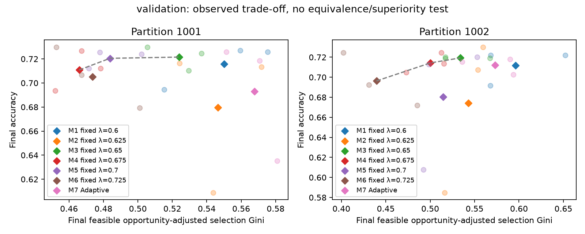
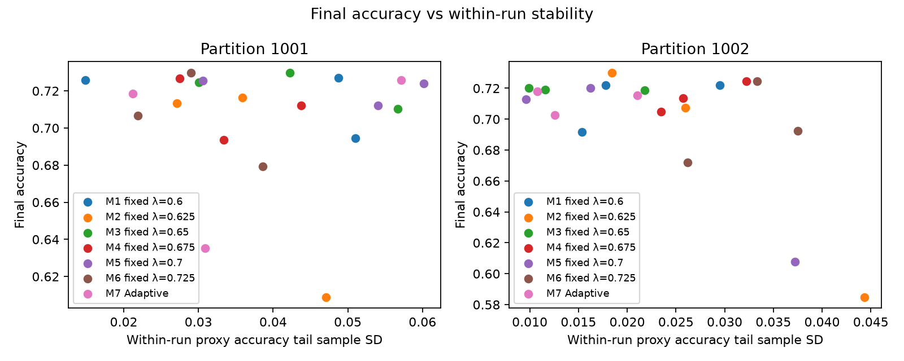
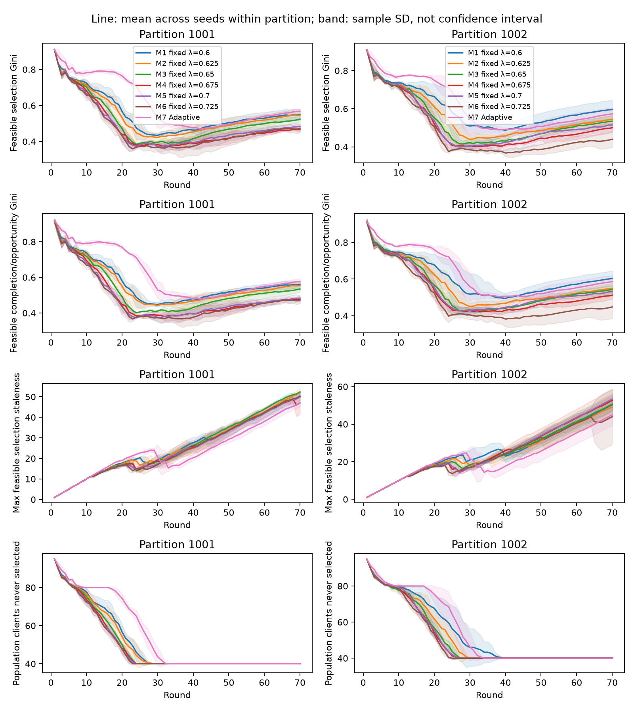
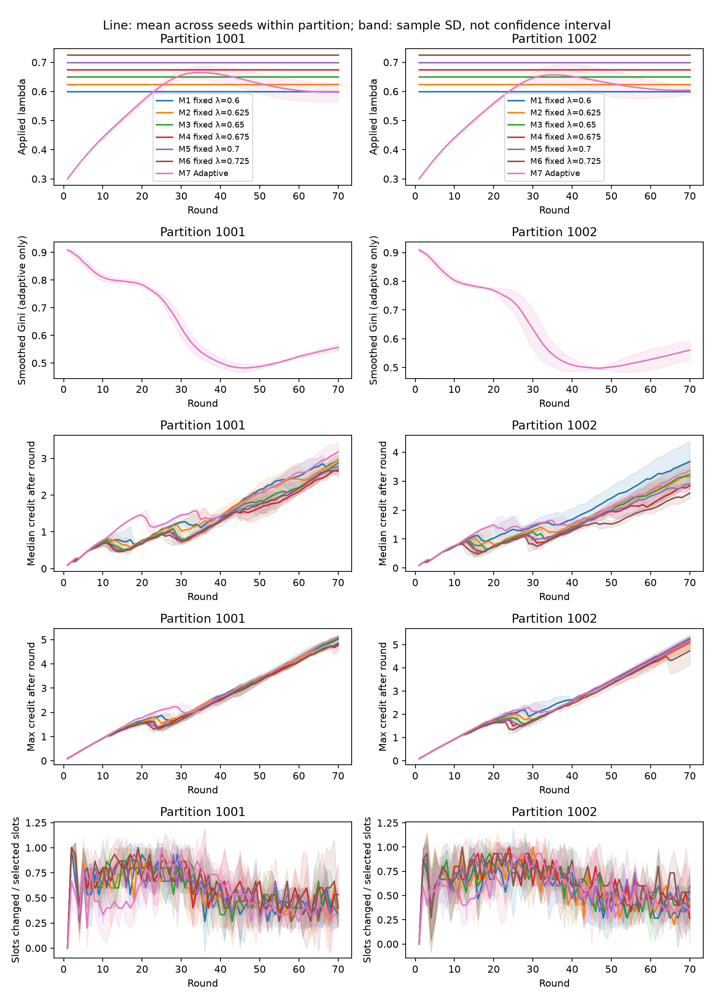

# Fairness-matched lambda experiments — validation

Complete: true; smoke: false.

Fairness status: **NO_MATCH**. Do not label this comparison fairness-matched. Inspect every coverage/Gini/staleness gap in JSON; held-out policy must not be retuned.

Ratios except maximum accuracy drop in percentage points and times in seconds. Tail SD is within-run; summary sample SD is between training/scenario seeds inside each partition. Partitions are not treated as extra independent training seeds.

Population selection/completion coverage: all 100 logical clients. RAM denominator: static feasible RAM population (normally 60). Feasible coverage/Gini/staleness: clients with >=1 valid estimated-feasible opportunity, whose count and membership are policy-specific and exported. Completion Ginis are explicitly separated into population, RAM-feasible and feasible completion/opportunity versions.

Phase A reports proxy validation outcomes. Phase B reports test ONLY at the final checkpoint; tail stability, drift/drop and time-to-target use the independently held-out proxy trajectory, as labelled in every record. Final accuracy always uses the final checkpoint, including low accuracy/drift runs.

## Per-partition mean ± sample SD across training/scenario seeds

| Partition:policy | Metric | Mean | Sample SD | n | Min / worst case | Max |
| --- | --- | ---: | ---: | ---: | ---: | ---: |
| 1001:M1 | accuracy | 0.715776 | 0.018435 | 3 | 0.694503 | 0.727066 |
| 1001:M1 | macroF1 | 0.441971 | 0.033407 | 3 | 0.403874 | 0.466264 |
| 1001:M1 | loss | 0.661138 | 0.034400 | 3 | 0.633737 | 0.699743 |
| 1001:M1 | worstClassRecall | 0.000000 | 0.000000 | 3 | 0.000000 | 0.000000 |
| 1001:M1 | recall0 | 0.673055 | 0.114021 | 3 | 0.545034 | 0.763690 |
| 1001:M1 | recall1 | 0.833557 | 0.069453 | 3 | 0.775291 | 0.910413 |
| 1001:M1 | recall2 | 0.564691 | 0.248738 | 3 | 0.292506 | 0.780201 |
| 1001:M1 | recall3 | 0.000000 | 0.000000 | 3 | 0.000000 | 0.000000 |
| 1001:M1 | recall4 | 0.060351 | 0.068456 | 3 | 0.000000 | 0.134737 |
| 1001:M1 | recall5 | 0.493472 | 0.187772 | 3 | 0.294931 | 0.668203 |
| 1001:M1 | recall6 | 0.381092 | 0.085019 | 3 | 0.290448 | 0.459064 |
| 1001:M1 | accuracyTailMean | 0.692813 | 0.015274 | 3 | 0.679866 | 0.709659 |
| 1001:M1 | accuracyTailSd | 0.038205 | 0.020260 | 3 | 0.014849 | 0.051040 |
| 1001:M1 | macroF1TailSd | 0.025006 | 0.005311 | 3 | 0.019565 | 0.030177 |
| 1001:M1 | maxAccuracyDropPp | 17.525501 | 3.504538 | 3 | 13.696603 | 20.574163 |
| 1001:M1 | populationSelectionCoverage | 0.600000 | 0.000000 | 3 | 0.600000 | 0.600000 |
| 1001:M1 | populationCompletionCoverage | 0.580000 | 0.010000 | 3 | 0.570000 | 0.590000 |
| 1001:M1 | feasibleSelectionCoverage | 1.000000 | 0.000000 | 3 | 1.000000 | 1.000000 |
| 1001:M1 | feasibleCompletionCoverage | 0.966667 | 0.016667 | 3 | 0.950000 | 0.983333 |
| 1001:M1 | feasibleOpportunityAdjustedGini | 0.550015 | 0.031105 | 3 | 0.515291 | 0.575327 |
| 1001:M1 | feasibleCompletionOpportunityAdjustedGini | 0.561324 | 0.020516 | 3 | 0.539538 | 0.580277 |
| 1001:M1 | selectionGini | 0.731390 | 0.019324 | 3 | 0.709829 | 0.747143 |
| 1001:M1 | completionGini | 0.738190 | 0.012889 | 3 | 0.724601 | 0.750240 |
| 1001:M1 | ramFeasibleCompletionGini | 0.563650 | 0.021481 | 3 | 0.541002 | 0.583734 |
| 1001:M1 | maxFeasibleSelectionStaleness | 50.000000 | 2.645751 | 3 | 47.000000 | 52.000000 |
| 1001:M1 | meanFeasibleSelectionStaleness | 16.772222 | 2.458112 | 3 | 14.166667 | 19.050000 |
| 1001:M1 | populationNeverSelected | 40.000000 | 0.000000 | 3 | 40.000000 | 40.000000 |
| 1001:M1 | feasibleNeverSelected | 0.000000 | 0.000000 | 3 | 0.000000 | 0.000000 |
| 1001:M1 | acceptedSelectedRatio | 0.942857 | 0.010302 | 3 | 0.931429 | 0.951429 |
| 1001:M1 | virtualSeconds | 134.830052 | 6.737968 | 3 | 130.820974 | 142.609164 |
| 1001:M1 | virtualSecondsWithSelector | 134.871390 | 6.737174 | 3 | 130.859957 | 142.649525 |
| 1001:M1 | wallSeconds | 69.022566 | 1.346016 | 3 | 67.469055 | 69.840674 |
| 1001:M1 | selectorSeconds | 0.037416 | 0.001668 | 3 | 0.035863 | 0.039180 |
| 1001:M1 | fairnessUpdateSeconds | 0.003921 | 0.001358 | 3 | 0.003120 | 0.005489 |
| 1001:M1 | slotsChangedVsTopsis | 192.333333 | 10.066446 | 3 | 183.000000 | 203.000000 |
| 1001:M1 | slotsChangedVsTopsisRatio | 0.549524 | 0.028761 | 3 | 0.522857 | 0.580000 |
| 1001:M1 | meanAppliedLambda | 0.600000 | 0.000000 | 3 | 0.600000 | 0.600000 |
| 1001:M2 | accuracy | 0.679575 | 0.061167 | 3 | 0.608964 | 0.716258 |
| 1001:M2 | macroF1 | 0.406073 | 0.005938 | 3 | 0.402095 | 0.412898 |
| 1001:M2 | loss | 0.722635 | 0.115113 | 3 | 0.656150 | 0.855557 |
| 1001:M2 | worstClassRecall | 0.000000 | 0.000000 | 3 | 0.000000 | 0.000000 |
| 1001:M2 | recall0 | 0.783327 | 0.139359 | 3 | 0.674282 | 0.940332 |
| 1001:M2 | recall1 | 0.692081 | 0.248148 | 3 | 0.406354 | 0.853583 |
| 1001:M2 | recall2 | 0.481357 | 0.118158 | 3 | 0.404922 | 0.617450 |
| 1001:M2 | recall3 | 0.000000 | 0.000000 | 3 | 0.000000 | 0.000000 |
| 1001:M2 | recall4 | 0.125614 | 0.217570 | 3 | 0.000000 | 0.376842 |
| 1001:M2 | recall5 | 0.594854 | 0.038164 | 3 | 0.558756 | 0.634793 |
| 1001:M2 | recall6 | 0.200130 | 0.022275 | 3 | 0.174464 | 0.214425 |
| 1001:M2 | accuracyTailMean | 0.695757 | 0.007980 | 3 | 0.690382 | 0.704926 |
| 1001:M2 | accuracyTailSd | 0.036674 | 0.010036 | 3 | 0.027077 | 0.047098 |
| 1001:M2 | macroF1TailSd | 0.026649 | 0.007070 | 3 | 0.018530 | 0.031451 |
| 1001:M2 | maxAccuracyDropPp | 16.236963 | 1.210562 | 3 | 14.894496 | 17.245534 |
| 1001:M2 | populationSelectionCoverage | 0.600000 | 0.000000 | 3 | 0.600000 | 0.600000 |
| 1001:M2 | populationCompletionCoverage | 0.583333 | 0.015275 | 3 | 0.570000 | 0.600000 |
| 1001:M2 | feasibleSelectionCoverage | 1.000000 | 0.000000 | 3 | 1.000000 | 1.000000 |
| 1001:M2 | feasibleCompletionCoverage | 0.972222 | 0.025459 | 3 | 0.950000 | 1.000000 |
| 1001:M2 | feasibleOpportunityAdjustedGini | 0.546586 | 0.023882 | 3 | 0.524254 | 0.571762 |
| 1001:M2 | feasibleCompletionOpportunityAdjustedGini | 0.554555 | 0.012966 | 3 | 0.542281 | 0.568117 |
| 1001:M2 | selectionGini | 0.728514 | 0.016065 | 3 | 0.712743 | 0.744857 |
| 1001:M2 | completionGini | 0.733144 | 0.009570 | 3 | 0.723394 | 0.742523 |
| 1001:M2 | ramFeasibleCompletionGini | 0.555240 | 0.015949 | 3 | 0.538991 | 0.570871 |
| 1001:M2 | maxFeasibleSelectionStaleness | 52.333333 | 1.527525 | 3 | 51.000000 | 54.000000 |
| 1001:M2 | meanFeasibleSelectionStaleness | 17.355556 | 0.371309 | 3 | 17.116667 | 17.783333 |
| 1001:M2 | populationNeverSelected | 40.000000 | 0.000000 | 3 | 40.000000 | 40.000000 |
| 1001:M2 | feasibleNeverSelected | 0.000000 | 0.000000 | 3 | 0.000000 | 0.000000 |
| 1001:M2 | acceptedSelectedRatio | 0.939048 | 0.004364 | 3 | 0.934286 | 0.942857 |
| 1001:M2 | virtualSeconds | 133.944172 | 3.033737 | 3 | 130.940977 | 137.007556 |
| 1001:M2 | virtualSecondsWithSelector | 133.986317 | 3.036483 | 3 | 130.980226 | 137.052306 |
| 1001:M2 | wallSeconds | 68.028771 | 1.085933 | 3 | 67.088154 | 69.217188 |
| 1001:M2 | selectorSeconds | 0.038692 | 0.002722 | 3 | 0.035762 | 0.041142 |
| 1001:M2 | fairnessUpdateSeconds | 0.003454 | 0.000173 | 3 | 0.003267 | 0.003607 |
| 1001:M2 | slotsChangedVsTopsis | 194.666667 | 9.073772 | 3 | 188.000000 | 205.000000 |
| 1001:M2 | slotsChangedVsTopsisRatio | 0.556190 | 0.025925 | 3 | 0.537143 | 0.585714 |
| 1001:M2 | meanAppliedLambda | 0.625000 | 0.000000 | 3 | 0.625000 | 0.625000 |
| 1001:M3 | accuracy | 0.721547 | 0.009935 | 3 | 0.710475 | 0.729682 |
| 1001:M3 | macroF1 | 0.451113 | 0.010829 | 3 | 0.440693 | 0.462310 |
| 1001:M3 | loss | 0.648527 | 0.006343 | 3 | 0.644824 | 0.655851 |
| 1001:M3 | worstClassRecall | 0.000000 | 0.000000 | 3 | 0.000000 | 0.000000 |
| 1001:M3 | recall0 | 0.662324 | 0.080369 | 3 | 0.569864 | 0.715446 |
| 1001:M3 | recall1 | 0.835110 | 0.047875 | 3 | 0.790116 | 0.885422 |
| 1001:M3 | recall2 | 0.681581 | 0.156492 | 3 | 0.536353 | 0.847315 |
| 1001:M3 | recall3 | 0.000000 | 0.000000 | 3 | 0.000000 | 0.000000 |
| 1001:M3 | recall4 | 0.012632 | 0.020083 | 3 | 0.000000 | 0.035789 |
| 1001:M3 | recall5 | 0.438940 | 0.155389 | 3 | 0.305300 | 0.609447 |
| 1001:M3 | recall6 | 0.498376 | 0.171147 | 3 | 0.305068 | 0.630604 |
| 1001:M3 | accuracyTailMean | 0.695359 | 0.013950 | 3 | 0.679539 | 0.705897 |
| 1001:M3 | accuracyTailSd | 0.042989 | 0.013345 | 3 | 0.030048 | 0.056705 |
| 1001:M3 | macroF1TailSd | 0.032941 | 0.010989 | 3 | 0.026071 | 0.045615 |
| 1001:M3 | maxAccuracyDropPp | 15.315594 | 1.282219 | 3 | 14.336856 | 16.767065 |
| 1001:M3 | populationSelectionCoverage | 0.600000 | 0.000000 | 3 | 0.600000 | 0.600000 |
| 1001:M3 | populationCompletionCoverage | 0.580000 | 0.010000 | 3 | 0.570000 | 0.590000 |
| 1001:M3 | feasibleSelectionCoverage | 1.000000 | 0.000000 | 3 | 1.000000 | 1.000000 |
| 1001:M3 | feasibleCompletionCoverage | 0.966667 | 0.016667 | 3 | 0.950000 | 0.983333 |
| 1001:M3 | feasibleOpportunityAdjustedGini | 0.524048 | 0.016464 | 3 | 0.505529 | 0.537027 |
| 1001:M3 | feasibleCompletionOpportunityAdjustedGini | 0.534717 | 0.017389 | 3 | 0.516224 | 0.550738 |
| 1001:M3 | selectionGini | 0.714686 | 0.012649 | 3 | 0.700286 | 0.724000 |
| 1001:M3 | completionGini | 0.721036 | 0.013205 | 3 | 0.706453 | 0.732182 |
| 1001:M3 | ramFeasibleCompletionGini | 0.535060 | 0.022008 | 3 | 0.510754 | 0.553636 |
| 1001:M3 | maxFeasibleSelectionStaleness | 52.333333 | 0.577350 | 3 | 52.000000 | 53.000000 |
| 1001:M3 | meanFeasibleSelectionStaleness | 16.961111 | 2.387254 | 3 | 14.283333 | 18.866667 |
| 1001:M3 | populationNeverSelected | 40.000000 | 0.000000 | 3 | 40.000000 | 40.000000 |
| 1001:M3 | feasibleNeverSelected | 0.000000 | 0.000000 | 3 | 0.000000 | 0.000000 |
| 1001:M3 | acceptedSelectedRatio | 0.942857 | 0.008571 | 3 | 0.934286 | 0.951429 |
| 1001:M3 | virtualSeconds | 137.791707 | 3.910015 | 3 | 134.176629 | 141.941601 |
| 1001:M3 | virtualSecondsWithSelector | 137.835713 | 3.913943 | 3 | 134.213220 | 141.987282 |
| 1001:M3 | wallSeconds | 67.371555 | 0.228661 | 3 | 67.158331 | 67.613029 |
| 1001:M3 | selectorSeconds | 0.040528 | 0.006366 | 3 | 0.033523 | 0.045961 |
| 1001:M3 | fairnessUpdateSeconds | 0.003478 | 0.000370 | 3 | 0.003068 | 0.003786 |
| 1001:M3 | slotsChangedVsTopsis | 204.666667 | 9.865766 | 3 | 198.000000 | 216.000000 |
| 1001:M3 | slotsChangedVsTopsisRatio | 0.584762 | 0.028188 | 3 | 0.565714 | 0.617143 |
| 1001:M3 | meanAppliedLambda | 0.650000 | 0.000000 | 3 | 0.650000 | 0.650000 |
| 1001:M4 | accuracy | 0.710830 | 0.016601 | 3 | 0.693573 | 0.726688 |
| 1001:M4 | macroF1 | 0.422263 | 0.052306 | 3 | 0.366410 | 0.470095 |
| 1001:M4 | loss | 0.667327 | 0.025129 | 3 | 0.643163 | 0.693322 |
| 1001:M4 | worstClassRecall | 0.000000 | 0.000000 | 3 | 0.000000 | 0.000000 |
| 1001:M4 | recall0 | 0.645707 | 0.083623 | 3 | 0.579588 | 0.739709 |
| 1001:M4 | recall1 | 0.853983 | 0.065735 | 3 | 0.780092 | 0.905965 |
| 1001:M4 | recall2 | 0.468494 | 0.154646 | 3 | 0.353468 | 0.644295 |
| 1001:M4 | recall3 | 0.000000 | 0.000000 | 3 | 0.000000 | 0.000000 |
| 1001:M4 | recall4 | 0.005614 | 0.009724 | 3 | 0.000000 | 0.016842 |
| 1001:M4 | recall5 | 0.543011 | 0.114237 | 3 | 0.447005 | 0.669355 |
| 1001:M4 | recall6 | 0.392463 | 0.227295 | 3 | 0.153021 | 0.605263 |
| 1001:M4 | accuracyTailMean | 0.695363 | 0.011890 | 3 | 0.685887 | 0.708705 |
| 1001:M4 | accuracyTailSd | 0.034852 | 0.008234 | 3 | 0.027456 | 0.043725 |
| 1001:M4 | macroF1TailSd | 0.037436 | 0.007724 | 3 | 0.031481 | 0.046163 |
| 1001:M4 | maxAccuracyDropPp | 20.022260 | 5.615682 | 3 | 16.656914 | 26.505112 |
| 1001:M4 | populationSelectionCoverage | 0.600000 | 0.000000 | 3 | 0.600000 | 0.600000 |
| 1001:M4 | populationCompletionCoverage | 0.590000 | 0.000000 | 3 | 0.590000 | 0.590000 |
| 1001:M4 | feasibleSelectionCoverage | 1.000000 | 0.000000 | 3 | 1.000000 | 1.000000 |
| 1001:M4 | feasibleCompletionCoverage | 0.983333 | 0.000000 | 3 | 0.983333 | 0.983333 |
| 1001:M4 | feasibleOpportunityAdjustedGini | 0.465896 | 0.013186 | 3 | 0.452048 | 0.478301 |
| 1001:M4 | feasibleCompletionOpportunityAdjustedGini | 0.474607 | 0.012298 | 3 | 0.461326 | 0.485601 |
| 1001:M4 | selectionGini | 0.680000 | 0.006059 | 3 | 0.673029 | 0.684000 |
| 1001:M4 | completionGini | 0.684990 | 0.005813 | 3 | 0.678282 | 0.688554 |
| 1001:M4 | ramFeasibleCompletionGini | 0.474983 | 0.009688 | 3 | 0.463804 | 0.480924 |
| 1001:M4 | maxFeasibleSelectionStaleness | 47.000000 | 5.567764 | 3 | 41.000000 | 52.000000 |
| 1001:M4 | meanFeasibleSelectionStaleness | 12.716667 | 3.640398 | 3 | 8.666667 | 15.716667 |
| 1001:M4 | populationNeverSelected | 40.000000 | 0.000000 | 3 | 40.000000 | 40.000000 |
| 1001:M4 | feasibleNeverSelected | 0.000000 | 0.000000 | 3 | 0.000000 | 0.000000 |
| 1001:M4 | acceptedSelectedRatio | 0.942857 | 0.009897 | 3 | 0.931429 | 0.948571 |
| 1001:M4 | virtualSeconds | 141.203139 | 3.330058 | 3 | 137.479418 | 143.895489 |
| 1001:M4 | virtualSecondsWithSelector | 141.241500 | 3.326022 | 3 | 137.522596 | 143.931456 |
| 1001:M4 | wallSeconds | 67.128504 | 0.154805 | 3 | 67.003812 | 67.301772 |
| 1001:M4 | selectorSeconds | 0.035079 | 0.004132 | 3 | 0.032566 | 0.039849 |
| 1001:M4 | fairnessUpdateSeconds | 0.003282 | 0.000121 | 3 | 0.003144 | 0.003372 |
| 1001:M4 | slotsChangedVsTopsis | 217.666667 | 2.081666 | 3 | 216.000000 | 220.000000 |
| 1001:M4 | slotsChangedVsTopsisRatio | 0.621905 | 0.005948 | 3 | 0.617143 | 0.628571 |
| 1001:M4 | meanAppliedLambda | 0.675000 | 0.000000 | 3 | 0.675000 | 0.675000 |
| 1001:M5 | accuracy | 0.720503 | 0.007381 | 3 | 0.712024 | 0.725483 |
| 1001:M5 | macroF1 | 0.439129 | 0.032198 | 3 | 0.411185 | 0.474339 |
| 1001:M5 | loss | 0.653986 | 0.014988 | 3 | 0.639724 | 0.669608 |
| 1001:M5 | worstClassRecall | 0.000000 | 0.000000 | 3 | 0.000000 | 0.000000 |
| 1001:M5 | recall0 | 0.672426 | 0.081864 | 3 | 0.612821 | 0.765767 |
| 1001:M5 | recall1 | 0.835769 | 0.061691 | 3 | 0.764984 | 0.878080 |
| 1001:M5 | recall2 | 0.678598 | 0.260992 | 3 | 0.387025 | 0.890380 |
| 1001:M5 | recall3 | 0.000000 | 0.000000 | 3 | 0.000000 | 0.000000 |
| 1001:M5 | recall4 | 0.049825 | 0.086299 | 3 | 0.000000 | 0.149474 |
| 1001:M5 | recall5 | 0.391321 | 0.287618 | 3 | 0.120968 | 0.693548 |
| 1001:M5 | recall6 | 0.383691 | 0.064889 | 3 | 0.320663 | 0.450292 |
| 1001:M5 | accuracyTailMean | 0.683846 | 0.011205 | 3 | 0.672015 | 0.694296 |
| 1001:M5 | accuracyTailSd | 0.048278 | 0.015623 | 3 | 0.030588 | 0.060182 |
| 1001:M5 | macroF1TailSd | 0.040738 | 0.010967 | 3 | 0.032309 | 0.053137 |
| 1001:M5 | maxAccuracyDropPp | 16.755591 | 0.163110 | 3 | 16.567416 | 16.856563 |
| 1001:M5 | populationSelectionCoverage | 0.600000 | 0.000000 | 3 | 0.600000 | 0.600000 |
| 1001:M5 | populationCompletionCoverage | 0.600000 | 0.000000 | 3 | 0.600000 | 0.600000 |
| 1001:M5 | feasibleSelectionCoverage | 1.000000 | 0.000000 | 3 | 1.000000 | 1.000000 |
| 1001:M5 | feasibleCompletionCoverage | 1.000000 | 0.000000 | 3 | 1.000000 | 1.000000 |
| 1001:M5 | feasibleOpportunityAdjustedGini | 0.483767 | 0.016155 | 3 | 0.471451 | 0.502058 |
| 1001:M5 | feasibleCompletionOpportunityAdjustedGini | 0.483603 | 0.016657 | 3 | 0.467514 | 0.500774 |
| 1001:M5 | selectionGini | 0.691010 | 0.011341 | 3 | 0.681086 | 0.703371 |
| 1001:M5 | completionGini | 0.690926 | 0.011905 | 3 | 0.678862 | 0.702667 |
| 1001:M5 | ramFeasibleCompletionGini | 0.484877 | 0.019842 | 3 | 0.464770 | 0.504444 |
| 1001:M5 | maxFeasibleSelectionStaleness | 50.000000 | 1.732051 | 3 | 49.000000 | 52.000000 |
| 1001:M5 | meanFeasibleSelectionStaleness | 13.577778 | 0.753940 | 3 | 12.733333 | 14.183333 |
| 1001:M5 | populationNeverSelected | 40.000000 | 0.000000 | 3 | 40.000000 | 40.000000 |
| 1001:M5 | feasibleNeverSelected | 0.000000 | 0.000000 | 3 | 0.000000 | 0.000000 |
| 1001:M5 | acceptedSelectedRatio | 0.952381 | 0.008729 | 3 | 0.942857 | 0.960000 |
| 1001:M5 | virtualSeconds | 139.970245 | 2.830817 | 3 | 137.508081 | 143.063272 |
| 1001:M5 | virtualSecondsWithSelector | 140.010142 | 2.835375 | 3 | 137.546153 | 143.109198 |
| 1001:M5 | wallSeconds | 67.419339 | 0.580037 | 3 | 66.820252 | 67.978236 |
| 1001:M5 | selectorSeconds | 0.036546 | 0.005279 | 3 | 0.032484 | 0.042513 |
| 1001:M5 | fairnessUpdateSeconds | 0.003351 | 0.000123 | 3 | 0.003209 | 0.003429 |
| 1001:M5 | slotsChangedVsTopsis | 209.000000 | 7.549834 | 3 | 202.000000 | 217.000000 |
| 1001:M5 | slotsChangedVsTopsisRatio | 0.597143 | 0.021571 | 3 | 0.577143 | 0.620000 |
| 1001:M5 | meanAppliedLambda | 0.700000 | 0.000000 | 3 | 0.700000 | 0.700000 |
| 1001:M6 | accuracy | 0.705185 | 0.025298 | 3 | 0.679185 | 0.729717 |
| 1001:M6 | macroF1 | 0.430233 | 0.010739 | 3 | 0.418491 | 0.439556 |
| 1001:M6 | loss | 0.669970 | 0.033838 | 3 | 0.635628 | 0.703281 |
| 1001:M6 | worstClassRecall | 0.000000 | 0.000000 | 3 | 0.000000 | 0.000000 |
| 1001:M6 | recall0 | 0.528732 | 0.125800 | 3 | 0.419656 | 0.666352 |
| 1001:M6 | recall1 | 0.893729 | 0.042956 | 3 | 0.844335 | 0.922344 |
| 1001:M6 | recall2 | 0.763050 | 0.193147 | 3 | 0.545861 | 0.915548 |
| 1001:M6 | recall3 | 0.000000 | 0.000000 | 3 | 0.000000 | 0.000000 |
| 1001:M6 | recall4 | 0.000000 | 0.000000 | 3 | 0.000000 | 0.000000 |
| 1001:M6 | recall5 | 0.275346 | 0.259196 | 3 | 0.055300 | 0.561060 |
| 1001:M6 | recall6 | 0.607212 | 0.127859 | 3 | 0.483431 | 0.738791 |
| 1001:M6 | accuracyTailMean | 0.700545 | 0.006933 | 3 | 0.693914 | 0.707745 |
| 1001:M6 | accuracyTailSd | 0.029831 | 0.008397 | 3 | 0.021889 | 0.038619 |
| 1001:M6 | macroF1TailSd | 0.030853 | 0.005886 | 3 | 0.024704 | 0.036436 |
| 1001:M6 | maxAccuracyDropPp | 16.236963 | 1.803133 | 3 | 15.101029 | 18.316065 |
| 1001:M6 | populationSelectionCoverage | 0.600000 | 0.000000 | 3 | 0.600000 | 0.600000 |
| 1001:M6 | populationCompletionCoverage | 0.600000 | 0.000000 | 3 | 0.600000 | 0.600000 |
| 1001:M6 | feasibleSelectionCoverage | 1.000000 | 0.000000 | 3 | 1.000000 | 1.000000 |
| 1001:M6 | feasibleCompletionCoverage | 1.000000 | 0.000000 | 3 | 1.000000 | 1.000000 |
| 1001:M6 | feasibleOpportunityAdjustedGini | 0.473672 | 0.024899 | 3 | 0.452524 | 0.501114 |
| 1001:M6 | feasibleCompletionOpportunityAdjustedGini | 0.473757 | 0.021115 | 3 | 0.460658 | 0.498116 |
| 1001:M6 | selectionGini | 0.684686 | 0.012861 | 3 | 0.674343 | 0.699086 |
| 1001:M6 | completionGini | 0.684815 | 0.010942 | 3 | 0.677605 | 0.697405 |
| 1001:M6 | ramFeasibleCompletionGini | 0.474692 | 0.018236 | 3 | 0.462675 | 0.495675 |
| 1001:M6 | maxFeasibleSelectionStaleness | 50.333333 | 0.577350 | 3 | 50.000000 | 51.000000 |
| 1001:M6 | meanFeasibleSelectionStaleness | 13.511111 | 3.328343 | 3 | 10.100000 | 16.750000 |
| 1001:M6 | populationNeverSelected | 40.000000 | 0.000000 | 3 | 40.000000 | 40.000000 |
| 1001:M6 | feasibleNeverSelected | 0.000000 | 0.000000 | 3 | 0.000000 | 0.000000 |
| 1001:M6 | acceptedSelectedRatio | 0.965714 | 0.013093 | 3 | 0.954286 | 0.980000 |
| 1001:M6 | virtualSeconds | 135.938197 | 2.673519 | 3 | 132.873022 | 137.788947 |
| 1001:M6 | virtualSecondsWithSelector | 135.976095 | 2.671755 | 3 | 132.913082 | 137.826566 |
| 1001:M6 | wallSeconds | 67.164785 | 0.335307 | 3 | 66.864196 | 67.526422 |
| 1001:M6 | selectorSeconds | 0.034615 | 0.001923 | 3 | 0.032955 | 0.036722 |
| 1001:M6 | fairnessUpdateSeconds | 0.003283 | 0.000201 | 3 | 0.003060 | 0.003450 |
| 1001:M6 | slotsChangedVsTopsis | 218.666667 | 7.094599 | 3 | 211.000000 | 225.000000 |
| 1001:M6 | slotsChangedVsTopsisRatio | 0.624762 | 0.020270 | 3 | 0.602857 | 0.642857 |
| 1001:M6 | meanAppliedLambda | 0.725000 | 0.000000 | 3 | 0.725000 | 0.725000 |
| 1001:M7 | accuracy | 0.693149 | 0.050346 | 3 | 0.635159 | 0.725689 |
| 1001:M7 | macroF1 | 0.413729 | 0.070075 | 3 | 0.341712 | 0.481686 |
| 1001:M7 | loss | 0.705464 | 0.087294 | 3 | 0.647161 | 0.805825 |
| 1001:M7 | worstClassRecall | 0.000000 | 0.000000 | 3 | 0.000000 | 0.000000 |
| 1001:M7 | recall0 | 0.807874 | 0.125791 | 3 | 0.678909 | 0.930230 |
| 1001:M7 | recall1 | 0.684433 | 0.163242 | 3 | 0.507519 | 0.829227 |
| 1001:M7 | recall2 | 0.691275 | 0.225793 | 3 | 0.482103 | 0.930649 |
| 1001:M7 | recall3 | 0.000000 | 0.000000 | 3 | 0.000000 | 0.000000 |
| 1001:M7 | recall4 | 0.087018 | 0.075477 | 3 | 0.000000 | 0.134737 |
| 1001:M7 | recall5 | 0.383257 | 0.332537 | 3 | 0.001152 | 0.607143 |
| 1001:M7 | recall6 | 0.267706 | 0.215786 | 3 | 0.020468 | 0.418129 |
| 1001:M7 | accuracyTailMean | 0.696791 | 0.013099 | 3 | 0.683908 | 0.710096 |
| 1001:M7 | accuracyTailSd | 0.036408 | 0.018569 | 3 | 0.021221 | 0.057109 |
| 1001:M7 | macroF1TailSd | 0.035017 | 0.019433 | 3 | 0.015798 | 0.054657 |
| 1001:M7 | maxAccuracyDropPp | 20.102578 | 4.517175 | 3 | 16.574300 | 25.193625 |
| 1001:M7 | populationSelectionCoverage | 0.600000 | 0.000000 | 3 | 0.600000 | 0.600000 |
| 1001:M7 | populationCompletionCoverage | 0.583333 | 0.005774 | 3 | 0.580000 | 0.590000 |
| 1001:M7 | feasibleSelectionCoverage | 1.000000 | 0.000000 | 3 | 1.000000 | 1.000000 |
| 1001:M7 | feasibleCompletionCoverage | 0.972222 | 0.009623 | 3 | 0.966667 | 0.983333 |
| 1001:M7 | feasibleOpportunityAdjustedGini | 0.567630 | 0.014976 | 3 | 0.551352 | 0.580823 |
| 1001:M7 | feasibleCompletionOpportunityAdjustedGini | 0.575442 | 0.018096 | 3 | 0.555546 | 0.590920 |
| 1001:M7 | selectionGini | 0.741219 | 0.008888 | 3 | 0.731143 | 0.747943 |
| 1001:M7 | completionGini | 0.745847 | 0.010833 | 3 | 0.733576 | 0.754085 |
| 1001:M7 | ramFeasibleCompletionGini | 0.576412 | 0.018055 | 3 | 0.555960 | 0.590142 |
| 1001:M7 | maxFeasibleSelectionStaleness | 47.000000 | 1.732051 | 3 | 46.000000 | 49.000000 |
| 1001:M7 | meanFeasibleSelectionStaleness | 18.138889 | 2.321777 | 3 | 15.733333 | 20.366667 |
| 1001:M7 | populationNeverSelected | 40.000000 | 0.000000 | 3 | 40.000000 | 40.000000 |
| 1001:M7 | feasibleNeverSelected | 0.000000 | 0.000000 | 3 | 0.000000 | 0.000000 |
| 1001:M7 | acceptedSelectedRatio | 0.943810 | 0.007190 | 3 | 0.937143 | 0.951429 |
| 1001:M7 | virtualSeconds | 125.411064 | 5.350647 | 3 | 121.839819 | 131.562930 |
| 1001:M7 | virtualSecondsWithSelector | 125.463730 | 5.340095 | 3 | 121.883690 | 131.601635 |
| 1001:M7 | wallSeconds | 66.756951 | 0.308586 | 3 | 66.503552 | 67.100600 |
| 1001:M7 | selectorSeconds | 0.047950 | 0.019904 | 3 | 0.034025 | 0.070748 |
| 1001:M7 | fairnessUpdateSeconds | 0.004716 | 0.000067 | 3 | 0.004676 | 0.004794 |
| 1001:M7 | slotsChangedVsTopsis | 185.000000 | 4.000000 | 3 | 181.000000 | 189.000000 |
| 1001:M7 | slotsChangedVsTopsisRatio | 0.528571 | 0.011429 | 3 | 0.517143 | 0.540000 |
| 1001:M7 | meanAppliedLambda | 0.574612 | 0.019803 | 3 | 0.552675 | 0.591168 |
| 1002:M1 | accuracy | 0.711920 | 0.017499 | 3 | 0.691715 | 0.722144 |
| 1002:M1 | macroF1 | 0.406406 | 0.027168 | 3 | 0.382571 | 0.435987 |
| 1002:M1 | loss | 0.662339 | 0.033332 | 3 | 0.641245 | 0.700767 |
| 1002:M1 | worstClassRecall | 0.000000 | 0.000000 | 3 | 0.000000 | 0.000000 |
| 1002:M1 | recall0 | 0.779047 | 0.102297 | 3 | 0.677209 | 0.881798 |
| 1002:M1 | recall1 | 0.740958 | 0.116608 | 3 | 0.615178 | 0.845464 |
| 1002:M1 | recall2 | 0.812081 | 0.188199 | 3 | 0.595078 | 0.930649 |
| 1002:M1 | recall3 | 0.000000 | 0.000000 | 3 | 0.000000 | 0.000000 |
| 1002:M1 | recall4 | 0.001404 | 0.002431 | 3 | 0.000000 | 0.004211 |
| 1002:M1 | recall5 | 0.208141 | 0.218743 | 3 | 0.054147 | 0.458525 |
| 1002:M1 | recall6 | 0.293697 | 0.071949 | 3 | 0.216374 | 0.358674 |
| 1002:M1 | accuracyTailMean | 0.711255 | 0.012356 | 3 | 0.697174 | 0.720288 |
| 1002:M1 | accuracyTailSd | 0.020902 | 0.007572 | 3 | 0.015373 | 0.029532 |
| 1002:M1 | macroF1TailSd | 0.025185 | 0.011794 | 3 | 0.017544 | 0.038768 |
| 1002:M1 | maxAccuracyDropPp | 17.741214 | 2.712757 | 3 | 14.660425 | 19.772125 |
| 1002:M1 | populationSelectionCoverage | 0.600000 | 0.000000 | 3 | 0.600000 | 0.600000 |
| 1002:M1 | populationCompletionCoverage | 0.586667 | 0.011547 | 3 | 0.580000 | 0.600000 |
| 1002:M1 | feasibleSelectionCoverage | 1.000000 | 0.000000 | 3 | 1.000000 | 1.000000 |
| 1002:M1 | feasibleCompletionCoverage | 0.977778 | 0.019245 | 3 | 0.966667 | 1.000000 |
| 1002:M1 | feasibleOpportunityAdjustedGini | 0.595907 | 0.048538 | 3 | 0.567614 | 0.651953 |
| 1002:M1 | feasibleCompletionOpportunityAdjustedGini | 0.602614 | 0.040653 | 3 | 0.575426 | 0.649349 |
| 1002:M1 | selectionGini | 0.758362 | 0.029978 | 3 | 0.740514 | 0.792971 |
| 1002:M1 | completionGini | 0.762262 | 0.025210 | 3 | 0.745856 | 0.791290 |
| 1002:M1 | ramFeasibleCompletionGini | 0.603770 | 0.042017 | 3 | 0.576426 | 0.652151 |
| 1002:M1 | maxFeasibleSelectionStaleness | 50.333333 | 3.214550 | 3 | 48.000000 | 54.000000 |
| 1002:M1 | meanFeasibleSelectionStaleness | 20.494444 | 2.493900 | 3 | 18.433333 | 23.266667 |
| 1002:M1 | populationNeverSelected | 40.000000 | 0.000000 | 3 | 40.000000 | 40.000000 |
| 1002:M1 | feasibleNeverSelected | 0.000000 | 0.000000 | 3 | 0.000000 | 0.000000 |
| 1002:M1 | acceptedSelectedRatio | 0.960000 | 0.012454 | 3 | 0.951429 | 0.974286 |
| 1002:M1 | virtualSeconds | 123.395819 | 9.683507 | 3 | 112.230940 | 129.506856 |
| 1002:M1 | virtualSecondsWithSelector | 123.441846 | 9.679202 | 3 | 112.281896 | 129.549645 |
| 1002:M1 | wallSeconds | 68.548100 | 0.665548 | 3 | 67.996764 | 69.287423 |
| 1002:M1 | selectorSeconds | 0.042560 | 0.004239 | 3 | 0.039376 | 0.047372 |
| 1002:M1 | fairnessUpdateSeconds | 0.003468 | 0.000102 | 3 | 0.003404 | 0.003585 |
| 1002:M1 | slotsChangedVsTopsis | 191.333333 | 9.073772 | 3 | 181.000000 | 198.000000 |
| 1002:M1 | slotsChangedVsTopsisRatio | 0.546667 | 0.025925 | 3 | 0.517143 | 0.565714 |
| 1002:M1 | meanAppliedLambda | 0.600000 | 0.000000 | 3 | 0.600000 | 0.600000 |
| 1002:M2 | accuracy | 0.674125 | 0.078052 | 3 | 0.584937 | 0.729958 |
| 1002:M2 | macroF1 | 0.395451 | 0.074191 | 3 | 0.309790 | 0.439199 |
| 1002:M2 | loss | 0.746371 | 0.165404 | 3 | 0.631710 | 0.935982 |
| 1002:M2 | worstClassRecall | 0.000000 | 0.000000 | 3 | 0.000000 | 0.000000 |
| 1002:M2 | recall0 | 0.487695 | 0.365450 | 3 | 0.065710 | 0.699113 |
| 1002:M2 | recall1 | 0.880409 | 0.081747 | 3 | 0.832333 | 0.974797 |
| 1002:M2 | recall2 | 0.612975 | 0.383482 | 3 | 0.177293 | 0.899329 |
| 1002:M2 | recall3 | 0.133820 | 0.231783 | 3 | 0.000000 | 0.401460 |
| 1002:M2 | recall4 | 0.000000 | 0.000000 | 3 | 0.000000 | 0.000000 |
| 1002:M2 | recall5 | 0.326037 | 0.361184 | 3 | 0.000000 | 0.714286 |
| 1002:M2 | recall6 | 0.536062 | 0.279544 | 3 | 0.365497 | 0.858674 |
| 1002:M2 | accuracyTailMean | 0.704555 | 0.007088 | 3 | 0.700176 | 0.712733 |
| 1002:M2 | accuracyTailSd | 0.029579 | 0.013347 | 3 | 0.018420 | 0.044365 |
| 1002:M2 | macroF1TailSd | 0.032942 | 0.013006 | 3 | 0.019319 | 0.045228 |
| 1002:M2 | maxAccuracyDropPp | 17.870871 | 2.625922 | 3 | 15.607036 | 20.749716 |
| 1002:M2 | populationSelectionCoverage | 0.600000 | 0.000000 | 3 | 0.600000 | 0.600000 |
| 1002:M2 | populationCompletionCoverage | 0.586667 | 0.005774 | 3 | 0.580000 | 0.590000 |
| 1002:M2 | feasibleSelectionCoverage | 1.000000 | 0.000000 | 3 | 1.000000 | 1.000000 |
| 1002:M2 | feasibleCompletionCoverage | 0.977778 | 0.009623 | 3 | 0.966667 | 0.983333 |
| 1002:M2 | feasibleOpportunityAdjustedGini | 0.543182 | 0.023543 | 3 | 0.516196 | 0.559518 |
| 1002:M2 | feasibleCompletionOpportunityAdjustedGini | 0.549785 | 0.027964 | 3 | 0.517506 | 0.566633 |
| 1002:M2 | selectionGini | 0.727429 | 0.015913 | 3 | 0.709486 | 0.739829 |
| 1002:M2 | completionGini | 0.731280 | 0.018519 | 3 | 0.710060 | 0.744174 |
| 1002:M2 | ramFeasibleCompletionGini | 0.552134 | 0.030865 | 3 | 0.516766 | 0.573624 |
| 1002:M2 | maxFeasibleSelectionStaleness | 49.000000 | 5.567764 | 3 | 44.000000 | 55.000000 |
| 1002:M2 | meanFeasibleSelectionStaleness | 17.150000 | 3.083333 | 3 | 13.816667 | 19.900000 |
| 1002:M2 | populationNeverSelected | 40.000000 | 0.000000 | 3 | 40.000000 | 40.000000 |
| 1002:M2 | feasibleNeverSelected | 0.000000 | 0.000000 | 3 | 0.000000 | 0.000000 |
| 1002:M2 | acceptedSelectedRatio | 0.950476 | 0.004364 | 3 | 0.945714 | 0.954286 |
| 1002:M2 | virtualSeconds | 132.093566 | 3.736978 | 3 | 127.864570 | 134.950828 |
| 1002:M2 | virtualSecondsWithSelector | 132.138483 | 3.724841 | 3 | 127.923855 | 134.988850 |
| 1002:M2 | wallSeconds | 67.675263 | 0.409477 | 3 | 67.217971 | 68.007997 |
| 1002:M2 | selectorSeconds | 0.041220 | 0.012374 | 3 | 0.033395 | 0.055487 |
| 1002:M2 | fairnessUpdateSeconds | 0.003697 | 0.000413 | 3 | 0.003242 | 0.004049 |
| 1002:M2 | slotsChangedVsTopsis | 204.333333 | 6.110101 | 3 | 199.000000 | 211.000000 |
| 1002:M2 | slotsChangedVsTopsisRatio | 0.583810 | 0.017457 | 3 | 0.568571 | 0.602857 |
| 1002:M2 | meanAppliedLambda | 0.625000 | 0.000000 | 3 | 0.625000 | 0.625000 |
| 1002:M3 | accuracy | 0.719310 | 0.000693 | 3 | 0.718667 | 0.720044 |
| 1002:M3 | macroF1 | 0.421656 | 0.042640 | 3 | 0.386269 | 0.468997 |
| 1002:M3 | loss | 0.655141 | 0.008496 | 3 | 0.646245 | 0.663171 |
| 1002:M3 | worstClassRecall | 0.000000 | 0.000000 | 3 | 0.000000 | 0.000000 |
| 1002:M3 | recall0 | 0.703896 | 0.094030 | 3 | 0.599603 | 0.782194 |
| 1002:M3 | recall1 | 0.822473 | 0.063927 | 3 | 0.763007 | 0.890081 |
| 1002:M3 | recall2 | 0.658091 | 0.291834 | 3 | 0.327740 | 0.880872 |
| 1002:M3 | recall3 | 0.111922 | 0.193855 | 3 | 0.000000 | 0.335766 |
| 1002:M3 | recall4 | 0.000000 | 0.000000 | 3 | 0.000000 | 0.000000 |
| 1002:M3 | recall5 | 0.274194 | 0.248867 | 3 | 0.008065 | 0.501152 |
| 1002:M3 | recall6 | 0.351527 | 0.176045 | 3 | 0.179337 | 0.531189 |
| 1002:M3 | accuracyTailMean | 0.716721 | 0.004021 | 3 | 0.714165 | 0.721356 |
| 1002:M3 | accuracyTailSd | 0.014444 | 0.006444 | 3 | 0.009900 | 0.021819 |
| 1002:M3 | macroF1TailSd | 0.027188 | 0.006490 | 3 | 0.020729 | 0.033708 |
| 1002:M3 | maxAccuracyDropPp | 15.010384 | 2.130033 | 3 | 13.077003 | 17.293725 |
| 1002:M3 | populationSelectionCoverage | 0.600000 | 0.000000 | 3 | 0.600000 | 0.600000 |
| 1002:M3 | populationCompletionCoverage | 0.586667 | 0.015275 | 3 | 0.570000 | 0.600000 |
| 1002:M3 | feasibleSelectionCoverage | 1.000000 | 0.000000 | 3 | 1.000000 | 1.000000 |
| 1002:M3 | feasibleCompletionCoverage | 0.977778 | 0.025459 | 3 | 0.950000 | 1.000000 |
| 1002:M3 | feasibleOpportunityAdjustedGini | 0.533877 | 0.029056 | 3 | 0.517053 | 0.567428 |
| 1002:M3 | feasibleCompletionOpportunityAdjustedGini | 0.541465 | 0.023812 | 3 | 0.524847 | 0.568745 |
| 1002:M3 | selectionGini | 0.721048 | 0.016192 | 3 | 0.709429 | 0.739543 |
| 1002:M3 | completionGini | 0.725442 | 0.012748 | 3 | 0.717530 | 0.740148 |
| 1002:M3 | ramFeasibleCompletionGini | 0.542404 | 0.021247 | 3 | 0.529217 | 0.566914 |
| 1002:M3 | maxFeasibleSelectionStaleness | 50.666667 | 5.507571 | 3 | 45.000000 | 56.000000 |
| 1002:M3 | meanFeasibleSelectionStaleness | 17.644444 | 3.975841 | 3 | 15.000000 | 22.216667 |
| 1002:M3 | populationNeverSelected | 40.000000 | 0.000000 | 3 | 40.000000 | 40.000000 |
| 1002:M3 | feasibleNeverSelected | 0.000000 | 0.000000 | 3 | 0.000000 | 0.000000 |
| 1002:M3 | acceptedSelectedRatio | 0.954286 | 0.007559 | 3 | 0.948571 | 0.962857 |
| 1002:M3 | virtualSeconds | 130.744622 | 5.594680 | 3 | 124.291950 | 134.240611 |
| 1002:M3 | virtualSecondsWithSelector | 130.784466 | 5.596832 | 3 | 124.329558 | 134.286059 |
| 1002:M3 | wallSeconds | 67.426118 | 0.235674 | 3 | 67.234271 | 67.689189 |
| 1002:M3 | selectorSeconds | 0.036604 | 0.004985 | 3 | 0.033232 | 0.042330 |
| 1002:M3 | fairnessUpdateSeconds | 0.003240 | 0.000121 | 3 | 0.003118 | 0.003360 |
| 1002:M3 | slotsChangedVsTopsis | 213.666667 | 4.618802 | 3 | 211.000000 | 219.000000 |
| 1002:M3 | slotsChangedVsTopsisRatio | 0.610476 | 0.013197 | 3 | 0.602857 | 0.625714 |
| 1002:M3 | meanAppliedLambda | 0.650000 | 0.000000 | 3 | 0.650000 | 0.650000 |
| 1002:M4 | accuracy | 0.714307 | 0.009808 | 3 | 0.704829 | 0.724416 |
| 1002:M4 | macroF1 | 0.443102 | 0.036224 | 3 | 0.401286 | 0.464874 |
| 1002:M4 | loss | 0.659635 | 0.017328 | 3 | 0.639671 | 0.670771 |
| 1002:M4 | worstClassRecall | 0.000000 | 0.000000 | 3 | 0.000000 | 0.000000 |
| 1002:M4 | recall0 | 0.779016 | 0.057883 | 3 | 0.716484 | 0.830721 |
| 1002:M4 | recall1 | 0.751100 | 0.051892 | 3 | 0.706954 | 0.808260 |
| 1002:M4 | recall2 | 0.503542 | 0.091306 | 3 | 0.401007 | 0.576063 |
| 1002:M4 | recall3 | 0.009732 | 0.016857 | 3 | 0.000000 | 0.029197 |
| 1002:M4 | recall4 | 0.028070 | 0.048619 | 3 | 0.000000 | 0.084211 |
| 1002:M4 | recall5 | 0.589862 | 0.066101 | 3 | 0.546083 | 0.665899 |
| 1002:M4 | recall6 | 0.422677 | 0.231914 | 3 | 0.154971 | 0.562378 |
| 1002:M4 | accuracyTailMean | 0.705423 | 0.001203 | 3 | 0.704065 | 0.706358 |
| 1002:M4 | accuracyTailSd | 0.027132 | 0.004533 | 3 | 0.023470 | 0.032203 |
| 1002:M4 | macroF1TailSd | 0.039748 | 0.006622 | 3 | 0.033623 | 0.046775 |
| 1002:M4 | maxAccuracyDropPp | 19.525432 | 1.534877 | 3 | 17.754983 | 20.481223 |
| 1002:M4 | populationSelectionCoverage | 0.600000 | 0.000000 | 3 | 0.600000 | 0.600000 |
| 1002:M4 | populationCompletionCoverage | 0.580000 | 0.010000 | 3 | 0.570000 | 0.590000 |
| 1002:M4 | feasibleSelectionCoverage | 1.000000 | 0.000000 | 3 | 1.000000 | 1.000000 |
| 1002:M4 | feasibleCompletionCoverage | 0.966667 | 0.016667 | 3 | 0.950000 | 0.983333 |
| 1002:M4 | feasibleOpportunityAdjustedGini | 0.500250 | 0.023669 | 3 | 0.472975 | 0.515403 |
| 1002:M4 | feasibleCompletionOpportunityAdjustedGini | 0.511956 | 0.019778 | 3 | 0.490063 | 0.528531 |
| 1002:M4 | selectionGini | 0.701562 | 0.014335 | 3 | 0.685029 | 0.710514 |
| 1002:M4 | completionGini | 0.708534 | 0.012839 | 3 | 0.695000 | 0.720542 |
| 1002:M4 | ramFeasibleCompletionGini | 0.514223 | 0.021399 | 3 | 0.491667 | 0.534237 |
| 1002:M4 | maxFeasibleSelectionStaleness | 52.666667 | 5.859465 | 3 | 46.000000 | 57.000000 |
| 1002:M4 | meanFeasibleSelectionStaleness | 15.888889 | 2.182782 | 3 | 13.416667 | 17.550000 |
| 1002:M4 | populationNeverSelected | 40.000000 | 0.000000 | 3 | 40.000000 | 40.000000 |
| 1002:M4 | feasibleNeverSelected | 0.000000 | 0.000000 | 3 | 0.000000 | 0.000000 |
| 1002:M4 | acceptedSelectedRatio | 0.951429 | 0.004949 | 3 | 0.948571 | 0.957143 |
| 1002:M4 | virtualSeconds | 135.931088 | 5.280070 | 3 | 129.918551 | 139.812681 |
| 1002:M4 | virtualSecondsWithSelector | 135.982587 | 5.284480 | 3 | 129.961759 | 139.852040 |
| 1002:M4 | wallSeconds | 68.349627 | 1.617412 | 3 | 67.346746 | 70.215506 |
| 1002:M4 | selectorSeconds | 0.046694 | 0.015171 | 3 | 0.036244 | 0.064095 |
| 1002:M4 | fairnessUpdateSeconds | 0.004805 | 0.002630 | 3 | 0.003115 | 0.007835 |
| 1002:M4 | slotsChangedVsTopsis | 223.333333 | 4.041452 | 3 | 219.000000 | 227.000000 |
| 1002:M4 | slotsChangedVsTopsisRatio | 0.638095 | 0.011547 | 3 | 0.625714 | 0.648571 |
| 1002:M4 | meanAppliedLambda | 0.675000 | 0.000000 | 3 | 0.675000 | 0.675000 |
| 1002:M5 | accuracy | 0.680286 | 0.062827 | 3 | 0.607862 | 0.720147 |
| 1002:M5 | macroF1 | 0.385302 | 0.019720 | 3 | 0.367201 | 0.406317 |
| 1002:M5 | loss | 0.725092 | 0.123097 | 3 | 0.651013 | 0.867189 |
| 1002:M5 | worstClassRecall | 0.000000 | 0.000000 | 3 | 0.000000 | 0.000000 |
| 1002:M5 | recall0 | 0.796639 | 0.167351 | 3 | 0.623489 | 0.957515 |
| 1002:M5 | recall1 | 0.672409 | 0.241189 | 3 | 0.405224 | 0.874056 |
| 1002:M5 | recall2 | 0.768270 | 0.142349 | 3 | 0.626957 | 0.911633 |
| 1002:M5 | recall3 | 0.000000 | 0.000000 | 3 | 0.000000 | 0.000000 |
| 1002:M5 | recall4 | 0.019649 | 0.034033 | 3 | 0.000000 | 0.058947 |
| 1002:M5 | recall5 | 0.267665 | 0.216260 | 3 | 0.029954 | 0.452765 |
| 1002:M5 | recall6 | 0.180312 | 0.087725 | 3 | 0.098441 | 0.272904 |
| 1002:M5 | accuracyTailMean | 0.704571 | 0.007871 | 3 | 0.697886 | 0.713246 |
| 1002:M5 | accuracyTailSd | 0.021027 | 0.014411 | 3 | 0.009619 | 0.037222 |
| 1002:M5 | macroF1TailSd | 0.031705 | 0.006859 | 3 | 0.023879 | 0.036672 |
| 1002:M5 | maxAccuracyDropPp | 14.142944 | 3.528700 | 3 | 10.330109 | 17.293725 |
| 1002:M5 | populationSelectionCoverage | 0.600000 | 0.000000 | 3 | 0.600000 | 0.600000 |
| 1002:M5 | populationCompletionCoverage | 0.570000 | 0.030000 | 3 | 0.540000 | 0.600000 |
| 1002:M5 | feasibleSelectionCoverage | 1.000000 | 0.000000 | 3 | 1.000000 | 1.000000 |
| 1002:M5 | feasibleCompletionCoverage | 0.950000 | 0.050000 | 3 | 0.900000 | 1.000000 |
| 1002:M5 | feasibleOpportunityAdjustedGini | 0.514512 | 0.033296 | 3 | 0.492163 | 0.552779 |
| 1002:M5 | feasibleCompletionOpportunityAdjustedGini | 0.530464 | 0.021544 | 3 | 0.508940 | 0.552027 |
| 1002:M5 | selectionGini | 0.710476 | 0.018804 | 3 | 0.698857 | 0.732171 |
| 1002:M5 | completionGini | 0.720063 | 0.011195 | 3 | 0.709339 | 0.731677 |
| 1002:M5 | ramFeasibleCompletionGini | 0.533439 | 0.018659 | 3 | 0.515566 | 0.552794 |
| 1002:M5 | maxFeasibleSelectionStaleness | 53.333333 | 2.081666 | 3 | 51.000000 | 55.000000 |
| 1002:M5 | meanFeasibleSelectionStaleness | 15.888889 | 1.005862 | 3 | 15.283333 | 17.050000 |
| 1002:M5 | populationNeverSelected | 40.000000 | 0.000000 | 3 | 40.000000 | 40.000000 |
| 1002:M5 | feasibleNeverSelected | 0.000000 | 0.000000 | 3 | 0.000000 | 0.000000 |
| 1002:M5 | acceptedSelectedRatio | 0.946667 | 0.010817 | 3 | 0.934286 | 0.954286 |
| 1002:M5 | virtualSeconds | 135.215458 | 8.032758 | 3 | 126.198166 | 141.605999 |
| 1002:M5 | virtualSecondsWithSelector | 135.256508 | 8.034965 | 3 | 126.235186 | 141.643996 |
| 1002:M5 | wallSeconds | 68.351820 | 1.580566 | 3 | 67.274735 | 70.166335 |
| 1002:M5 | selectorSeconds | 0.037350 | 0.005343 | 3 | 0.033762 | 0.043491 |
| 1002:M5 | fairnessUpdateSeconds | 0.003699 | 0.000816 | 3 | 0.003198 | 0.004641 |
| 1002:M5 | slotsChangedVsTopsis | 218.333333 | 8.504901 | 3 | 210.000000 | 227.000000 |
| 1002:M5 | slotsChangedVsTopsisRatio | 0.623810 | 0.024300 | 3 | 0.600000 | 0.648571 |
| 1002:M5 | meanAppliedLambda | 0.700000 | 0.000000 | 3 | 0.700000 | 0.700000 |
| 1002:M6 | accuracy | 0.696327 | 0.026550 | 3 | 0.671853 | 0.724553 |
| 1002:M6 | macroF1 | 0.396523 | 0.013754 | 3 | 0.384985 | 0.411744 |
| 1002:M6 | loss | 0.688708 | 0.041193 | 3 | 0.645042 | 0.726877 |
| 1002:M6 | worstClassRecall | 0.000000 | 0.000000 | 3 | 0.000000 | 0.000000 |
| 1002:M6 | recall0 | 0.812783 | 0.133248 | 3 | 0.659649 | 0.902285 |
| 1002:M6 | recall1 | 0.683845 | 0.149871 | 3 | 0.571761 | 0.854077 |
| 1002:M6 | recall2 | 0.833520 | 0.122656 | 3 | 0.692394 | 0.914430 |
| 1002:M6 | recall3 | 0.000000 | 0.000000 | 3 | 0.000000 | 0.000000 |
| 1002:M6 | recall4 | 0.000000 | 0.000000 | 3 | 0.000000 | 0.000000 |
| 1002:M6 | recall5 | 0.167435 | 0.199097 | 3 | 0.004608 | 0.389401 |
| 1002:M6 | recall6 | 0.290123 | 0.023154 | 3 | 0.274854 | 0.316764 |
| 1002:M6 | accuracyTailMean | 0.700886 | 0.010091 | 3 | 0.689653 | 0.709184 |
| 1002:M6 | accuracyTailSd | 0.032336 | 0.005728 | 3 | 0.026178 | 0.037505 |
| 1002:M6 | macroF1TailSd | 0.029311 | 0.003015 | 3 | 0.026859 | 0.032677 |
| 1002:M6 | maxAccuracyDropPp | 17.047032 | 2.455456 | 3 | 14.302434 | 19.035489 |
| 1002:M6 | populationSelectionCoverage | 0.600000 | 0.000000 | 3 | 0.600000 | 0.600000 |
| 1002:M6 | populationCompletionCoverage | 0.583333 | 0.020817 | 3 | 0.560000 | 0.600000 |
| 1002:M6 | feasibleSelectionCoverage | 1.000000 | 0.000000 | 3 | 1.000000 | 1.000000 |
| 1002:M6 | feasibleCompletionCoverage | 0.972222 | 0.034694 | 3 | 0.933333 | 1.000000 |
| 1002:M6 | feasibleOpportunityAdjustedGini | 0.439518 | 0.042199 | 3 | 0.402322 | 0.485376 |
| 1002:M6 | feasibleCompletionOpportunityAdjustedGini | 0.447965 | 0.061771 | 3 | 0.399496 | 0.517517 |
| 1002:M6 | selectionGini | 0.665810 | 0.024402 | 3 | 0.644914 | 0.692629 |
| 1002:M6 | completionGini | 0.671022 | 0.036185 | 3 | 0.643393 | 0.711981 |
| 1002:M6 | ramFeasibleCompletionGini | 0.451704 | 0.060308 | 3 | 0.405656 | 0.519969 |
| 1002:M6 | maxFeasibleSelectionStaleness | 44.000000 | 14.798649 | 3 | 27.000000 | 54.000000 |
| 1002:M6 | meanFeasibleSelectionStaleness | 12.083333 | 3.091970 | 3 | 9.016667 | 15.200000 |
| 1002:M6 | populationNeverSelected | 40.000000 | 0.000000 | 3 | 40.000000 | 40.000000 |
| 1002:M6 | feasibleNeverSelected | 0.000000 | 0.000000 | 3 | 0.000000 | 0.000000 |
| 1002:M6 | acceptedSelectedRatio | 0.946667 | 0.021822 | 3 | 0.922857 | 0.965714 |
| 1002:M6 | virtualSeconds | 140.719136 | 2.744234 | 3 | 138.169553 | 143.623510 |
| 1002:M6 | virtualSecondsWithSelector | 140.771846 | 2.739900 | 3 | 138.211430 | 143.661481 |
| 1002:M6 | wallSeconds | 69.908359 | 2.519845 | 3 | 67.556232 | 72.567744 |
| 1002:M6 | selectorSeconds | 0.048874 | 0.021788 | 3 | 0.034091 | 0.073895 |
| 1002:M6 | fairnessUpdateSeconds | 0.003836 | 0.000574 | 3 | 0.003242 | 0.004387 |
| 1002:M6 | slotsChangedVsTopsis | 236.000000 | 12.767145 | 3 | 222.000000 | 247.000000 |
| 1002:M6 | slotsChangedVsTopsisRatio | 0.674286 | 0.036478 | 3 | 0.634286 | 0.705714 |
| 1002:M6 | meanAppliedLambda | 0.725000 | 0.000000 | 3 | 0.725000 | 0.725000 |
| 1002:M7 | accuracy | 0.712024 | 0.008230 | 3 | 0.702626 | 0.717944 |
| 1002:M7 | macroF1 | 0.425764 | 0.034278 | 3 | 0.395914 | 0.463199 |
| 1002:M7 | loss | 0.660942 | 0.016224 | 3 | 0.647581 | 0.678995 |
| 1002:M7 | worstClassRecall | 0.000000 | 0.000000 | 3 | 0.000000 | 0.000000 |
| 1002:M7 | recall0 | 0.725579 | 0.128314 | 3 | 0.577606 | 0.806080 |
| 1002:M7 | recall1 | 0.793599 | 0.099985 | 3 | 0.722203 | 0.907872 |
| 1002:M7 | recall2 | 0.553132 | 0.063466 | 3 | 0.493289 | 0.619687 |
| 1002:M7 | recall3 | 0.002433 | 0.004214 | 3 | 0.000000 | 0.007299 |
| 1002:M7 | recall4 | 0.000000 | 0.000000 | 3 | 0.000000 | 0.000000 |
| 1002:M7 | recall5 | 0.449693 | 0.122815 | 3 | 0.317972 | 0.561060 |
| 1002:M7 | recall6 | 0.369071 | 0.207996 | 3 | 0.230019 | 0.608187 |
| 1002:M7 | accuracyTailMean | 0.714956 | 0.005542 | 3 | 0.711149 | 0.721314 |
| 1002:M7 | accuracyTailSd | 0.014803 | 0.005456 | 3 | 0.010802 | 0.021017 |
| 1002:M7 | macroF1TailSd | 0.027255 | 0.005174 | 3 | 0.024211 | 0.033229 |
| 1002:M7 | maxAccuracyDropPp | 13.865271 | 3.944386 | 3 | 10.037520 | 17.916767 |
| 1002:M7 | populationSelectionCoverage | 0.600000 | 0.000000 | 3 | 0.600000 | 0.600000 |
| 1002:M7 | populationCompletionCoverage | 0.576667 | 0.005774 | 3 | 0.570000 | 0.580000 |
| 1002:M7 | feasibleSelectionCoverage | 1.000000 | 0.000000 | 3 | 1.000000 | 1.000000 |
| 1002:M7 | feasibleCompletionCoverage | 0.961111 | 0.009623 | 3 | 0.950000 | 0.966667 |
| 1002:M7 | feasibleOpportunityAdjustedGini | 0.573122 | 0.032241 | 3 | 0.535958 | 0.593597 |
| 1002:M7 | feasibleCompletionOpportunityAdjustedGini | 0.586129 | 0.034057 | 3 | 0.546819 | 0.606757 |
| 1002:M7 | selectionGini | 0.745162 | 0.017591 | 3 | 0.724914 | 0.756686 |
| 1002:M7 | completionGini | 0.752989 | 0.018693 | 3 | 0.731424 | 0.764590 |
| 1002:M7 | ramFeasibleCompletionGini | 0.588314 | 0.031155 | 3 | 0.552374 | 0.607649 |
| 1002:M7 | maxFeasibleSelectionStaleness | 45.000000 | 5.567764 | 3 | 39.000000 | 50.000000 |
| 1002:M7 | meanFeasibleSelectionStaleness | 18.911111 | 2.495626 | 3 | 16.066667 | 20.733333 |
| 1002:M7 | populationNeverSelected | 40.000000 | 0.000000 | 3 | 40.000000 | 40.000000 |
| 1002:M7 | feasibleNeverSelected | 0.000000 | 0.000000 | 3 | 0.000000 | 0.000000 |
| 1002:M7 | acceptedSelectedRatio | 0.950476 | 0.011547 | 3 | 0.940000 | 0.962857 |
| 1002:M7 | virtualSeconds | 124.368610 | 2.216100 | 3 | 121.994559 | 126.382684 |
| 1002:M7 | virtualSecondsWithSelector | 124.416912 | 2.212196 | 3 | 122.049314 | 126.431175 |
| 1002:M7 | wallSeconds | 69.098821 | 1.871730 | 3 | 67.912923 | 71.256573 |
| 1002:M7 | selectorSeconds | 0.043265 | 0.006211 | 3 | 0.036907 | 0.049318 |
| 1002:M7 | fairnessUpdateSeconds | 0.005037 | 0.000357 | 3 | 0.004752 | 0.005436 |
| 1002:M7 | slotsChangedVsTopsis | 198.000000 | 9.848858 | 3 | 190.000000 | 209.000000 |
| 1002:M7 | slotsChangedVsTopsisRatio | 0.565714 | 0.028140 | 3 | 0.542857 | 0.597143 |
| 1002:M7 | meanAppliedLambda | 0.572397 | 0.020663 | 3 | 0.558032 | 0.596078 |

## Candidate fairness gaps

Coverage uses maximum absolute paired gap; selection/completion Gini and staleness use mean absolute paired gaps. Coverage and all other tolerances must pass; among qualified policies minimize selection-Gini gap, tie smaller lambda. Completion Gini here is feasible completion/opportunity Gini. This is an operational match, not statistical equivalence.

| Policy | Lambda | Selection coverage max gap | Completion coverage max gap | Selection Gini mean gap | Completion Gini mean gap | Max staleness mean gap | Mean staleness mean gap | All tolerances pass |
| --- | ---: | ---: | ---: | ---: | ---: | ---: | ---: | --- |
| M1 | 0.600000 | 0.000000 | 0.033333 | 0.040309 | 0.036002 | 4.833333 | 2.991667 | false |
| M2 | 0.625000 | 0.000000 | 0.033333 | 0.040148 | 0.039410 | 4.666667 | 2.288889 | false |
| M3 | 0.650000 | 0.000000 | 0.033333 | 0.041413 | 0.042695 | 5.500000 | 1.900000 | false |
| M4 | 0.675000 | 0.000000 | 0.016667 | 0.087303 | 0.087504 | 5.500000 | 4.433333 | false |
| M5 | 0.700000 | 0.000000 | 0.050000 | 0.071237 | 0.073752 | 5.666667 | 3.791667 | false |
| M6 | 0.725000 | 0.000000 | 0.033333 | 0.113780 | 0.119925 | 5.166667 | 5.727778 | false |

Configured tolerances: `{"selectionCoverageAbs":0.02,"completionCoverageAbs":0.02,"selectionGiniMeanAbs":0.025,"completionGiniMeanAbs":0.05,"maxStalenessMeanAbs":5.0,"meanStalenessMeanAbs":2.0}`. Selected policy: null; lambda: null.

## Paired differences: Adaptive minus Fixed

| Partition | Seed | Fixed policy | Accuracy difference | Tail SD difference | Selection Gini difference |
| --- | --- | --- | ---: | ---: | ---: |
| 1001 | 42 | M1 | -0.001377 | 0.008383 | -0.008075 |
| 1001 | 42 | M2 | 0.012185 | 0.030032 | -0.020410 |
| 1001 | 42 | M3 | 0.015215 | 0.000404 | 0.021763 |
| 1001 | 42 | M6 | 0.019035 | 0.035220 | 0.083975 |
| 1001 | 42 | M5 | 0.001687 | -0.003073 | 0.049294 |
| 1001 | 42 | M4 | 0.032116 | 0.023735 | 0.099303 |
| 1001 | 43 | M1 | -0.059344 | -0.020147 | 0.065532 |
| 1001 | 43 | M2 | -0.081099 | -0.004955 | 0.056569 |
| 1001 | 43 | M6 | -0.044026 | -0.007727 | 0.079709 |
| 1001 | 43 | M3 | -0.094523 | -0.011321 | 0.075294 |
| 1001 | 43 | M5 | -0.076865 | -0.023173 | 0.109372 |
| 1001 | 43 | M4 | -0.077071 | -0.012832 | 0.102522 |
| 1001 | 44 | M5 | -0.006884 | -0.009366 | 0.092923 |
| 1001 | 44 | M6 | -0.011118 | -0.007763 | 0.118190 |
| 1001 | 44 | M3 | -0.005886 | -0.008827 | 0.033687 |
| 1001 | 44 | M4 | -0.008089 | -0.006234 | 0.103376 |
| 1001 | 44 | M1 | -0.007160 | 0.006373 | -0.004614 |
| 1001 | 44 | M2 | 0.109635 | -0.025876 | 0.026972 |
| 1002 | 42 | M1 | -0.006403 | 0.003217 | -0.115995 |
| 1002 | 42 | M2 | -0.014457 | 0.002597 | -0.023561 |
| 1002 | 42 | M4 | -0.008915 | -0.011185 | 0.023585 |
| 1002 | 42 | M3 | -0.004544 | 0.011117 | 0.018807 |
| 1002 | 42 | M6 | -0.009053 | -0.012309 | 0.133636 |
| 1002 | 42 | M5 | 0.107638 | -0.016205 | 0.043795 |
| 1002 | 43 | M3 | -0.000723 | -0.011018 | 0.072757 |
| 1002 | 43 | M1 | 0.026230 | -0.004571 | 0.022197 |
| 1002 | 43 | M5 | 0.005094 | 0.001183 | 0.091218 |
| 1002 | 43 | M2 | 0.133007 | -0.033563 | 0.073615 |
| 1002 | 43 | M6 | 0.046091 | -0.015376 | 0.104435 |
| 1002 | 43 | M4 | 0.013115 | -0.012668 | 0.116835 |
| 1002 | 44 | M3 | -0.016592 | 0.000977 | 0.026169 |
| 1002 | 44 | M5 | -0.017521 | -0.003651 | 0.040817 |
| 1002 | 44 | M1 | -0.019517 | -0.016942 | 0.025443 |
| 1002 | 44 | M6 | 0.010051 | -0.024915 | 0.162739 |
| 1002 | 44 | M4 | -0.011050 | -0.013134 | 0.078194 |
| 1002 | 44 | M2 | -0.004854 | -0.013360 | 0.039764 |

All paired metric differences and their sample SD within each partition are in JSON. Accuracy–Gini points below are descriptive means across balanced partition/seed cells, not a significance or superiority test.

## Observed Accuracy–Gini Pareto analysis

| Policy | Mean accuracy | Mean selection Gini | On observed mean frontier |
| --- | ---: | ---: | --- |
| M1 | 0.713848 | 0.572961 | false |
| M2 | 0.676850 | 0.544884 | false |
| M3 | 0.720428 | 0.528963 | true |
| M4 | 0.712569 | 0.483073 | true |
| M5 | 0.700395 | 0.499139 | false |
| M6 | 0.700756 | 0.456595 | true |
| M7 | 0.702586 | 0.570376 | false |

## Fairness and adaptive trajectories

Per-round Gini/staleness, population never-selected count, applied/next lambda, smoothed Gini, full credit distributions and slots changed vs raw TOPSIS on the same pre-round history are retained under `trajectories` in JSON. Matching tolerances and each candidate's exact gaps are under `fairnessMatching`.

Virtual time includes measured server overhead; virtual time with selector additionally includes measured selector/fairness overhead. Deterministic simulated duration does not make those measured overheads deterministic. No best-test-checkpoint selection, statistical equivalence, or adaptive-superiority claim is made.
